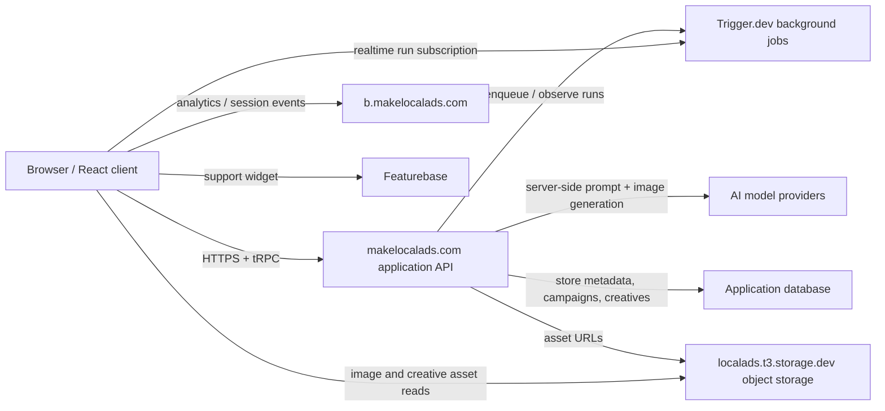

# MakeLocalAds HAR prompt and architecture analysis

> Evidence-based reverse engineering from browser HAR captures. Secrets, cookies, authorization headers, and personal account fields are intentionally excluded.

## Executive summary

The evidence set contains **11 HAR files**, **1,233 network entries**, and **31 unique generated creative prompt packages** after deduplicating polling responses, versions, and variations.

The browser talks to a first-party tRPC application API. Long-running ingestion and generation work is surfaced through Trigger.dev realtime run streams; generated/source assets are read from an object-storage host. Image-model calls happen server-side, so the HAR exposes returned prompt/model metadata but not the private server-to-provider request envelopes or hidden system prompts.

## Evidence and limits

- **Observed** means directly present in a request, response, URL, or returned metadata field.
- **Inferred** means reconstructed from ordering, naming, polling behavior, or identifiers shared across calls.
- Repeated `creatives.feed` polling responses contain the same prompts many times; the catalog hashes exact text to retain one canonical copy.
- Provider API keys, cookies, session values, bearer tokens, emails, and phone numbers are not reproduced.
- HAR captures cannot reveal server-only source code or undisclosed prompt templates. The catalog contains all prompt-bearing values observable in these captures.

## HAR inventory

| File | Size | Entries | Capture window | Main domains |
|---|---:|---:|---|---|
| `makelocalads.com.har` | 7.5 MB | 46 | 2026-08-15T17:18:01.509Z → 2026-08-15T17:20:42.100Z | `makelocalads.com` (23), `b.makelocalads.com` (19), `do.featurebase.app` (4) |
| `makelocalads.com_2nd.har` | 12.7 MB | 100 | 2026-08-15T17:56:22.688Z → 2026-08-15T17:59:06.550Z | `makelocalads.com` (63), `b.makelocalads.com` (33), `do.featurebase.app` (4) |
| `makelocalads.com_3rd.har` | 7.3 MB | 30 | 2026-08-15T18:10:26.768Z → 2026-08-15T18:12:10.734Z | `makelocalads.com` (16), `b.makelocalads.com` (12), `do.featurebase.app` (2) |
| `makelocalads.com_discovermode.har` | 14.3 MB | 102 | 2026-08-16T08:35:07.643Z → 2026-08-16T08:36:55.133Z | `makelocalads.com` (69), `b.makelocalads.com` (31), `do.featurebase.app` (2) |
| `makelocalads.com_drivepurchase.har` | 12.1 MB | 87 | 2026-08-16T09:27:04.536Z → 2026-08-16T09:29:40.200Z | `makelocalads.com` (53), `b.makelocalads.com` (30), `do.featurebase.app` (4) |
| `makelocalads.com_full_step.har` | 26.3 MB | 248 | 2026-08-17T13:26:33.706Z → 2026-08-17T13:30:23.890Z | `makelocalads.com` (158), `b.makelocalads.com` (58), `localads.t3.storage.dev` (14), `api.trigger.dev` (12), `do.featurebase.app` (6) |
| `makelocalads.com_olipop_comaprison.har` | 20.9 MB | 157 | 2026-08-17T07:51:21.076Z → 2026-08-17T07:54:35.947Z | `makelocalads.com` (94), `b.makelocalads.com` (52), `localads.t3.storage.dev` (7), `do.featurebase.app` (4) |
| `makelocalads.com_Photoshoot mode.har` | 11.0 MB | 122 | 2026-08-15T18:20:25.355Z → 2026-08-15T18:22:30.728Z | `makelocalads.com` (88), `b.makelocalads.com` (34) |
| `makelocalads.com_recent.har` | 9.7 MB | 78 | 2026-08-16T11:05:31.550Z → 2026-08-16T11:08:01.103Z | `makelocalads.com` (43), `b.makelocalads.com` (31), `do.featurebase.app` (4) |
| `makelocalads.com_recentnow.har` | 21.7 MB | 156 | 2026-08-16T11:21:17.071Z → 2026-08-16T11:24:46.002Z | `makelocalads.com` (83), `b.makelocalads.com` (62), `do.featurebase.app` (6), `localads.t3.storage.dev` (5) |
| `makelocalads.com_wincomparison.har` | 15.9 MB | 107 | 2026-08-16T09:01:20.929Z → 2026-08-16T09:03:23.435Z | `makelocalads.com` (78), `b.makelocalads.com` (27), `do.featurebase.app` (2) |

## Reconstructed architecture

### Component evidence

| Component | Evidence | Role | Confidence |
|---|---|---|---|
| First-party web/API | `makelocalads.com`, `/api/trpc/*`, `/api/auth/*` | UI assets, session, brands, products, audiences, campaigns, creatives, credits | Observed |
| Workflow runner | `api.trigger.dev/realtime/v1/runs/*` | Realtime status/results for product ingestion and asynchronous generation | Observed |
| Object storage | `localads.t3.storage.dev/*` | Product images and generated creative assets | Observed |
| Analytics/feature flags | `b.makelocalads.com/s/`, `/i/v0/e/`, `/flags/` | Session/event telemetry and flags | Inferred from endpoint shape |
| Support/feedback | `do.featurebase.app/v1/messenger/widget/ping` | Embedded customer-support widget | Observed |
| AI providers | Returned `imageModel`, `imageProvider`, and `imageGeneratorId` fields | Server-side image generation | Observed metadata; provider calls themselves are not in HAR |

## API surface observed

| Endpoint | Methods | Calls | Statuses | HAR files | Request field paths (redacted) |
|---|---|---:|---|---|---|
| `makelocalads.com/api/trpc/creatives.feed` | `GET` | 173 | 200: 173 | `makelocalads.com.har`, `makelocalads.com_2nd.har`, `makelocalads.com_3rd.har`, `makelocalads.com_Photoshoot mode.har`, `makelocalads.com_discovermode.har`, `makelocalads.com_drivepurchase.har`, `makelocalads.com_full_step.har`, `makelocalads.com_olipop_comaprison.har`, `makelocalads.com_recent.har`, `makelocalads.com_recentnow.har`, `makelocalads.com_wincomparison.har` | `[].campaignId`, `[].limit`, `[].offeringId`, `[].studioType` |
| `makelocalads.com/api/trpc/adCampaignsV2.listCampaigns` | `GET` | 109 | 200: 109 | `makelocalads.com.har`, `makelocalads.com_2nd.har`, `makelocalads.com_discovermode.har`, `makelocalads.com_full_step.har`, `makelocalads.com_olipop_comaprison.har`, `makelocalads.com_recent.har`, `makelocalads.com_recentnow.har`, `makelocalads.com_wincomparison.har` | `[].offeringId` |
| `makelocalads.com/api/trpc/adCampaignsV2.getCampaign` | `GET` | 107 | 200: 107 | `makelocalads.com.har`, `makelocalads.com_2nd.har`, `makelocalads.com_discovermode.har`, `makelocalads.com_full_step.har`, `makelocalads.com_olipop_comaprison.har`, `makelocalads.com_recent.har`, `makelocalads.com_recentnow.har`, `makelocalads.com_wincomparison.har` | `[].campaignId` |
| `makelocalads.com/api/trpc/notifications.list` | `GET` | 85 | 200: 85 | `makelocalads.com.har`, `makelocalads.com_2nd.har`, `makelocalads.com_3rd.har`, `makelocalads.com_Photoshoot mode.har`, `makelocalads.com_discovermode.har`, `makelocalads.com_drivepurchase.har`, `makelocalads.com_full_step.har`, `makelocalads.com_olipop_comaprison.har`, `makelocalads.com_recent.har`, `makelocalads.com_recentnow.har`, `makelocalads.com_wincomparison.har` | — |
| `makelocalads.com/api/creative-assets/{assetId}` | `GET` | 31 | 200: 31 | `makelocalads.com.har`, `makelocalads.com_2nd.har`, `makelocalads.com_3rd.har`, `makelocalads.com_Photoshoot mode.har`, `makelocalads.com_discovermode.har`, `makelocalads.com_drivepurchase.har`, `makelocalads.com_full_step.har`, `makelocalads.com_olipop_comaprison.har`, `makelocalads.com_recent.har`, `makelocalads.com_recentnow.har`, `makelocalads.com_wincomparison.har` | — |
| `makelocalads.com/api/trpc/adCampaignsV2.listCampaigns,adCampaignsV2.getCampaign` | `GET` | 28 | 200: 28 | `makelocalads.com_3rd.har`, `makelocalads.com_drivepurchase.har`, `makelocalads.com_full_step.har`, `makelocalads.com_olipop_comaprison.har`, `makelocalads.com_recent.har` | `[].campaignId`, `[].offeringId` |
| `makelocalads.com/api/trpc/photoshoot.listMoodboards,photoshoot.listPlannedShootPacks` | `GET` | 27 | 200: 27 | `makelocalads.com_Photoshoot mode.har` | `[].offeringId` |
| `localads.t3.storage.dev/product-images/{productId}/{assetFile}` | `GET` | 25 | 200: 25 | `makelocalads.com_full_step.har`, `makelocalads.com_olipop_comaprison.har`, `makelocalads.com_recentnow.har` | — |
| `makelocalads.com/api/auth/get-session` | `GET` | 22 | 200: 22 | `makelocalads.com.har`, `makelocalads.com_2nd.har`, `makelocalads.com_3rd.har`, `makelocalads.com_drivepurchase.har`, `makelocalads.com_full_step.har`, `makelocalads.com_olipop_comaprison.har`, `makelocalads.com_recent.har` | — |
| `makelocalads.com/api/trpc/creatives.activeJob,creatives.feed` | `GET` | 22 | 200: 22 | `makelocalads.com_Photoshoot mode.har` | `[].limit`, `[].offeringId`, `[].studioType` |
| `makelocalads.com/api/trpc/creatives.activeJob` | `GET` | 14 | 200: 14 | `makelocalads.com_Photoshoot mode.har` | `[].offeringId` |
| `api.trigger.dev/realtime/v1/runs/{runId}` | `GET`, `OPTIONS` | 12 | 0: 4, 200: 8 | `makelocalads.com_full_step.har` | — |
| `makelocalads.com/api/trpc/credits.overview` | `GET` | 11 | 200: 11 | `makelocalads.com.har`, `makelocalads.com_2nd.har`, `makelocalads.com_3rd.har`, `makelocalads.com_Photoshoot mode.har`, `makelocalads.com_discovermode.har`, `makelocalads.com_drivepurchase.har`, `makelocalads.com_full_step.har`, `makelocalads.com_olipop_comaprison.har`, `makelocalads.com_recent.har`, `makelocalads.com_recentnow.har`, `makelocalads.com_wincomparison.har` | — |
| `makelocalads.com/api/trpc/productAudiences.list` | `GET` | 11 | 200: 11 | `makelocalads.com_full_step.har`, `makelocalads.com_olipop_comaprison.har` | `[].offeringId` |
| `makelocalads.com/api/trpc/adCampaignsV2.getCampaign,creatives.feed,credits.overview` | `GET` | 9 | 200: 9 | `makelocalads.com.har`, `makelocalads.com_2nd.har`, `makelocalads.com_3rd.har`, `makelocalads.com_drivepurchase.har`, `makelocalads.com_full_step.har`, `makelocalads.com_olipop_comaprison.har`, `makelocalads.com_recent.har`, `makelocalads.com_recentnow.har`, `makelocalads.com_wincomparison.har` | `[].campaignId`, `[].limit`, `[].offeringId` |
| `makelocalads.com/api/trpc/adCampaignsV2.listCampaigns,credits.overview` | `GET` | 9 | 200: 9 | `makelocalads.com.har`, `makelocalads.com_2nd.har`, `makelocalads.com_3rd.har`, `makelocalads.com_drivepurchase.har`, `makelocalads.com_full_step.har`, `makelocalads.com_olipop_comaprison.har`, `makelocalads.com_recent.har`, `makelocalads.com_recentnow.har`, `makelocalads.com_wincomparison.har` | `[].offeringId` |
| `makelocalads.com/api/trpc/adCampaignsV2.createCampaign` | `POST` | 8 | 200: 8 | `makelocalads.com.har`, `makelocalads.com_2nd.har`, `makelocalads.com_3rd.har`, `makelocalads.com_drivepurchase.har`, `makelocalads.com_full_step.har`, `makelocalads.com_olipop_comaprison.har`, `makelocalads.com_recent.har`, `makelocalads.com_recentnow.har` | `[].audienceId`, `[].creativeCount`, `[].goal`, `[].language`, `[].mode`, `[].offeringId` |
| `makelocalads.com/api/trpc/brands.getDesignGuide` | `GET` | 7 | 200: 7 | `makelocalads.com_full_step.har` | `[].brandId` |
| `makelocalads.com/api/trpc/productAudiences.approveRecommendation` | `POST` | 6 | 200: 6 | `makelocalads.com_full_step.har`, `makelocalads.com_olipop_comaprison.har` | `[].audienceId`, `[].offeringId` |
| `makelocalads.com/api/trpc/billing.subscription,tips.seen` | `GET` | 5 | 200: 5 | `makelocalads.com_Photoshoot mode.har`, `makelocalads.com_discovermode.har`, `makelocalads.com_olipop_comaprison.har`, `makelocalads.com_recent.har`, `makelocalads.com_recentnow.har` | `[].orgId`, `[].tipIds.[]` |
| `makelocalads.com/api/trpc/offerings.get` | `GET` | 4 | 200: 4 | `makelocalads.com_full_step.har` | `[].offeringId` |
| `makelocalads.com/api/trpc/offerings.get,offerings.list,offerings.searchSidebar` | `GET` | 3 | 200: 3 | `makelocalads.com_full_step.har`, `makelocalads.com_olipop_comaprison.har` | `[].brandId`, `[].limit`, `[].offeringId`, `[].orgId` |
| `makelocalads.com/api/trpc/billing.subscription` | `GET` | 2 | 200: 2 | `makelocalads.com_full_step.har`, `makelocalads.com_recentnow.har` | `[].orgId` |
| `makelocalads.com/api/trpc/products.activateProduct` | `POST` | 2 | 200: 2 | `makelocalads.com_full_step.har`, `makelocalads.com_olipop_comaprison.har` | `[].offeringId` |
| `makelocalads.com/api/trpc/products.saveDraftProduct` | `POST` | 2 | 200: 2 | `makelocalads.com_full_step.har`, `makelocalads.com_olipop_comaprison.har` | `[].classifyBuyingArchetypes`, `[].extraction.images.[]`, `[].extraction.kind`, `[].extraction.name`, `[].extraction.productTruth.addedSugars`, `[].extraction.productTruth.brand`, `[].extraction.productTruth.calories`, `[].extraction.productTruth.description`, `[].extraction.productTruth.dietaryClaims.[]`, `[].extraction.productTruth.dietaryFiber`, `[].extraction.productTruth.fiber`, `[].extraction.productTruth.fiberLine`, `[].extraction.productTruth.flavor`, `[].extraction.productTruth.hasNSFWRisk`, `[].extraction.productTruth.images.[]`, `[].extraction.productTruth.ingredients.[]`, `[].extraction.productTruth.juiceContent`, `[].extraction.productTruth.nutritionFacts`, … (+49) |
| `localads.t3.storage.dev/brand-logos/{brandId}/{assetFile}` | `GET` | 1 | 200: 1 | `makelocalads.com_full_step.har` | — |
| `makelocalads.com/api/trpc/adCampaignsV2.getCampaign,adCampaignsV2.listCampaigns` | `GET` | 1 | 200: 1 | `makelocalads.com_recent.har` | `[].campaignId`, `[].offeringId` |
| `makelocalads.com/api/trpc/adCampaignsV2.getCampaign,creatives.feed` | `GET` | 1 | 200: 1 | `makelocalads.com_olipop_comaprison.har` | `[].campaignId`, `[].limit`, `[].offeringId` |
| `makelocalads.com/api/trpc/adCampaignsV2.listCampaigns,productAudiences.list` | `GET` | 1 | 200: 1 | `makelocalads.com_recentnow.har` | `[].offeringId` |
| `makelocalads.com/api/trpc/brands.create` | `POST` | 1 | 200: 1 | `makelocalads.com_full_step.har` | `[].name`, `[].orgId`, `[].websiteUrl` |
| `makelocalads.com/api/trpc/brands.list,billing.subscription,credits.overview,offerings.searchSidebar,referrals.status,brands.getDesignGuide,notifications.list,whatsNew.list,offerings.list,offerings.get,adCampaignsV2.listCampaigns,adCampaignsV2.getCampaign,creatives.feed` | `GET` | 1 | 200: 1 | `makelocalads.com.har` | `[].brandId`, `[].campaignId`, `[].limit`, `[].offeringId`, `[].orgId` |
| `makelocalads.com/api/trpc/brands.list,billing.subscription,credits.overview,referrals.status,notifications.list,offerings.list,offerings.searchSidebar,brands.getDesignGuide,offerings.get,adCampaignsV2.listCampaigns,adCampaignsV2.getCampaign,creatives.feed` | `GET` | 1 | 200: 1 | `makelocalads.com_3rd.har` | `[].brandId`, `[].campaignId`, `[].limit`, `[].offeringId`, `[].orgId` |
| `makelocalads.com/api/trpc/brands.list,billing.subscription,offerings.searchSidebar,referrals.status,brands.getDesignGuide,notifications.list,offerings.list,offerings.get` | `GET` | 1 | 200: 1 | `makelocalads.com_recent.har` | `[].brandId`, `[].limit`, `[].offeringId`, `[].orgId` |
| `makelocalads.com/api/trpc/brands.list,billing.subscription,offerings.searchSidebar,referrals.status,brands.getDesignGuide,offerings.list,offerings.get,creatives.feed` | `GET` | 1 | 200: 1 | `makelocalads.com_recent.har` | `[].brandId`, `[].campaignId`, `[].limit`, `[].offeringId`, `[].orgId` |
| `makelocalads.com/api/trpc/brands.list,billing.subscription,offerings.searchSidebar,referrals.status,credits.overview,brands.getDesignGuide,notifications.list,offerings.list,offerings.get,adCampaignsV2.listCampaigns,adCampaignsV2.getCampaign` | `GET` | 1 | 200: 1 | `makelocalads.com_drivepurchase.har` | `[].brandId`, `[].campaignId`, `[].limit`, `[].offeringId`, `[].orgId` |
| `makelocalads.com/api/trpc/brands.list,billing.subscription,offerings.searchSidebar,referrals.status,credits.overview,brands.getDesignGuide,notifications.list,whatsNew.list,offerings.list,offerings.get,adCampaignsV2.listCampaigns,adCampaignsV2.getCampaign,creatives.feed` | `GET` | 1 | 200: 1 | `makelocalads.com_recent.har` | `[].brandId`, `[].campaignId`, `[].limit`, `[].offeringId`, `[].orgId` |
| `makelocalads.com/api/trpc/brands.list,billing.subscription,referrals.status,credits.overview,notifications.list,offerings.list,offerings.searchSidebar,brands.getDesignGuide,offerings.get,adCampaignsV2.listCampaigns,adCampaignsV2.getCampaign,creatives.feed` | `GET` | 1 | 200: 1 | `makelocalads.com_2nd.har` | `[].brandId`, `[].campaignId`, `[].limit`, `[].offeringId`, `[].orgId` |
| `makelocalads.com/api/trpc/brands.list,billing.subscription,referrals.status,credits.overview,offerings.list,offerings.searchSidebar,brands.getDesignGuide,offerings.get` | `GET` | 1 | 200: 1 | `makelocalads.com_olipop_comaprison.har` | `[].brandId`, `[].limit`, `[].offeringId`, `[].orgId` |
| `makelocalads.com/api/trpc/brands.list,referrals.status,credits.overview,notifications.list,whatsNew.list,offerings.list,offerings.searchSidebar,brands.getDesignGuide,offerings.get,adCampaignsV2.listCampaigns,adCampaignsV2.getCampaign,creatives.feed` | `GET` | 1 | 200: 1 | `makelocalads.com_olipop_comaprison.har` | `[].brandId`, `[].campaignId`, `[].limit`, `[].offeringId`, `[].orgId` |
| `makelocalads.com/api/trpc/creatives.feed,adCampaignsV2.listCampaigns` | `GET` | 1 | 200: 1 | `makelocalads.com_recentnow.har` | `[].campaignId`, `[].limit`, `[].offeringId` |
| `makelocalads.com/api/trpc/credits.overview,billing.subscription,referrals.status,notifications.list,offerings.list` | `GET` | 1 | 200: 1 | `makelocalads.com_full_step.har` | `[].orgId` |
| `makelocalads.com/api/trpc/credits.overview,brands.list,billing.subscription,referrals.status,notifications.list,offerings.list,offerings.searchSidebar,brands.getDesignGuide,offerings.get,offerings.productIngestionRealtime` | `GET` | 1 | 200: 1 | `makelocalads.com_full_step.har` | `[].brandId`, `[].limit`, `[].offeringId`, `[].orgId` |
| `makelocalads.com/api/trpc/offerings.get,strategy.getMap,creatives.activeJob,creatives.feed` | `GET` | 1 | 200: 1 | `makelocalads.com_recentnow.har` | `[].limit`, `[].offeringId` |
| `makelocalads.com/api/trpc/offerings.list` | `GET` | 1 | 200: 1 | `makelocalads.com_full_step.har` | `[].orgId` |
| `makelocalads.com/api/trpc/offerings.productIngestionRealtime` | `GET` | 1 | 200: 1 | `makelocalads.com_full_step.har` | `[].offeringId` |
| `makelocalads.com/api/trpc/offerings.searchSidebar,brands.getDesignGuide` | `GET` | 1 | 200: 1 | `makelocalads.com_full_step.har` | `[].brandId`, `[].limit`, `[].orgId` |
| `makelocalads.com/api/trpc/photoshoot.listPlannedShootMemberships` | `GET` | 1 | 200: 1 | `makelocalads.com_Photoshoot mode.har` | `[].offeringId` |
| `makelocalads.com/api/trpc/photoshoot.startQuickShoot` | `POST` | 1 | 200: 1 | `makelocalads.com_Photoshoot mode.har` | `[].creativeCount`, `[].offeringId`, `[].productFocusMode` |
| `makelocalads.com/api/trpc/products.startProductIngestion` | `POST` | 1 | 200: 1 | `makelocalads.com_full_step.har` | `[].brandId`, `[].orgId`, `[].sourceUrl` |
| `makelocalads.com/api/url-style-snapshot` | `POST` | 1 | 202: 1 | `makelocalads.com_full_step.har` | `brandId`, `url` |

## Models, providers, and generator identifiers

| Observed value | Evidence paths | HAR files | Interpretation |
|---|---|---|---|
| `azure-openai` | `0.result.data.items.0.currentVersion.metadata.imageProvider`, `0.result.data.items.0.currentVersion.variations.0.metadata.imageProvider`, `0.result.data.items.0.displayVariation.metadata.imageProvider`, `0.result.data.items.0.metadata.imageProvider`, `0.result.data.items.0.versions.0.metadata.imageProvider`, `0.result.data.items.0.versions.0.variations.0.metadata.imageProvider` | `makelocalads.com.har`, `makelocalads.com_2nd.har`, `makelocalads.com_3rd.har`, `makelocalads.com_Photoshoot mode.har`, `makelocalads.com_discovermode.har`, `makelocalads.com_drivepurchase.har`, `makelocalads.com_full_step.har`, `makelocalads.com_olipop_comaprison.har`, `makelocalads.com_recent.har`, `makelocalads.com_recentnow.har`, `makelocalads.com_wincomparison.har` | Image-provider/routing label |
| `google/gemini-3.1-flash-lite` | `0.result.data.items.0.currentVersion.metadata.referenceCompositionModel`, `0.result.data.items.0.currentVersion.variations.0.metadata.referenceCompositionModel`, `0.result.data.items.0.displayVariation.metadata.referenceCompositionModel`, `0.result.data.items.0.metadata.referenceCompositionModel`, `0.result.data.items.0.versions.0.metadata.referenceCompositionModel`, `0.result.data.items.0.versions.0.variations.0.metadata.referenceCompositionModel` | `makelocalads.com_Photoshoot mode.har` | Reference-composition model returned for Photoshoot/Quick Shoot |
| `gpt-5.5` | `0.result.data.items.0.currentVersion.metadata.quickShootDirectionModel`, `0.result.data.items.0.currentVersion.variations.0.metadata.quickShootDirectionModel`, `0.result.data.items.0.displayVariation.metadata.quickShootDirectionModel`, `0.result.data.items.0.metadata.quickShootDirectionModel`, `0.result.data.items.0.versions.0.metadata.quickShootDirectionModel`, `0.result.data.items.0.versions.0.variations.0.metadata.quickShootDirectionModel` | `makelocalads.com_Photoshoot mode.har` | Quick Shoot direction/planning model returned in creative metadata |
| `gpt-image-2` | `0.result.data.items.0.currentVersion.metadata.imageModel`, `0.result.data.items.0.currentVersion.variations.0.metadata.imageModel`, `0.result.data.items.0.displayVariation.metadata.imageModel`, `0.result.data.items.0.versions.0.metadata.imageModel`, `0.result.data.items.0.versions.0.variations.0.metadata.imageModel`, `0.result.data.items.1.currentVersion.metadata.imageModel` | `makelocalads.com.har`, `makelocalads.com_2nd.har`, `makelocalads.com_3rd.har`, `makelocalads.com_Photoshoot mode.har`, `makelocalads.com_discovermode.har`, `makelocalads.com_drivepurchase.har`, `makelocalads.com_full_step.har`, `makelocalads.com_olipop_comaprison.har`, `makelocalads.com_recent.har`, `makelocalads.com_recentnow.har`, `makelocalads.com_wincomparison.har` | OpenAI-family image model identifier or quality/routing alias |
| `gpt-image-2-low` | `client bundle string` | `makelocalads.com_full_step.har` | Client-bundle option string; this capture does not prove it was selected for a generation |
| `openai` | `0.result.data.items.0.currentVersion.metadata.imageProvider`, `0.result.data.items.0.currentVersion.variations.0.metadata.imageProvider`, `0.result.data.items.0.displayVariation.metadata.imageProvider`, `0.result.data.items.0.metadata.imageProvider`, `0.result.data.items.0.versions.0.metadata.imageProvider`, `0.result.data.items.0.versions.0.variations.0.metadata.imageProvider` | `makelocalads.com.har`, `makelocalads.com_2nd.har`, `makelocalads.com_3rd.har`, `makelocalads.com_discovermode.har`, `makelocalads.com_drivepurchase.har`, `makelocalads.com_full_step.har`, `makelocalads.com_olipop_comaprison.har`, `makelocalads.com_recent.har`, `makelocalads.com_recentnow.har`, `makelocalads.com_wincomparison.har` | Image-provider/routing label |
| `openai/gpt-image-2` | `0.result.data.items.0.currentVersion.metadata.imageGeneratorId`, `0.result.data.items.0.currentVersion.variations.0.metadata.imageGeneratorId`, `0.result.data.items.0.displayVariation.metadata.imageGeneratorId`, `0.result.data.items.0.metadata.imageGeneratorId`, `0.result.data.items.0.versions.0.metadata.imageGeneratorId`, `0.result.data.items.0.versions.0.variations.0.metadata.imageGeneratorId` | `makelocalads.com.har`, `makelocalads.com_2nd.har`, `makelocalads.com_3rd.har`, `makelocalads.com_Photoshoot mode.har`, `makelocalads.com_discovermode.har`, `makelocalads.com_drivepurchase.har`, `makelocalads.com_full_step.har`, `makelocalads.com_olipop_comaprison.har`, `makelocalads.com_recent.har`, `makelocalads.com_recentnow.har`, `makelocalads.com_wincomparison.har` | OpenAI-family image model identifier or quality/routing alias |
| `openai/gpt-image-2:100` | `0.result.data.items.0.currentVersion.metadata.imageModel`, `0.result.data.items.0.currentVersion.variations.0.metadata.imageModel`, `0.result.data.items.0.displayVariation.metadata.imageModel`, `0.result.data.items.0.versions.0.metadata.imageModel`, `0.result.data.items.0.versions.0.variations.0.metadata.imageModel`, `0.result.data.items.1.currentVersion.metadata.imageModel` | `makelocalads.com.har`, `makelocalads.com_2nd.har`, `makelocalads.com_3rd.har`, `makelocalads.com_discovermode.har`, `makelocalads.com_drivepurchase.har`, `makelocalads.com_full_step.har`, `makelocalads.com_olipop_comaprison.har`, `makelocalads.com_recent.har`, `makelocalads.com_recentnow.har`, `makelocalads.com_wincomparison.har` | OpenAI-family image model identifier or quality/routing alias |

## Prompt coverage by capture

| HAR file | Unique prompt packages | Frameworks / concepts | Image models | Providers |
|---|---:|---|---|---|
| `makelocalads.com.har` | 3 | `Attention-Interest-Desire-Action (AIDA)`, `Before-After-Bridge (BAB)`, `Problem-Agitate-Solve (PAS)` | `gpt-image-2` | `openai` |
| `makelocalads.com_2nd.har` | 3 | `Before-After-Bridge`, `Feature-Benefit-Difference`, `Objection-Rebuttal` | `gpt-image-2`, `openai/gpt-image-2:100` | `openai` |
| `makelocalads.com_3rd.har` | 3 | `Before-After-Bridge (BAB)`, `Feature-Benefit (FAB)`, `PAS (Problem-Agitate-Solve)` | `gpt-image-2`, `openai/gpt-image-2:100` | `openai` |
| `makelocalads.com_discovermode.har` | 3 | `AIDA`, `BAB (Before-After-Bridge)`, `PAS` | `gpt-image-2`, `openai/gpt-image-2:100` | `openai` |
| `makelocalads.com_drivepurchase.har` | 3 | `Feature-Benefit-Action (FBA)`, `Problem-Agitation-Solution (PAS)`, `Side-by-Side Comparison` | `gpt-image-2`, `openai/gpt-image-2:100` | `openai` |
| `makelocalads.com_full_step.har` | 3 | `Contrast and Choice (CC)`, `Problem-Agitate-Solve (PAS)`, `Side-by-Side Comparison (SBSC)` | `gpt-image-2`, `openai/gpt-image-2:100` | `openai` |
| `makelocalads.com_olipop_comaprison.har` | 3 | `Attention-Interest-Desire-Action (AIDA)`, `Before-After-Bridge (BAB)`, `Problem-Agitate-Solve (PAS)` | `gpt-image-2`, `openai/gpt-image-2:100` | `openai` |
| `makelocalads.com_Photoshoot mode.har` | 1 | `Quick Shoot: Deep-Sea Beauty Ritual` | `gpt-image-2` | `azure-openai` |
| `makelocalads.com_recent.har` | 3 | `AIDA (Attention-Interest-Desire-Action)`, `BAB (Before-After-Bridge)`, `PAS (Problem-Agitation-Solution)` | `gpt-image-2`, `openai/gpt-image-2:100` | `openai` |
| `makelocalads.com_recentnow.har` | 3 | `AIDA`, `FAB`, `PAS (Problem-Agitate-Solve)` | `gpt-image-2`, `openai/gpt-image-2:100` | `openai` |
| `makelocalads.com_wincomparison.har` | 3 | `Contrast`, `PAS`, `Spec-Sheet Showdown` | `gpt-image-2`, `openai/gpt-image-2:100` | `openai` |

## Full-step workflow reconstruction

The `full_step` trace shows the broad orchestration below. Poll-only calls are retained in the detailed timeline, but collapsed conceptually here.

1. Load session, credits, brand/design-guide state, offerings, notifications, and product state.
2. Create/select a brand and collect a URL style snapshot.
3. Save initial product data and start `products.startProductIngestion`.
4. Subscribe to a Trigger.dev run; background work extracts product content and images.
5. Save the enriched product draft, fetch recommended audiences, and approve selected recommendations.
6. Activate the product/offering.
7. Create an ad campaign through `adCampaignsV2.createCampaign`.
8. Poll campaign state and `creatives.feed` while asynchronous strategy/generation jobs run.
9. Receive creative metadata containing `brief`, `prompt`, model/provider identifiers, asset URLs, versions, and variations.
10. Fetch generated assets through first-party creative-asset URLs and object storage.

### Detailed `full_step` API timeline

| Time | Method | Endpoint | Status | Duration | Request fields |
|---|---|---|---:|---:|---|
| 13:26:34.001Z | `GET` | `makelocalads.com/api/trpc/notifications.list` | 200 | 219 ms | — |
| 13:26:34.378Z | `GET` | `localads.t3.storage.dev/brand-logos/{brandId}/{assetFile}` | 200 | 649 ms | — |
| 13:26:36.052Z | `GET` | `makelocalads.com/api/trpc/billing.subscription` | 200 | 355 ms | `[].orgId` |
| 13:26:41.879Z | `POST` | `makelocalads.com/api/trpc/brands.create` | 200 | 268 ms | `[].name`, `[].orgId`, `[].websiteUrl` |
| 13:26:42.154Z | `POST` | `makelocalads.com/api/url-style-snapshot` | 202 | 1114 ms | `brandId`, `url` |
| 13:26:42.190Z | `GET` | `makelocalads.com/api/trpc/offerings.searchSidebar,brands.getDesignGuide` | 200 | 258 ms | `[].brandId`, `[].limit`, `[].orgId` |
| 13:26:48.296Z | `GET` | `makelocalads.com/api/trpc/brands.getDesignGuide` | 200 | 216 ms | `[].brandId` |
| 13:26:55.606Z | `GET` | `makelocalads.com/api/auth/get-session` | 200 | 367 ms | — |
| 13:26:55.610Z | `GET` | `makelocalads.com/api/trpc/credits.overview,billing.subscription,referrals.status,notifications.list,offerings.list` | 200 | 472 ms | `[].orgId` |
| 13:26:55.993Z | `GET` | `makelocalads.com/api/auth/get-session` | 200 | 162 ms | — |
| 13:26:58.527Z | `GET` | `makelocalads.com/api/trpc/brands.getDesignGuide` | 200 | 217 ms | `[].brandId` |
| 13:26:59.186Z | `POST` | `makelocalads.com/api/trpc/products.startProductIngestion` | 200 | 674 ms | `[].brandId`, `[].orgId`, `[].sourceUrl` |
| 13:26:59.865Z | `GET` | `makelocalads.com/api/trpc/offerings.list` | 200 | 234 ms | `[].orgId` |
| 13:27:01.297Z | `GET` | `makelocalads.com/api/trpc/offerings.get` | 200 | 254 ms | `[].offeringId` |
| 13:27:01.573Z | `GET` | `makelocalads.com/api/trpc/offerings.productIngestionRealtime` | 200 | 947 ms | `[].offeringId` |
| 13:27:02.530Z | `GET` | `api.trigger.dev/realtime/v1/runs/{runId}` | 200 | 1296 ms | — |
| 13:27:02.581Z | `OPTIONS` | `api.trigger.dev/realtime/v1/runs/{runId}` | 200 | 955 ms | — |
| 13:27:03.764Z | `GET` | `makelocalads.com/api/trpc/brands.getDesignGuide` | 200 | 351 ms | `[].brandId` |
| 13:27:03.829Z | `GET` | `api.trigger.dev/realtime/v1/runs/{runId}` | 0 | 29 ms | — |
| 13:27:03.848Z | `GET` | `api.trigger.dev/realtime/v1/runs/{runId}` | 200 | 616 ms | — |
| 13:27:03.850Z | `OPTIONS` | `api.trigger.dev/realtime/v1/runs/{runId}` | 200 | 284 ms | — |
| 13:27:04.476Z | `GET` | `api.trigger.dev/realtime/v1/runs/{runId}` | 0 | 6831 ms | — |
| 13:27:04.480Z | `OPTIONS` | `api.trigger.dev/realtime/v1/runs/{runId}` | 200 | 255 ms | — |
| 13:27:04.576Z | `GET` | `makelocalads.com/api/trpc/offerings.get` | 200 | 225 ms | `[].offeringId` |
| 13:27:07.816Z | `GET` | `makelocalads.com/api/trpc/offerings.get` | 200 | 209 ms | `[].offeringId` |
| 13:27:09.130Z | `GET` | `makelocalads.com/api/trpc/brands.getDesignGuide` | 200 | 313 ms | `[].brandId` |
| 13:27:11.034Z | `GET` | `makelocalads.com/api/trpc/offerings.get` | 200 | 261 ms | `[].offeringId` |
| 13:27:11.091Z | `GET` | `makelocalads.com/api/trpc/notifications.list` | 200 | 262 ms | — |
| 13:27:49.777Z | `GET` | `makelocalads.com/api/auth/get-session` | 200 | 1281 ms | — |
| 13:27:49.780Z | `GET` | `api.trigger.dev/realtime/v1/runs/{runId}` | 200 | 1075 ms | — |
| 13:27:49.786Z | `OPTIONS` | `api.trigger.dev/realtime/v1/runs/{runId}` | 200 | 768 ms | — |
| 13:27:49.791Z | `GET` | `makelocalads.com/api/trpc/credits.overview,brands.list,billing.subscription,referrals.status,notifications.list,offerings.list,offerings.searchSidebar,brands.getDesignGuide,offerings.get,offerings.productIngestionRealtime` | 200 | 1806 ms | `[].brandId`, `[].limit`, `[].offeringId`, `[].orgId` |
| 13:27:50.858Z | `GET` | `api.trigger.dev/realtime/v1/runs/{runId}` | 0 | 47 ms | — |
| 13:27:50.892Z | `GET` | `api.trigger.dev/realtime/v1/runs/{runId}` | 0 | 1156 ms | — |
| 13:27:50.895Z | `OPTIONS` | `api.trigger.dev/realtime/v1/runs/{runId}` | 200 | 233 ms | — |
| 13:27:50.897Z | `GET` | `makelocalads.com/api/trpc/offerings.get,offerings.list,offerings.searchSidebar` | 200 | 1098 ms | `[].brandId`, `[].limit`, `[].offeringId`, `[].orgId` |
| 13:27:51.068Z | `GET` | `makelocalads.com/api/auth/get-session` | 200 | 759 ms | — |
| 13:27:52.045Z | `GET` | `localads.t3.storage.dev/product-images/{productId}/{assetFile}` | 200 | 3040 ms | — |
| 13:27:56.538Z | `GET` | `localads.t3.storage.dev/product-images/{productId}/{assetFile}` | 200 | 1828 ms | — |
| 13:27:56.539Z | `GET` | `localads.t3.storage.dev/product-images/{productId}/{assetFile}` | 200 | 1363 ms | — |
| 13:27:56.539Z | `GET` | `localads.t3.storage.dev/product-images/{productId}/{assetFile}` | 200 | 898 ms | — |
| 13:27:56.539Z | `GET` | `localads.t3.storage.dev/product-images/{productId}/{assetFile}` | 200 | 1574 ms | — |
| 13:27:56.539Z | `GET` | `localads.t3.storage.dev/product-images/{productId}/{assetFile}` | 200 | 1267 ms | — |
| 13:27:56.540Z | `GET` | `localads.t3.storage.dev/product-images/{productId}/{assetFile}` | 200 | 2335 ms | — |
| 13:27:56.634Z | `GET` | `makelocalads.com/api/trpc/brands.getDesignGuide` | 200 | 235 ms | `[].brandId` |
| 13:27:57.746Z | `POST` | `makelocalads.com/api/trpc/products.saveDraftProduct` | 200 | 6624 ms | `[].classifyBuyingArchetypes`, `[].extraction.images.[]`, `[].extraction.kind`, `[].extraction.name`, `[].extraction.productTruth.addedSugars`, `[].extraction.productTruth.brand`, `[].extraction.productTruth.calories`, `[].extraction.productTruth.description`, `[].extraction.productTruth.dietaryClaims.[]`, `[].extraction.productTruth.dietaryFiber`, `[].extraction.productTruth.flavor`, `[].extraction.productTruth.hasNSFWRisk`, … (+42) |
| 13:28:01.874Z | `GET` | `makelocalads.com/api/trpc/brands.getDesignGuide` | 200 | 224 ms | `[].brandId` |
| 13:28:04.388Z | `GET` | `makelocalads.com/api/trpc/productAudiences.list` | 200 | 224 ms | `[].offeringId` |
| 13:28:06.617Z | `GET` | `makelocalads.com/api/trpc/notifications.list` | 200 | 189 ms | — |
| 13:28:07.102Z | `GET` | `makelocalads.com/api/trpc/brands.getDesignGuide` | 200 | 339 ms | `[].brandId` |
| 13:28:07.614Z | `GET` | `makelocalads.com/api/trpc/productAudiences.list` | 200 | 341 ms | `[].offeringId` |
| 13:28:10.962Z | `GET` | `makelocalads.com/api/trpc/productAudiences.list` | 200 | 329 ms | `[].offeringId` |
| 13:28:14.294Z | `GET` | `makelocalads.com/api/trpc/productAudiences.list` | 200 | 276 ms | `[].offeringId` |
| 13:28:17.779Z | `POST` | `makelocalads.com/api/trpc/productAudiences.approveRecommendation` | 200 | 312 ms | `[].audienceId`, `[].offeringId` |
| 13:28:18.097Z | `GET` | `makelocalads.com/api/trpc/productAudiences.list` | 200 | 293 ms | `[].offeringId` |
| 13:28:18.394Z | `POST` | `makelocalads.com/api/trpc/productAudiences.approveRecommendation` | 200 | 242 ms | `[].audienceId`, `[].offeringId` |
| 13:28:18.640Z | `GET` | `makelocalads.com/api/trpc/productAudiences.list` | 200 | 380 ms | `[].offeringId` |
| 13:28:19.023Z | `POST` | `makelocalads.com/api/trpc/productAudiences.approveRecommendation` | 200 | 211 ms | `[].audienceId`, `[].offeringId` |
| 13:28:19.237Z | `GET` | `makelocalads.com/api/trpc/productAudiences.list` | 200 | 254 ms | `[].offeringId` |
| 13:28:19.502Z | `POST` | `makelocalads.com/api/trpc/products.activateProduct` | 200 | 225 ms | `[].offeringId` |
| 13:28:19.732Z | `GET` | `makelocalads.com/api/trpc/offerings.get,offerings.list,offerings.searchSidebar` | 200 | 297 ms | `[].brandId`, `[].limit`, `[].offeringId`, `[].orgId` |
| 13:28:20.125Z | `GET` | `localads.t3.storage.dev/product-images/{productId}/{assetFile}` | 200 | 1775 ms | — |
| 13:28:20.125Z | `GET` | `localads.t3.storage.dev/product-images/{productId}/{assetFile}` | 200 | 1775 ms | — |
| 13:28:20.125Z | `GET` | `localads.t3.storage.dev/product-images/{productId}/{assetFile}` | 200 | 634 ms | — |
| 13:28:20.125Z | `GET` | `localads.t3.storage.dev/product-images/{productId}/{assetFile}` | 200 | 1744 ms | — |
| 13:28:20.126Z | `GET` | `localads.t3.storage.dev/product-images/{productId}/{assetFile}` | 200 | 789 ms | — |
| 13:28:20.126Z | `GET` | `localads.t3.storage.dev/product-images/{productId}/{assetFile}` | 200 | 1760 ms | — |
| 13:28:21.819Z | `GET` | `makelocalads.com/api/trpc/notifications.list` | 200 | 227 ms | — |
| 13:28:22.596Z | `GET` | `makelocalads.com/api/trpc/adCampaignsV2.listCampaigns` | 200 | 211 ms | `[].offeringId` |
| 13:28:37.055Z | `GET` | `makelocalads.com/api/trpc/notifications.list` | 200 | 238 ms | — |
| 13:28:39.830Z | `POST` | `makelocalads.com/api/trpc/adCampaignsV2.createCampaign` | 200 | 1506 ms | `[].audienceId`, `[].creativeCount`, `[].goal`, `[].language`, `[].mode`, `[].offeringId` |
| 13:28:41.359Z | `GET` | `makelocalads.com/api/trpc/adCampaignsV2.listCampaigns,credits.overview` | 200 | 270 ms | `[].offeringId` |
| 13:28:41.398Z | `GET` | `makelocalads.com/api/trpc/adCampaignsV2.getCampaign,creatives.feed,credits.overview` | 200 | 281 ms | `[].campaignId`, `[].limit`, `[].offeringId` |
| 13:28:44.683Z | `GET` | `makelocalads.com/api/trpc/creatives.feed` | 200 | 858 ms | `[].campaignId`, `[].limit`, `[].offeringId` |
| 13:28:45.634Z | `GET` | `makelocalads.com/api/trpc/adCampaignsV2.listCampaigns` | 200 | 216 ms | `[].offeringId` |
| 13:28:45.687Z | `GET` | `makelocalads.com/api/trpc/adCampaignsV2.getCampaign` | 200 | 232 ms | `[].campaignId` |
| 13:28:48.550Z | `GET` | `makelocalads.com/api/trpc/creatives.feed` | 200 | 264 ms | `[].campaignId`, `[].limit`, `[].offeringId` |
| 13:28:49.855Z | `GET` | `makelocalads.com/api/trpc/adCampaignsV2.listCampaigns` | 200 | 230 ms | `[].offeringId` |
| 13:28:49.926Z | `GET` | `makelocalads.com/api/trpc/adCampaignsV2.getCampaign` | 200 | 219 ms | `[].campaignId` |
| 13:28:51.818Z | `GET` | `makelocalads.com/api/trpc/creatives.feed` | 200 | 230 ms | `[].campaignId`, `[].limit`, `[].offeringId` |
| 13:28:52.301Z | `GET` | `makelocalads.com/api/trpc/notifications.list` | 200 | 301 ms | — |
| 13:28:54.089Z | `GET` | `makelocalads.com/api/trpc/adCampaignsV2.listCampaigns` | 200 | 223 ms | `[].offeringId` |
| 13:28:54.154Z | `GET` | `makelocalads.com/api/trpc/adCampaignsV2.getCampaign` | 200 | 246 ms | `[].campaignId` |
| 13:28:55.056Z | `GET` | `makelocalads.com/api/trpc/creatives.feed` | 200 | 240 ms | `[].campaignId`, `[].limit`, `[].offeringId` |
| 13:28:58.305Z | `GET` | `makelocalads.com/api/trpc/creatives.feed` | 200 | 248 ms | `[].campaignId`, `[].limit`, `[].offeringId` |
| 13:28:58.321Z | `GET` | `makelocalads.com/api/trpc/adCampaignsV2.listCampaigns` | 200 | 214 ms | `[].offeringId` |
| 13:28:58.406Z | `GET` | `makelocalads.com/api/trpc/adCampaignsV2.getCampaign` | 200 | 231 ms | `[].campaignId` |
| 13:29:01.570Z | `GET` | `makelocalads.com/api/trpc/creatives.feed` | 200 | 280 ms | `[].campaignId`, `[].limit`, `[].offeringId` |
| 13:29:02.548Z | `GET` | `makelocalads.com/api/trpc/adCampaignsV2.listCampaigns` | 200 | 201 ms | `[].offeringId` |
| 13:29:02.640Z | `GET` | `makelocalads.com/api/trpc/adCampaignsV2.getCampaign` | 200 | 255 ms | `[].campaignId` |
| 13:29:04.856Z | `GET` | `makelocalads.com/api/trpc/creatives.feed` | 200 | 1369 ms | `[].campaignId`, `[].limit`, `[].offeringId` |
| 13:29:06.756Z | `GET` | `makelocalads.com/api/trpc/adCampaignsV2.listCampaigns` | 200 | 188 ms | `[].offeringId` |
| 13:29:06.905Z | `GET` | `makelocalads.com/api/trpc/adCampaignsV2.getCampaign` | 200 | 188 ms | `[].campaignId` |
| 13:29:07.605Z | `GET` | `makelocalads.com/api/trpc/notifications.list` | 200 | 249 ms | — |
| 13:29:09.230Z | `GET` | `makelocalads.com/api/trpc/creatives.feed` | 200 | 271 ms | `[].campaignId`, `[].limit`, `[].offeringId` |
| 13:29:10.951Z | `GET` | `makelocalads.com/api/trpc/adCampaignsV2.listCampaigns` | 200 | 213 ms | `[].offeringId` |
| 13:29:11.100Z | `GET` | `makelocalads.com/api/trpc/adCampaignsV2.getCampaign` | 200 | 192 ms | `[].campaignId` |
| 13:29:12.506Z | `GET` | `makelocalads.com/api/trpc/creatives.feed` | 200 | 311 ms | `[].campaignId`, `[].limit`, `[].offeringId` |
| 13:29:15.174Z | `GET` | `makelocalads.com/api/trpc/adCampaignsV2.listCampaigns` | 200 | 218 ms | `[].offeringId` |
| 13:29:15.303Z | `GET` | `makelocalads.com/api/trpc/adCampaignsV2.getCampaign` | 200 | 199 ms | `[].campaignId` |
| 13:29:15.836Z | `GET` | `makelocalads.com/api/trpc/creatives.feed` | 200 | 315 ms | `[].campaignId`, `[].limit`, `[].offeringId` |
| 13:29:19.158Z | `GET` | `makelocalads.com/api/trpc/creatives.feed` | 200 | 515 ms | `[].campaignId`, `[].limit`, `[].offeringId` |
| 13:29:19.401Z | `GET` | `makelocalads.com/api/trpc/adCampaignsV2.listCampaigns` | 200 | 216 ms | `[].offeringId` |
| 13:29:19.508Z | `GET` | `makelocalads.com/api/trpc/adCampaignsV2.getCampaign` | 200 | 208 ms | `[].campaignId` |
| 13:29:22.689Z | `GET` | `makelocalads.com/api/trpc/creatives.feed` | 200 | 298 ms | `[].campaignId`, `[].limit`, `[].offeringId` |
| 13:29:22.861Z | `GET` | `makelocalads.com/api/trpc/notifications.list` | 200 | 329 ms | — |
| 13:29:23.624Z | `GET` | `makelocalads.com/api/trpc/adCampaignsV2.listCampaigns` | 200 | 300 ms | `[].offeringId` |
| 13:29:23.719Z | `GET` | `makelocalads.com/api/trpc/adCampaignsV2.getCampaign` | 200 | 297 ms | `[].campaignId` |
| 13:29:25.991Z | `GET` | `makelocalads.com/api/trpc/creatives.feed` | 200 | 273 ms | `[].campaignId`, `[].limit`, `[].offeringId` |
| 13:29:27.939Z | `GET` | `makelocalads.com/api/trpc/adCampaignsV2.listCampaigns` | 200 | 301 ms | `[].offeringId` |
| 13:29:28.023Z | `GET` | `makelocalads.com/api/trpc/adCampaignsV2.getCampaign` | 200 | 273 ms | `[].campaignId` |
| 13:29:29.274Z | `GET` | `makelocalads.com/api/trpc/creatives.feed` | 200 | 500 ms | `[].campaignId`, `[].limit`, `[].offeringId` |
| 13:29:32.252Z | `GET` | `makelocalads.com/api/trpc/adCampaignsV2.listCampaigns` | 200 | 218 ms | `[].offeringId` |
| 13:29:32.301Z | `GET` | `makelocalads.com/api/trpc/adCampaignsV2.getCampaign` | 200 | 226 ms | `[].campaignId` |
| 13:29:32.785Z | `GET` | `makelocalads.com/api/trpc/creatives.feed` | 200 | 283 ms | `[].campaignId`, `[].limit`, `[].offeringId` |
| 13:29:36.074Z | `GET` | `makelocalads.com/api/trpc/creatives.feed` | 200 | 255 ms | `[].campaignId`, `[].limit`, `[].offeringId` |
| 13:29:36.475Z | `GET` | `makelocalads.com/api/trpc/adCampaignsV2.listCampaigns` | 200 | 298 ms | `[].offeringId` |
| 13:29:36.532Z | `GET` | `makelocalads.com/api/trpc/adCampaignsV2.getCampaign` | 200 | 265 ms | `[].campaignId` |
| 13:29:38.205Z | `GET` | `makelocalads.com/api/trpc/notifications.list` | 200 | 233 ms | — |
| 13:29:39.340Z | `GET` | `makelocalads.com/api/trpc/creatives.feed` | 200 | 257 ms | `[].campaignId`, `[].limit`, `[].offeringId` |
| 13:29:40.776Z | `GET` | `makelocalads.com/api/trpc/adCampaignsV2.listCampaigns` | 200 | 260 ms | `[].offeringId` |
| 13:29:40.807Z | `GET` | `makelocalads.com/api/trpc/adCampaignsV2.getCampaign` | 200 | 240 ms | `[].campaignId` |
| 13:29:42.609Z | `GET` | `makelocalads.com/api/trpc/creatives.feed` | 200 | 316 ms | `[].campaignId`, `[].limit`, `[].offeringId` |
| 13:29:45.040Z | `GET` | `makelocalads.com/api/trpc/adCampaignsV2.listCampaigns` | 200 | 202 ms | `[].offeringId` |
| 13:29:45.051Z | `GET` | `makelocalads.com/api/trpc/adCampaignsV2.getCampaign` | 200 | 228 ms | `[].campaignId` |
| 13:29:45.936Z | `GET` | `makelocalads.com/api/trpc/creatives.feed` | 200 | 324 ms | `[].campaignId`, `[].limit`, `[].offeringId` |
| 13:29:49.254Z | `GET` | `makelocalads.com/api/trpc/adCampaignsV2.listCampaigns` | 200 | 439 ms | `[].offeringId` |
| 13:29:49.272Z | `GET` | `makelocalads.com/api/trpc/creatives.feed` | 200 | 513 ms | `[].campaignId`, `[].limit`, `[].offeringId` |
| 13:29:49.280Z | `GET` | `makelocalads.com/api/trpc/adCampaignsV2.getCampaign` | 200 | 443 ms | `[].campaignId` |
| 13:29:52.793Z | `GET` | `makelocalads.com/api/trpc/creatives.feed` | 200 | 333 ms | `[].campaignId`, `[].limit`, `[].offeringId` |
| 13:29:53.443Z | `GET` | `makelocalads.com/api/trpc/notifications.list` | 200 | 229 ms | — |
| 13:29:53.698Z | `GET` | `makelocalads.com/api/trpc/adCampaignsV2.listCampaigns` | 200 | 344 ms | `[].offeringId` |
| 13:29:53.729Z | `GET` | `makelocalads.com/api/trpc/adCampaignsV2.getCampaign` | 200 | 314 ms | `[].campaignId` |
| 13:29:56.138Z | `GET` | `makelocalads.com/api/trpc/creatives.feed` | 200 | 286 ms | `[].campaignId`, `[].limit`, `[].offeringId` |
| 13:29:58.054Z | `GET` | `makelocalads.com/api/trpc/adCampaignsV2.listCampaigns,adCampaignsV2.getCampaign` | 200 | 247 ms | `[].campaignId`, `[].offeringId` |
| 13:29:59.440Z | `GET` | `makelocalads.com/api/trpc/creatives.feed` | 200 | 321 ms | `[].campaignId`, `[].limit`, `[].offeringId` |
| 13:30:02.310Z | `GET` | `makelocalads.com/api/trpc/adCampaignsV2.listCampaigns,adCampaignsV2.getCampaign` | 200 | 208 ms | `[].campaignId`, `[].offeringId` |
| 13:30:02.764Z | `GET` | `makelocalads.com/api/trpc/creatives.feed` | 200 | 288 ms | `[].campaignId`, `[].limit`, `[].offeringId` |
| 13:30:03.072Z | `GET` | `makelocalads.com/api/creative-assets/{assetId}` | 200 | 2250 ms | — |
| 13:30:06.060Z | `GET` | `makelocalads.com/api/trpc/creatives.feed` | 200 | 247 ms | `[].campaignId`, `[].limit`, `[].offeringId` |
| 13:30:06.521Z | `GET` | `makelocalads.com/api/trpc/adCampaignsV2.listCampaigns,adCampaignsV2.getCampaign` | 200 | 231 ms | `[].campaignId`, `[].offeringId` |
| 13:30:08.678Z | `GET` | `makelocalads.com/api/trpc/notifications.list` | 200 | 203 ms | — |
| 13:30:09.322Z | `GET` | `makelocalads.com/api/trpc/creatives.feed` | 200 | 365 ms | `[].campaignId`, `[].limit`, `[].offeringId` |
| 13:30:09.703Z | `GET` | `makelocalads.com/api/creative-assets/{assetId}` | 200 | 2781 ms | — |
| 13:30:09.703Z | `GET` | `makelocalads.com/api/creative-assets/{assetId}` | 200 | 2898 ms | — |
| 13:30:10.762Z | `GET` | `makelocalads.com/api/trpc/adCampaignsV2.listCampaigns,adCampaignsV2.getCampaign` | 200 | 277 ms | `[].campaignId`, `[].offeringId` |
| 13:30:11.046Z | `GET` | `makelocalads.com/api/trpc/credits.overview` | 200 | 303 ms | — |
| 13:30:23.890Z | `GET` | `makelocalads.com/api/trpc/notifications.list` | 200 | 571 ms | — |

## Prompt construction pattern

Across returned creatives, the observable pipeline is consistently layered:

1. **Campaign/strategy context** selects an audience, marketing objective, angle, and copywriting framework.
2. **Creative brief** (`metadata.brief`) describes the intended persuasion mechanism, composition, headline/copy, product placement, branding, and visual hierarchy.
3. **Visual description** (`metadata.visualDescription`) supplies a shorter visual concept in some modes.
4. **Final image prompt** (`metadata.prompt`, `finalImagePrompt`, or `imagePrompt`) starts with the director brief and expands it with production constraints, reference-image instructions, layout, typography, realism, brand fidelity, and exclusions.
5. **Server-side routing metadata** records provider/model/generator identifiers, moderation/fallback state, reference-image normalization, dimensions, versioning, and provider request IDs.
6. **Generation output** is stored as an asset plus a version/variation tree; polling repeats the same metadata until status changes.

## Complete unique creative prompt catalog

Each entry below preserves the full observable brief and final prompt. Exact duplicates across polling responses and nested versions are merged.

### P-001: Attention-Interest-Desire-Action (AIDA)

- Evidence ID: `185b7654b2b6de9e`
- HAR source(s): `makelocalads.com.har`
- Model(s): `gpt-image-2`
- Provider(s): `openai`
- Generator ID(s): `openai/gpt-image-2`
- Dimensions: 1024x1024
- Offering kind(s): physical

**Creative brief**

~~~~text
Using the Attention-Interest-Desire-Action (AIDA) framework, this ad targets the conscious mother's values of clean-label transparency and honest ingredients. The visual is a minimalist, flat-lay graphic shot against a clean, off-white Soft Cloud (#f8f9fa) background. The visual hero is the clean ingredient list on the back of the Essen Root pack, with the package slightly turned to reveal both the appetizing front cartoon girl illustration and the clear ingredient table, where 'Bajara, Ragi, Jowar' are subtly highlighted with a thin, professional Action Blue (#0d6efd) circle. Scattered around the pouch are a few whole, ultra-thin, golden-orange rectangular crackers speckled with real green fenugreek leaves. The short on-image headline is 'Honest ingredients. Zero chemical preservatives.' The call to action is 'Explore the collection' in a clean Deep Onyx (#212529) sans-serif font. Brand consistency is maintained by keeping the layout strictly geometric, avoiding hand-drawn decorations, ensuring text occupies less than 20 percent of the image, and using precise, thin 1px borders.
~~~~

**Visual description**

~~~~text
The product is a roasted methi khakhra, a thin Indian flatbread cracker, packaged in a matte-finish, light olive-khaki stand-up pouch. The actual crackers, as seen unpacked, are ultra-thin, flat, and rectangular with rounded corners, featuring a crisp, matte, and slightly bubbled texture; they have a warm, toasted golden-yellow to deep ochre-orange hue, speckled with fine, dark green dried fenugreek leaf flecks and occasional small, charred brown spots. The heat-sealed, zip-lock pouch features dual tear notches at the top. Its front panel displays bold, dark brown, sans-serif branding that reads "ROASTED METHI KHAKHRA" above "CRISPY & NUTRITIOUS FLATREADS" on the left, alongside three functional icon callouts ("HIGH FIBRE", "READY TO EAT", "SUPERGRAIN POWER") and a cartoon illustration of a smiling young girl with brown pigtails in an orange shirt eating a cracker. To the right of the text is a circular graphic containing fan-sliced wedges of a round, herb-speckled khakhra, which contrasts with the rectangular shape of the actual loose crackers. A dark brown horizontal banner at the bottom reads "MADE WITH REAL FENUGREEK LEAVES" next to a circular "Net Wt. 130g" badge. The back of the pouch organizes detailed nutritional and ingredient tables on the upper half, manufacturer details and a circular icon graphic in the middle, and a dedicated white block at the bottom containing a QR code, barcode, and product specifications including a printed net weight of 120g.
~~~~

**Final image prompt**

~~~~text
Instructions by the director: Using the Attention-Interest-Desire-Action (AIDA) framework, this ad targets the conscious mother's values of clean-label transparency and honest ingredients. The visual is a minimalist, flat-lay graphic shot against a clean, off-white Soft Cloud (#f8f9fa) background. The visual hero is the clean ingredient list on the back of the Essen Root pack, with the package slightly turned to reveal both the appetizing front cartoon girl illustration and the clear ingredient table, where 'Bajara, Ragi, Jowar' are subtly highlighted with a thin, professional Action Blue (#0d6efd) circle. Scattered around the pouch are a few whole, ultra-thin, golden-orange rectangular crackers speckled with real green fenugreek leaves. The short on-image headline is 'Honest ingredients. Zero chemical preservatives.' The call to action is 'Explore the collection' in a clean Deep Onyx (#212529) sans-serif font. Brand consistency is maintained by keeping the layout strictly geometric, avoiding hand-drawn decorations, ensuring text occupies less than 20 percent of the image, and using precise, thin 1px borders.

Product appearance: The product is a roasted methi khakhra, a thin Indian flatbread cracker, packaged in a matte-finish, light olive-khaki stand-up pouch. The actual crackers, as seen unpacked, are ultra-thin, flat, and rectangular with rounded corners, featuring a crisp, matte, and slightly bubbled texture; they have a warm, toasted golden-yellow to deep ochre-orange hue, speckled with fine, dark green dried fenugreek leaf flecks and occasional small, charred brown spots. The heat-sealed, zip-lock pouch features dual tear notches at the top. Its front panel displays bold, dark brown, sans-serif branding that reads "ROASTED METHI KHAKHRA" above "CRISPY & NUTRITIOUS FLATREADS" on the left, alongside three functional icon callouts ("HIGH FIBRE", "READY TO EAT", "SUPERGRAIN POWER") and a cartoon illustration of a smiling young girl with brown pigtails in an orange shirt eating a cracker. To the right of the text is a circular graphic containing fan-sliced wedges of a round, herb-speckled khakhra, which contrasts with the rectangular shape of the actual loose crackers. A dark brown horizontal banner at the bottom reads "MADE WITH REAL FENUGREEK LEAVES" next to a circular "Net Wt. 130g" badge. The back of the pouch organizes detailed nutritional and ingredient tables on the upper half, manufacturer details and a circular icon graphic in the middle, and a dedicated white block at the bottom containing a QR code, barcode, and product specifications including a printed net weight of 120g.

Use the product appearance text only as a private visual reference for accurately drawing the product. Do not print, quote, paraphrase, label, or turn any of that description into ad copy. Treat orientation-specific details carefully: show front-only details only when the product front is visible; if the brief shows the back, side, top, or an angled view where those details would not be visible, omit them instead of moving them onto the wrong face.

The attached product photos show the real product — reproduce it faithfully.

The final attached image is the official brand logo. Add it once, subtly, in clean negative space; keep it exact, legible, and uncropped.

Design requirements (apply to this ad):
- Follow the instructions by the director.
- Make the ad design, layout, typography on-branded, but should look premium, editorial-like.
- Establish a clear visual hierarchy: one dominant focal point the eye lands on
  first, then the supporting message, then the CTA.
- Keep strong figure/ground contrast. If text sits over imagery, place a scrim or
  overlay behind it so it stays fully legible.
- Place the focal subject on a rule-of-thirds line; leave generous whitespace and
  avoid clutter.
- Use a limited palette anchored to the brand colors (~60-30-10), reserving one
  accent color for the call to action.
- Keep 20% space all around the creative for the ad to look cleaner
- Group and align elements cleanly (Gestalt); use at most two type styles.
~~~~

### P-002: Before-After-Bridge (BAB)

- Evidence ID: `d8dbf5a83940f1cd`
- HAR source(s): `makelocalads.com.har`
- Model(s): `gpt-image-2`
- Provider(s): `openai`
- Generator ID(s): `openai/gpt-image-2`
- Dimensions: 1024x1024
- Offering kind(s): physical

**Creative brief**

~~~~text
Using the Before-After-Bridge (BAB) framework, this ad targets the clean-label parent's desire to upgrade their children's nutrition from refined-flour junk to wholesome alternatives. The visual is a high-contrast, clean side-by-side studio shot on a split background. On the left, on a dull gray background, is a pile of greasy, broken refined-flour potato chips. On the right, on a bright, airy white background, sits a neat, appetizing stack of ultra-thin, golden-toasted rectangular Essen Root methi khakhra crackers, showing off their crispy, micro-thin texture and beautiful dark green dried fenugreek flecks, next to a pristine, matte olive-khaki pouch. The clear visual hero is the crispy, upgraded snack texture. The on-image headline is 'Upgrade their snack, protect their health.' This ad maintains brand alignment by using Deep Onyx (#212529) for the heading in a geometric sans-serif font, using an Action Blue (#0d6efd) pill-shaped container for the soft call to action button reading 'Learn more', and keeping at least 80 percent of the frame free of text to preserve a modern, structured layout.
~~~~

**Visual description**

~~~~text
The product is a roasted methi khakhra, a thin Indian flatbread cracker, packaged in a matte-finish, light olive-khaki stand-up pouch. The actual crackers, as seen unpacked, are ultra-thin, flat, and rectangular with rounded corners, featuring a crisp, matte, and slightly bubbled texture; they have a warm, toasted golden-yellow to deep ochre-orange hue, speckled with fine, dark green dried fenugreek leaf flecks and occasional small, charred brown spots. The heat-sealed, zip-lock pouch features dual tear notches at the top. Its front panel displays bold, dark brown, sans-serif branding that reads "ROASTED METHI KHAKHRA" above "CRISPY & NUTRITIOUS FLATREADS" on the left, alongside three functional icon callouts ("HIGH FIBRE", "READY TO EAT", "SUPERGRAIN POWER") and a cartoon illustration of a smiling young girl with brown pigtails in an orange shirt eating a cracker. To the right of the text is a circular graphic containing fan-sliced wedges of a round, herb-speckled khakhra, which contrasts with the rectangular shape of the actual loose crackers. A dark brown horizontal banner at the bottom reads "MADE WITH REAL FENUGREEK LEAVES" next to a circular "Net Wt. 130g" badge. The back of the pouch organizes detailed nutritional and ingredient tables on the upper half, manufacturer details and a circular icon graphic in the middle, and a dedicated white block at the bottom containing a QR code, barcode, and product specifications including a printed net weight of 120g.
~~~~

**Final image prompt**

~~~~text
Instructions by the director: Using the Before-After-Bridge (BAB) framework, this ad targets the clean-label parent's desire to upgrade their children's nutrition from refined-flour junk to wholesome alternatives. The visual is a high-contrast, clean side-by-side studio shot on a split background. On the left, on a dull gray background, is a pile of greasy, broken refined-flour potato chips. On the right, on a bright, airy white background, sits a neat, appetizing stack of ultra-thin, golden-toasted rectangular Essen Root methi khakhra crackers, showing off their crispy, micro-thin texture and beautiful dark green dried fenugreek flecks, next to a pristine, matte olive-khaki pouch. The clear visual hero is the crispy, upgraded snack texture. The on-image headline is 'Upgrade their snack, protect their health.' This ad maintains brand alignment by using Deep Onyx (#212529) for the heading in a geometric sans-serif font, using an Action Blue (#0d6efd) pill-shaped container for the soft call to action button reading 'Learn more', and keeping at least 80 percent of the frame free of text to preserve a modern, structured layout.

Product appearance: The product is a roasted methi khakhra, a thin Indian flatbread cracker, packaged in a matte-finish, light olive-khaki stand-up pouch. The actual crackers, as seen unpacked, are ultra-thin, flat, and rectangular with rounded corners, featuring a crisp, matte, and slightly bubbled texture; they have a warm, toasted golden-yellow to deep ochre-orange hue, speckled with fine, dark green dried fenugreek leaf flecks and occasional small, charred brown spots. The heat-sealed, zip-lock pouch features dual tear notches at the top. Its front panel displays bold, dark brown, sans-serif branding that reads "ROASTED METHI KHAKHRA" above "CRISPY & NUTRITIOUS FLATREADS" on the left, alongside three functional icon callouts ("HIGH FIBRE", "READY TO EAT", "SUPERGRAIN POWER") and a cartoon illustration of a smiling young girl with brown pigtails in an orange shirt eating a cracker. To the right of the text is a circular graphic containing fan-sliced wedges of a round, herb-speckled khakhra, which contrasts with the rectangular shape of the actual loose crackers. A dark brown horizontal banner at the bottom reads "MADE WITH REAL FENUGREEK LEAVES" next to a circular "Net Wt. 130g" badge. The back of the pouch organizes detailed nutritional and ingredient tables on the upper half, manufacturer details and a circular icon graphic in the middle, and a dedicated white block at the bottom containing a QR code, barcode, and product specifications including a printed net weight of 120g.

Use the product appearance text only as a private visual reference for accurately drawing the product. Do not print, quote, paraphrase, label, or turn any of that description into ad copy. Treat orientation-specific details carefully: show front-only details only when the product front is visible; if the brief shows the back, side, top, or an angled view where those details would not be visible, omit them instead of moving them onto the wrong face.

The attached product photos show the real product — reproduce it faithfully.

The final attached image is the official brand logo. Add it once, subtly, in clean negative space; keep it exact, legible, and uncropped.

Design requirements (apply to this ad):
- Follow the instructions by the director.
- Make the ad design, layout, typography on-branded, but should look premium, editorial-like.
- Establish a clear visual hierarchy: one dominant focal point the eye lands on
  first, then the supporting message, then the CTA.
- Keep strong figure/ground contrast. If text sits over imagery, place a scrim or
  overlay behind it so it stays fully legible.
- Place the focal subject on a rule-of-thirds line; leave generous whitespace and
  avoid clutter.
- Use a limited palette anchored to the brand colors (~60-30-10), reserving one
  accent color for the call to action.
- Keep 20% space all around the creative for the ad to look cleaner
- Group and align elements cleanly (Gestalt); use at most two type styles.
~~~~

### P-003: Problem-Agitate-Solve (PAS)

- Evidence ID: `cc8a7eb2fcbf075d`
- HAR source(s): `makelocalads.com.har`
- Model(s): `gpt-image-2`
- Provider(s): `openai`
- Generator ID(s): `openai/gpt-image-2`
- Dimensions: 1024x1024
- Offering kind(s): physical

**Creative brief**

~~~~text
Using the Problem-Agitate-Solve (PAS) framework, this concept targets the daily routine friction of mothers finding half-eaten, soggy food returned in school lunchboxes. The visual is a warm, high-definition, in-context lifestyle photo of a modern, organized kitchen counter. An open, stainless steel tiffin box is the hero, featuring a compartment packed with crisp, intact, rectangular golden-yellow khakhra crackers, arranged alongside fresh baby carrots and cucumber slices, with the clean Essen Root olive-khaki pouch sitting elegantly in the soft-focus background. The visual hero is the perfect, mess-free tiffin-box solution that kids love. The short on-image headline is 'No more empty school tiffin boxes.' The soft call to action is 'See how it works' styled inside a minimalist Action Blue (#0d6efd) bordered button with 6px rounded corners. To stay on-brand, keep the scene brightly lit with natural light, use clean geometric sans-serif typography, and ensure the background elements remain uncluttered and structured.
~~~~

**Visual description**

~~~~text
The product is a roasted methi khakhra, a thin Indian flatbread cracker, packaged in a matte-finish, light olive-khaki stand-up pouch. The actual crackers, as seen unpacked, are ultra-thin, flat, and rectangular with rounded corners, featuring a crisp, matte, and slightly bubbled texture; they have a warm, toasted golden-yellow to deep ochre-orange hue, speckled with fine, dark green dried fenugreek leaf flecks and occasional small, charred brown spots. The heat-sealed, zip-lock pouch features dual tear notches at the top. Its front panel displays bold, dark brown, sans-serif branding that reads "ROASTED METHI KHAKHRA" above "CRISPY & NUTRITIOUS FLATREADS" on the left, alongside three functional icon callouts ("HIGH FIBRE", "READY TO EAT", "SUPERGRAIN POWER") and a cartoon illustration of a smiling young girl with brown pigtails in an orange shirt eating a cracker. To the right of the text is a circular graphic containing fan-sliced wedges of a round, herb-speckled khakhra, which contrasts with the rectangular shape of the actual loose crackers. A dark brown horizontal banner at the bottom reads "MADE WITH REAL FENUGREEK LEAVES" next to a circular "Net Wt. 130g" badge. The back of the pouch organizes detailed nutritional and ingredient tables on the upper half, manufacturer details and a circular icon graphic in the middle, and a dedicated white block at the bottom containing a QR code, barcode, and product specifications including a printed net weight of 120g.
~~~~

**Final image prompt**

~~~~text
Instructions by the director: Using the Problem-Agitate-Solve (PAS) framework, this concept targets the daily routine friction of mothers finding half-eaten, soggy food returned in school lunchboxes. The visual is a warm, high-definition, in-context lifestyle photo of a modern, organized kitchen counter. An open, stainless steel tiffin box is the hero, featuring a compartment packed with crisp, intact, rectangular golden-yellow khakhra crackers, arranged alongside fresh baby carrots and cucumber slices, with the clean Essen Root olive-khaki pouch sitting elegantly in the soft-focus background. The visual hero is the perfect, mess-free tiffin-box solution that kids love. The short on-image headline is 'No more empty school tiffin boxes.' The soft call to action is 'See how it works' styled inside a minimalist Action Blue (#0d6efd) bordered button with 6px rounded corners. To stay on-brand, keep the scene brightly lit with natural light, use clean geometric sans-serif typography, and ensure the background elements remain uncluttered and structured.

Product appearance: The product is a roasted methi khakhra, a thin Indian flatbread cracker, packaged in a matte-finish, light olive-khaki stand-up pouch. The actual crackers, as seen unpacked, are ultra-thin, flat, and rectangular with rounded corners, featuring a crisp, matte, and slightly bubbled texture; they have a warm, toasted golden-yellow to deep ochre-orange hue, speckled with fine, dark green dried fenugreek leaf flecks and occasional small, charred brown spots. The heat-sealed, zip-lock pouch features dual tear notches at the top. Its front panel displays bold, dark brown, sans-serif branding that reads "ROASTED METHI KHAKHRA" above "CRISPY & NUTRITIOUS FLATREADS" on the left, alongside three functional icon callouts ("HIGH FIBRE", "READY TO EAT", "SUPERGRAIN POWER") and a cartoon illustration of a smiling young girl with brown pigtails in an orange shirt eating a cracker. To the right of the text is a circular graphic containing fan-sliced wedges of a round, herb-speckled khakhra, which contrasts with the rectangular shape of the actual loose crackers. A dark brown horizontal banner at the bottom reads "MADE WITH REAL FENUGREEK LEAVES" next to a circular "Net Wt. 130g" badge. The back of the pouch organizes detailed nutritional and ingredient tables on the upper half, manufacturer details and a circular icon graphic in the middle, and a dedicated white block at the bottom containing a QR code, barcode, and product specifications including a printed net weight of 120g.

Use the product appearance text only as a private visual reference for accurately drawing the product. Do not print, quote, paraphrase, label, or turn any of that description into ad copy. Treat orientation-specific details carefully: show front-only details only when the product front is visible; if the brief shows the back, side, top, or an angled view where those details would not be visible, omit them instead of moving them onto the wrong face.

The attached product photos show the real product — reproduce it faithfully.

The final attached image is the official brand logo. Add it once, subtly, in clean negative space; keep it exact, legible, and uncropped.

Design requirements (apply to this ad):
- Follow the instructions by the director.
- Make the ad design, layout, typography on-branded, but should look premium, editorial-like.
- Establish a clear visual hierarchy: one dominant focal point the eye lands on
  first, then the supporting message, then the CTA.
- Keep strong figure/ground contrast. If text sits over imagery, place a scrim or
  overlay behind it so it stays fully legible.
- Place the focal subject on a rule-of-thirds line; leave generous whitespace and
  avoid clutter.
- Use a limited palette anchored to the brand colors (~60-30-10), reserving one
  accent color for the call to action.
- Keep 20% space all around the creative for the ad to look cleaner
- Group and align elements cleanly (Gestalt); use at most two type styles.
~~~~

### P-004: Before-After-Bridge

- Evidence ID: `eafaf20c2c5cd9ab`
- HAR source(s): `makelocalads.com_2nd.har`
- Model(s): `gpt-image-2`, `openai/gpt-image-2:100`
- Provider(s): `openai`
- Generator ID(s): `openai/gpt-image-2`
- Dimensions: 1024x1024
- Offering kind(s): physical

**Creative brief**

~~~~text
Ground this ad in the Before-After-Bridge framework to speak to customers dealing with irritation from active serums. The visual layout is a premium, editorial lifestyle flat-lay on a smooth, solid white surface. On the left, a generic chemical dropper bottle lies knocked over, symbolizing past skin irritation. On the right, the premium, cylindrical sniQue foam face wash bottle stands tall and upright, casting a sharp, realistic shadow, with a large dollop of its rich, cloud-like microfoam resting beside it. The visual hero is the soothing, non-stripping microfoam texture. The short on-image headline is 'Fight acne. Keep your barrier.' The call to action is 'See the difference'. To keep the ad on-brand, maintain a high-contrast editorial look using midnight black text, Jost typography, sharp lines, clean margins, and use the review teal color to highlight the key benefit tag.
~~~~

**Visual description**

~~~~text
This skincare product set consists of a 150 mL cylindrical foaming face wash bottle and its matching tall, rectangular cardboard outer box, both featuring a clean, minimalist white-and-light-green color palette. The bottle is made of smooth white plastic, capped with a large white foaming pump dispenser nozzle and covered by a clear, translucent cylindrical plastic cap. The bottle's main body is wrapped in a matte white label with a solid light green band at the base, matching the graphics on the rectangular box. On the front of both the bottle and the box, the upper left side displays bold, black sans-serif text reading "Anti-Acne", "Foam Face", and "Wash", followed by the description "Foam That Fights Acne – Gently & Effectively" and a list of benefits ("Clear Skin", "Zero Oil", "Gentle Foam Purity") separated by a thin, horizontal green line. The brand name "sniQue" is printed vertically on the right in a large, stylized, rounded light green lowercase font. At the very bottom, set inside the light green band, a rounded-corner rectangular block contains the text "Salicylic Acid (BHA) + Succinic Acid + Multi-fruit anti-acne complex + Allantoin" in small black sans-serif font. The side panels of the box and back of the bottle display detailed product information, featuring light green section headers such as "Ingredients", "Directions For Use", and "Warnings" followed by dense black text detailing chemical and botanical components, application steps, and safety precautions.
~~~~

**Final image prompt**

~~~~text
Instructions by the director: Ground this ad in the Before-After-Bridge framework to speak to customers dealing with irritation from active serums. The visual layout is a premium, editorial lifestyle flat-lay on a smooth, solid white surface. On the left, a generic chemical dropper bottle lies knocked over, symbolizing past skin irritation. On the right, the premium, cylindrical sniQue foam face wash bottle stands tall and upright, casting a sharp, realistic shadow, with a large dollop of its rich, cloud-like microfoam resting beside it. The visual hero is the soothing, non-stripping microfoam texture. The short on-image headline is 'Fight acne. Keep your barrier.' The call to action is 'See the difference'. To keep the ad on-brand, maintain a high-contrast editorial look using midnight black text, Jost typography, sharp lines, clean margins, and use the review teal color to highlight the key benefit tag.

Product appearance: This skincare product set consists of a 150 mL cylindrical foaming face wash bottle and its matching tall, rectangular cardboard outer box, both featuring a clean, minimalist white-and-light-green color palette. The bottle is made of smooth white plastic, capped with a large white foaming pump dispenser nozzle and covered by a clear, translucent cylindrical plastic cap. The bottle's main body is wrapped in a matte white label with a solid light green band at the base, matching the graphics on the rectangular box. On the front of both the bottle and the box, the upper left side displays bold, black sans-serif text reading "Anti-Acne", "Foam Face", and "Wash", followed by the description "Foam That Fights Acne – Gently & Effectively" and a list of benefits ("Clear Skin", "Zero Oil", "Gentle Foam Purity") separated by a thin, horizontal green line. The brand name "sniQue" is printed vertically on the right in a large, stylized, rounded light green lowercase font. At the very bottom, set inside the light green band, a rounded-corner rectangular block contains the text "Salicylic Acid (BHA) + Succinic Acid + Multi-fruit anti-acne complex + Allantoin" in small black sans-serif font. The side panels of the box and back of the bottle display detailed product information, featuring light green section headers such as "Ingredients", "Directions For Use", and "Warnings" followed by dense black text detailing chemical and botanical components, application steps, and safety precautions.

Use the product appearance text only as a private visual reference for accurately drawing the product. Do not print, quote, paraphrase, label, or turn any of that description into ad copy. Treat orientation-specific details carefully: show front-only details only when the product front is visible; if the brief shows the back, side, top, or an angled view where those details would not be visible, omit them instead of moving them onto the wrong face.

The attached product photos show the real product — reproduce it faithfully.

The final attached image is the official brand logo. Add it once, subtly, in clean negative space; keep it exact, legible, and uncropped.

Design requirements (apply to this ad):
- Follow the instructions by the director.
- Make the ad design, layout, typography on-branded, but should look premium, editorial-like.
- Establish a clear visual hierarchy: one dominant focal point the eye lands on
  first, then the supporting message, then the CTA.
- Keep strong figure/ground contrast. If text sits over imagery, place a scrim or
  overlay behind it so it stays fully legible.
- Place the focal subject on a rule-of-thirds line; leave generous whitespace and
  avoid clutter.
- Use a limited palette anchored to the brand colors (~60-30-10), reserving one
  accent color for the call to action.
- Keep 20% space all around the creative for the ad to look cleaner
- Group and align elements cleanly (Gestalt); use at most two type styles.
~~~~

### P-005: Feature-Benefit-Difference

- Evidence ID: `e17a2df21b3138a4`
- HAR source(s): `makelocalads.com_2nd.har`
- Model(s): `gpt-image-2`, `openai/gpt-image-2:100`
- Provider(s): `openai`
- Generator ID(s): `openai/gpt-image-2`
- Dimensions: 1024x1024
- Offering kind(s): physical

**Creative brief**

~~~~text
Ground this ad in the Feature-Benefit-Difference framework to target the ingredient-conscious skincare lover who is wary of harsh acne treatments. The visual layout is a stark, minimalist split-screen split down the middle with a sharp line. On the left, on a dull, dry background, sits a generic clinical bottle labeled 'Ordinary 2% BHA' with text highlighting 'Stripped Barrier and Redness'. On the right, on a refreshing cool gray background, sits the pristine sniQue white-and-light-green foaming face wash bottle, pumping a dense, pillowy cloud of white foam, highlighting 'pH-Balanced BHA + Succinic Acid + Soothing Allantoin'. The visual hero is the product's gentler formulation versus the clinical alternative. The short on-image headline is 'Active BHA without the burning.' The call to action is 'Compare formulas'. To keep the ad on-brand, use Jost Bold for the headline, maintain high contrast with midnight black text, utilize a pure white and cool gray background with sharp-edged layout boxes, and present the product with subtle, hard studio shadows that ground it.
~~~~

**Visual description**

~~~~text
This skincare product set consists of a 150 mL cylindrical foaming face wash bottle and its matching tall, rectangular cardboard outer box, both featuring a clean, minimalist white-and-light-green color palette. The bottle is made of smooth white plastic, capped with a large white foaming pump dispenser nozzle and covered by a clear, translucent cylindrical plastic cap. The bottle's main body is wrapped in a matte white label with a solid light green band at the base, matching the graphics on the rectangular box. On the front of both the bottle and the box, the upper left side displays bold, black sans-serif text reading "Anti-Acne", "Foam Face", and "Wash", followed by the description "Foam That Fights Acne – Gently & Effectively" and a list of benefits ("Clear Skin", "Zero Oil", "Gentle Foam Purity") separated by a thin, horizontal green line. The brand name "sniQue" is printed vertically on the right in a large, stylized, rounded light green lowercase font. At the very bottom, set inside the light green band, a rounded-corner rectangular block contains the text "Salicylic Acid (BHA) + Succinic Acid + Multi-fruit anti-acne complex + Allantoin" in small black sans-serif font. The side panels of the box and back of the bottle display detailed product information, featuring light green section headers such as "Ingredients", "Directions For Use", and "Warnings" followed by dense black text detailing chemical and botanical components, application steps, and safety precautions.
~~~~

**Final image prompt**

~~~~text
Instructions by the director: Ground this ad in the Feature-Benefit-Difference framework to target the ingredient-conscious skincare lover who is wary of harsh acne treatments. The visual layout is a stark, minimalist split-screen split down the middle with a sharp line. On the left, on a dull, dry background, sits a generic clinical bottle labeled 'Ordinary 2% BHA' with text highlighting 'Stripped Barrier and Redness'. On the right, on a refreshing cool gray background, sits the pristine sniQue white-and-light-green foaming face wash bottle, pumping a dense, pillowy cloud of white foam, highlighting 'pH-Balanced BHA + Succinic Acid + Soothing Allantoin'. The visual hero is the product's gentler formulation versus the clinical alternative. The short on-image headline is 'Active BHA without the burning.' The call to action is 'Compare formulas'. To keep the ad on-brand, use Jost Bold for the headline, maintain high contrast with midnight black text, utilize a pure white and cool gray background with sharp-edged layout boxes, and present the product with subtle, hard studio shadows that ground it.

Product appearance: This skincare product set consists of a 150 mL cylindrical foaming face wash bottle and its matching tall, rectangular cardboard outer box, both featuring a clean, minimalist white-and-light-green color palette. The bottle is made of smooth white plastic, capped with a large white foaming pump dispenser nozzle and covered by a clear, translucent cylindrical plastic cap. The bottle's main body is wrapped in a matte white label with a solid light green band at the base, matching the graphics on the rectangular box. On the front of both the bottle and the box, the upper left side displays bold, black sans-serif text reading "Anti-Acne", "Foam Face", and "Wash", followed by the description "Foam That Fights Acne – Gently & Effectively" and a list of benefits ("Clear Skin", "Zero Oil", "Gentle Foam Purity") separated by a thin, horizontal green line. The brand name "sniQue" is printed vertically on the right in a large, stylized, rounded light green lowercase font. At the very bottom, set inside the light green band, a rounded-corner rectangular block contains the text "Salicylic Acid (BHA) + Succinic Acid + Multi-fruit anti-acne complex + Allantoin" in small black sans-serif font. The side panels of the box and back of the bottle display detailed product information, featuring light green section headers such as "Ingredients", "Directions For Use", and "Warnings" followed by dense black text detailing chemical and botanical components, application steps, and safety precautions.

Use the product appearance text only as a private visual reference for accurately drawing the product. Do not print, quote, paraphrase, label, or turn any of that description into ad copy. Treat orientation-specific details carefully: show front-only details only when the product front is visible; if the brief shows the back, side, top, or an angled view where those details would not be visible, omit them instead of moving them onto the wrong face.

The attached product photos show the real product — reproduce it faithfully.

The final attached image is the official brand logo. Add it once, subtly, in clean negative space; keep it exact, legible, and uncropped.

Design requirements (apply to this ad):
- Follow the instructions by the director.
- Make the ad design, layout, typography on-branded, but should look premium, editorial-like.
- Establish a clear visual hierarchy: one dominant focal point the eye lands on
  first, then the supporting message, then the CTA.
- Keep strong figure/ground contrast. If text sits over imagery, place a scrim or
  overlay behind it so it stays fully legible.
- Place the focal subject on a rule-of-thirds line; leave generous whitespace and
  avoid clutter.
- Use a limited palette anchored to the brand colors (~60-30-10), reserving one
  accent color for the call to action.
- Keep 20% space all around the creative for the ad to look cleaner
- Group and align elements cleanly (Gestalt); use at most two type styles.
~~~~

### P-006: Objection-Rebuttal

- Evidence ID: `ef29b706129547e2`
- HAR source(s): `makelocalads.com_2nd.har`
- Model(s): `gpt-image-2`, `openai/gpt-image-2:100`
- Provider(s): `openai`
- Generator ID(s): `openai/gpt-image-2`
- Dimensions: 1024x1024
- Offering kind(s): physical

**Creative brief**

~~~~text
Ground this ad in the Objection-Rebuttal framework to tackle the fear that a gentle cleanser won't be effective against stubborn breakouts. The visual layout is a clean, sharp-edged comparative T-chart on a pure white background. The left column lists 'Other Acne Washes' highlighting drawbacks like 'Stripping pH' and 'Dry Flakes', while the right column lists 'sniQue Microfoam' showcasing 'Barrier-Safe BHA' and 'Allantoin Soothing', next to a crisp shot of the green-and-white sniQue product box. A clean 4.7-star rating badge is placed elegantly next to the box. The visual hero is the easy-to-read comparative data table. The short on-image headline is 'Strong on acne, gentle on skin.' The call to action is 'Try it today'. To keep the ad on-brand, use Jost sans-serif typography, ensure all table borders and text boxes have sharp corners with a zero-pixel radius, keep the layout compressed and highly structured, and use Review Teal (#108474) exclusively for the star rating.
~~~~

**Visual description**

~~~~text
This skincare product set consists of a 150 mL cylindrical foaming face wash bottle and its matching tall, rectangular cardboard outer box, both featuring a clean, minimalist white-and-light-green color palette. The bottle is made of smooth white plastic, capped with a large white foaming pump dispenser nozzle and covered by a clear, translucent cylindrical plastic cap. The bottle's main body is wrapped in a matte white label with a solid light green band at the base, matching the graphics on the rectangular box. On the front of both the bottle and the box, the upper left side displays bold, black sans-serif text reading "Anti-Acne", "Foam Face", and "Wash", followed by the description "Foam That Fights Acne – Gently & Effectively" and a list of benefits ("Clear Skin", "Zero Oil", "Gentle Foam Purity") separated by a thin, horizontal green line. The brand name "sniQue" is printed vertically on the right in a large, stylized, rounded light green lowercase font. At the very bottom, set inside the light green band, a rounded-corner rectangular block contains the text "Salicylic Acid (BHA) + Succinic Acid + Multi-fruit anti-acne complex + Allantoin" in small black sans-serif font. The side panels of the box and back of the bottle display detailed product information, featuring light green section headers such as "Ingredients", "Directions For Use", and "Warnings" followed by dense black text detailing chemical and botanical components, application steps, and safety precautions.
~~~~

**Final image prompt**

~~~~text
Instructions by the director: Ground this ad in the Objection-Rebuttal framework to tackle the fear that a gentle cleanser won't be effective against stubborn breakouts. The visual layout is a clean, sharp-edged comparative T-chart on a pure white background. The left column lists 'Other Acne Washes' highlighting drawbacks like 'Stripping pH' and 'Dry Flakes', while the right column lists 'sniQue Microfoam' showcasing 'Barrier-Safe BHA' and 'Allantoin Soothing', next to a crisp shot of the green-and-white sniQue product box. A clean 4.7-star rating badge is placed elegantly next to the box. The visual hero is the easy-to-read comparative data table. The short on-image headline is 'Strong on acne, gentle on skin.' The call to action is 'Try it today'. To keep the ad on-brand, use Jost sans-serif typography, ensure all table borders and text boxes have sharp corners with a zero-pixel radius, keep the layout compressed and highly structured, and use Review Teal (#108474) exclusively for the star rating.

Product appearance: This skincare product set consists of a 150 mL cylindrical foaming face wash bottle and its matching tall, rectangular cardboard outer box, both featuring a clean, minimalist white-and-light-green color palette. The bottle is made of smooth white plastic, capped with a large white foaming pump dispenser nozzle and covered by a clear, translucent cylindrical plastic cap. The bottle's main body is wrapped in a matte white label with a solid light green band at the base, matching the graphics on the rectangular box. On the front of both the bottle and the box, the upper left side displays bold, black sans-serif text reading "Anti-Acne", "Foam Face", and "Wash", followed by the description "Foam That Fights Acne – Gently & Effectively" and a list of benefits ("Clear Skin", "Zero Oil", "Gentle Foam Purity") separated by a thin, horizontal green line. The brand name "sniQue" is printed vertically on the right in a large, stylized, rounded light green lowercase font. At the very bottom, set inside the light green band, a rounded-corner rectangular block contains the text "Salicylic Acid (BHA) + Succinic Acid + Multi-fruit anti-acne complex + Allantoin" in small black sans-serif font. The side panels of the box and back of the bottle display detailed product information, featuring light green section headers such as "Ingredients", "Directions For Use", and "Warnings" followed by dense black text detailing chemical and botanical components, application steps, and safety precautions.

Use the product appearance text only as a private visual reference for accurately drawing the product. Do not print, quote, paraphrase, label, or turn any of that description into ad copy. Treat orientation-specific details carefully: show front-only details only when the product front is visible; if the brief shows the back, side, top, or an angled view where those details would not be visible, omit them instead of moving them onto the wrong face.

The attached product photos show the real product — reproduce it faithfully.

The final attached image is the official brand logo. Add it once, subtly, in clean negative space; keep it exact, legible, and uncropped.

Design requirements (apply to this ad):
- Follow the instructions by the director.
- Make the ad design, layout, typography on-branded, but should look premium, editorial-like.
- Establish a clear visual hierarchy: one dominant focal point the eye lands on
  first, then the supporting message, then the CTA.
- Keep strong figure/ground contrast. If text sits over imagery, place a scrim or
  overlay behind it so it stays fully legible.
- Place the focal subject on a rule-of-thirds line; leave generous whitespace and
  avoid clutter.
- Use a limited palette anchored to the brand colors (~60-30-10), reserving one
  accent color for the call to action.
- Keep 20% space all around the creative for the ad to look cleaner
- Group and align elements cleanly (Gestalt); use at most two type styles.
~~~~

### P-007: Before-After-Bridge (BAB)

- Evidence ID: `6fd52e9363a9fa85`
- HAR source(s): `makelocalads.com_3rd.har`
- Model(s): `gpt-image-2`, `openai/gpt-image-2:100`
- Provider(s): `openai`
- Generator ID(s): `openai/gpt-image-2`
- Dimensions: 1024x1024
- Offering kind(s): physical

**Creative brief**

~~~~text
Using the Before-After-Bridge (BAB) framework, this top-of-funnel discovery ad positions the moisturizer as an effortless daily routine upgrade for balanced skin. The visual hero is the fresh, shine-free outcome, showcased through an in-context lifestyle shot of a confident individual walking through a sunny urban street, their skin looking naturally matte, clean, and perfectly hydrated without a trace of grease. Beside them, the white and light-blue SNIQUE carton and jar are displayed together on a sharp, modern concrete ledge, casting a crisp, hard shadow. The headline in high-contrast Midnight Black Jost Bold reads "YOUR 12-HOUR OIL CONTROL HABIT" in All-Caps, occupying under 15% of the frame. The single soft call to action is "Explore the collection" set inside a clean, borderless rectangle. To keep the ad on-brand, ensure the lifestyle photography feels modern and urban, using a cool-toned palette dominated by Pure White and Slate Navy with sharp-edged layout blocks and high-impact geometric typography.
~~~~

**Visual description**

~~~~text
This skin care product set consists of a 50-gram moisturizer in a cylindrical jar and its corresponding square paperboard carton. The jar features a thick-walled, frosted, semi-translucent pale-blue body—likely made of glass or heavy plastic—topped with a flush-fitting, opaque, matte white cylindrical screw cap. A white adhesive label on the front of the jar displays the text "Bakuchi Matte" over "Hydrator Moisturizer" in a bold, dark gray sans-serif font, underlined by a thin light-blue line, with a left-aligned list of six product benefits and "NET QTY.: 50 gm" at the bottom right. The brand name "sniQue" is printed vertically along the label's right edge in a light-blue stylized typeface. The matching matte-finish outer carton is primarily white with a contrasting solid light-blue band wrapping around the bottom fifth of the box. The front of the carton replicates the jar's typography and vertical brand logo, but adds a horizontal, rounded light-blue capsule printed with "Ceramides + Hyaluronic Acid + Bakuchiol" positioned within the bottom band. The carton's side panels present lists of ingredients, directions, and warnings in dark gray text under light-blue headers, maintaining the clean, two-tone layout.
~~~~

**Final image prompt**

~~~~text
Instructions by the director: Using the Before-After-Bridge (BAB) framework, this top-of-funnel discovery ad positions the moisturizer as an effortless daily routine upgrade for balanced skin. The visual hero is the fresh, shine-free outcome, showcased through an in-context lifestyle shot of a confident individual walking through a sunny urban street, their skin looking naturally matte, clean, and perfectly hydrated without a trace of grease. Beside them, the white and light-blue SNIQUE carton and jar are displayed together on a sharp, modern concrete ledge, casting a crisp, hard shadow. The headline in high-contrast Midnight Black Jost Bold reads "YOUR 12-HOUR OIL CONTROL HABIT" in All-Caps, occupying under 15% of the frame. The single soft call to action is "Explore the collection" set inside a clean, borderless rectangle. To keep the ad on-brand, ensure the lifestyle photography feels modern and urban, using a cool-toned palette dominated by Pure White and Slate Navy with sharp-edged layout blocks and high-impact geometric typography.

Product appearance: This skin care product set consists of a 50-gram moisturizer in a cylindrical jar and its corresponding square paperboard carton. The jar features a thick-walled, frosted, semi-translucent pale-blue body—likely made of glass or heavy plastic—topped with a flush-fitting, opaque, matte white cylindrical screw cap. A white adhesive label on the front of the jar displays the text "Bakuchi Matte" over "Hydrator Moisturizer" in a bold, dark gray sans-serif font, underlined by a thin light-blue line, with a left-aligned list of six product benefits and "NET QTY.: 50 gm" at the bottom right. The brand name "sniQue" is printed vertically along the label's right edge in a light-blue stylized typeface. The matching matte-finish outer carton is primarily white with a contrasting solid light-blue band wrapping around the bottom fifth of the box. The front of the carton replicates the jar's typography and vertical brand logo, but adds a horizontal, rounded light-blue capsule printed with "Ceramides + Hyaluronic Acid + Bakuchiol" positioned within the bottom band. The carton's side panels present lists of ingredients, directions, and warnings in dark gray text under light-blue headers, maintaining the clean, two-tone layout.

Use the product appearance text only as a private visual reference for accurately drawing the product. Do not print, quote, paraphrase, label, or turn any of that description into ad copy. Treat orientation-specific details carefully: show front-only details only when the product front is visible; if the brief shows the back, side, top, or an angled view where those details would not be visible, omit them instead of moving them onto the wrong face.

The attached product photos show the real product — reproduce it faithfully.

The final attached image is the official brand logo. Add it once, subtly, in clean negative space; keep it exact, legible, and uncropped.

Design requirements (apply to this ad):
- Follow the instructions by the director.
- Make the ad design, layout, typography on-branded, but should look premium, editorial-like.
- Establish a clear visual hierarchy: one dominant focal point the eye lands on
  first, then the supporting message, then the CTA.
- Keep strong figure/ground contrast. If text sits over imagery, place a scrim or
  overlay behind it so it stays fully legible.
- Place the focal subject on a rule-of-thirds line; leave generous whitespace and
  avoid clutter.
- Use a limited palette anchored to the brand colors (~60-30-10), reserving one
  accent color for the call to action.
- Keep 20% space all around the creative for the ad to look cleaner
- Group and align elements cleanly (Gestalt); use at most two type styles.
~~~~

### P-008: Feature-Benefit (FAB)

- Evidence ID: `de1bb60343269e0b`
- HAR source(s): `makelocalads.com_3rd.har`
- Model(s): `gpt-image-2`, `openai/gpt-image-2:100`
- Provider(s): `openai`
- Generator ID(s): `openai/gpt-image-2`
- Dimensions: 1024x1024
- Offering kind(s): physical

**Creative brief**

~~~~text
Using the Feature-Benefit (FAB) framework, this top-of-funnel discovery ad targets skincare optimizers looking to upgrade their basic moisturizers to high-performance formulas without irritation. The visual hero is the product's advanced formula, depicted through a premium, minimalist studio composition where the frosted pale-blue SNIQUE Bakuchi Matte jar rests on a block of raw, textured stone, surrounded by clean splashes of water and delicate green cica leaves. The background is a clean, solid Pure White, reflecting a premium editorial aesthetic. The short, high-contrast headline in All-Caps Jost Bold reads "DITCH RETINOL. TRY GENTLE BAKUCHIOL." in Slate Navy, taking up less than 10% of the space. The single call to action is a soft "See how it works" pill-shaped badge in Electric Blue at the bottom. To keep the ad on-brand, employ sharp-edged design elements, crisp typography with generous spacing, a high-contrast layout, and clean, high-resolution product photography that makes the pale-blue and white packaging pop against the monochromatic setting.
~~~~

**Visual description**

~~~~text
This skin care product set consists of a 50-gram moisturizer in a cylindrical jar and its corresponding square paperboard carton. The jar features a thick-walled, frosted, semi-translucent pale-blue body—likely made of glass or heavy plastic—topped with a flush-fitting, opaque, matte white cylindrical screw cap. A white adhesive label on the front of the jar displays the text "Bakuchi Matte" over "Hydrator Moisturizer" in a bold, dark gray sans-serif font, underlined by a thin light-blue line, with a left-aligned list of six product benefits and "NET QTY.: 50 gm" at the bottom right. The brand name "sniQue" is printed vertically along the label's right edge in a light-blue stylized typeface. The matching matte-finish outer carton is primarily white with a contrasting solid light-blue band wrapping around the bottom fifth of the box. The front of the carton replicates the jar's typography and vertical brand logo, but adds a horizontal, rounded light-blue capsule printed with "Ceramides + Hyaluronic Acid + Bakuchiol" positioned within the bottom band. The carton's side panels present lists of ingredients, directions, and warnings in dark gray text under light-blue headers, maintaining the clean, two-tone layout.
~~~~

**Final image prompt**

~~~~text
Instructions by the director: Using the Feature-Benefit (FAB) framework, this top-of-funnel discovery ad targets skincare optimizers looking to upgrade their basic moisturizers to high-performance formulas without irritation. The visual hero is the product's advanced formula, depicted through a premium, minimalist studio composition where the frosted pale-blue SNIQUE Bakuchi Matte jar rests on a block of raw, textured stone, surrounded by clean splashes of water and delicate green cica leaves. The background is a clean, solid Pure White, reflecting a premium editorial aesthetic. The short, high-contrast headline in All-Caps Jost Bold reads "DITCH RETINOL. TRY GENTLE BAKUCHIOL." in Slate Navy, taking up less than 10% of the space. The single call to action is a soft "See how it works" pill-shaped badge in Electric Blue at the bottom. To keep the ad on-brand, employ sharp-edged design elements, crisp typography with generous spacing, a high-contrast layout, and clean, high-resolution product photography that makes the pale-blue and white packaging pop against the monochromatic setting.

Product appearance: This skin care product set consists of a 50-gram moisturizer in a cylindrical jar and its corresponding square paperboard carton. The jar features a thick-walled, frosted, semi-translucent pale-blue body—likely made of glass or heavy plastic—topped with a flush-fitting, opaque, matte white cylindrical screw cap. A white adhesive label on the front of the jar displays the text "Bakuchi Matte" over "Hydrator Moisturizer" in a bold, dark gray sans-serif font, underlined by a thin light-blue line, with a left-aligned list of six product benefits and "NET QTY.: 50 gm" at the bottom right. The brand name "sniQue" is printed vertically along the label's right edge in a light-blue stylized typeface. The matching matte-finish outer carton is primarily white with a contrasting solid light-blue band wrapping around the bottom fifth of the box. The front of the carton replicates the jar's typography and vertical brand logo, but adds a horizontal, rounded light-blue capsule printed with "Ceramides + Hyaluronic Acid + Bakuchiol" positioned within the bottom band. The carton's side panels present lists of ingredients, directions, and warnings in dark gray text under light-blue headers, maintaining the clean, two-tone layout.

Use the product appearance text only as a private visual reference for accurately drawing the product. Do not print, quote, paraphrase, label, or turn any of that description into ad copy. Treat orientation-specific details carefully: show front-only details only when the product front is visible; if the brief shows the back, side, top, or an angled view where those details would not be visible, omit them instead of moving them onto the wrong face.

The attached product photos show the real product — reproduce it faithfully.

The final attached image is the official brand logo. Add it once, subtly, in clean negative space; keep it exact, legible, and uncropped.

Design requirements (apply to this ad):
- Follow the instructions by the director.
- Make the ad design, layout, typography on-branded, but should look premium, editorial-like.
- Establish a clear visual hierarchy: one dominant focal point the eye lands on
  first, then the supporting message, then the CTA.
- Keep strong figure/ground contrast. If text sits over imagery, place a scrim or
  overlay behind it so it stays fully legible.
- Place the focal subject on a rule-of-thirds line; leave generous whitespace and
  avoid clutter.
- Use a limited palette anchored to the brand colors (~60-30-10), reserving one
  accent color for the call to action.
- Keep 20% space all around the creative for the ad to look cleaner
- Group and align elements cleanly (Gestalt); use at most two type styles.
~~~~

### P-009: PAS (Problem-Agitate-Solve)

- Evidence ID: `6ca9882fb98476e0`
- HAR source(s): `makelocalads.com_3rd.har`
- Model(s): `gpt-image-2`, `openai/gpt-image-2:100`
- Provider(s): `openai`
- Generator ID(s): `openai/gpt-image-2`
- Dimensions: 1024x1024
- Offering kind(s): physical

**Creative brief**

~~~~text
Using the PAS (Problem-Agitate-Solve) framework, this top-of-funnel discovery ad targets the daily frustration of midday facial shine for oily skin types. The visual hero is the problem itself, dramatized by a split-screen high-contrast photographic studio shot: the left half shows a close-up of a person's forehead and nose reflecting heavy, slick oil under harsh urban lighting, while the right half is perfectly matte, clean, and soft-focus. Positioned subtly in the bottom-right corner is the SNIQUE Bakuchi Matte Hydrator Moisturizer jar on a solid, sharp-edged cool gray surface with a hard, realistic cast shadow. The minimal on-image headline in bold, all-caps Jost reads "STOP FEEDING THE MIDDAY GREASE" in Midnight Black, taking up less than 15% of the overall layout. The single call to action is a soft "Learn more" button presented as a solid, sharp-edged Midnight Black rectangle with white text. To keep the ad on-brand, maintain a premium street-editorial vibe using a strict palette of Cool Gray, Midnight Black, and Electric Blue accents, with no rounded corners on any elements and a clean, high-contrast, uncluttered layout.
~~~~

**Visual description**

~~~~text
This skin care product set consists of a 50-gram moisturizer in a cylindrical jar and its corresponding square paperboard carton. The jar features a thick-walled, frosted, semi-translucent pale-blue body—likely made of glass or heavy plastic—topped with a flush-fitting, opaque, matte white cylindrical screw cap. A white adhesive label on the front of the jar displays the text "Bakuchi Matte" over "Hydrator Moisturizer" in a bold, dark gray sans-serif font, underlined by a thin light-blue line, with a left-aligned list of six product benefits and "NET QTY.: 50 gm" at the bottom right. The brand name "sniQue" is printed vertically along the label's right edge in a light-blue stylized typeface. The matching matte-finish outer carton is primarily white with a contrasting solid light-blue band wrapping around the bottom fifth of the box. The front of the carton replicates the jar's typography and vertical brand logo, but adds a horizontal, rounded light-blue capsule printed with "Ceramides + Hyaluronic Acid + Bakuchiol" positioned within the bottom band. The carton's side panels present lists of ingredients, directions, and warnings in dark gray text under light-blue headers, maintaining the clean, two-tone layout.
~~~~

**Final image prompt**

~~~~text
Instructions by the director: Using the PAS (Problem-Agitate-Solve) framework, this top-of-funnel discovery ad targets the daily frustration of midday facial shine for oily skin types. The visual hero is the problem itself, dramatized by a split-screen high-contrast photographic studio shot: the left half shows a close-up of a person's forehead and nose reflecting heavy, slick oil under harsh urban lighting, while the right half is perfectly matte, clean, and soft-focus. Positioned subtly in the bottom-right corner is the SNIQUE Bakuchi Matte Hydrator Moisturizer jar on a solid, sharp-edged cool gray surface with a hard, realistic cast shadow. The minimal on-image headline in bold, all-caps Jost reads "STOP FEEDING THE MIDDAY GREASE" in Midnight Black, taking up less than 15% of the overall layout. The single call to action is a soft "Learn more" button presented as a solid, sharp-edged Midnight Black rectangle with white text. To keep the ad on-brand, maintain a premium street-editorial vibe using a strict palette of Cool Gray, Midnight Black, and Electric Blue accents, with no rounded corners on any elements and a clean, high-contrast, uncluttered layout.

Product appearance: This skin care product set consists of a 50-gram moisturizer in a cylindrical jar and its corresponding square paperboard carton. The jar features a thick-walled, frosted, semi-translucent pale-blue body—likely made of glass or heavy plastic—topped with a flush-fitting, opaque, matte white cylindrical screw cap. A white adhesive label on the front of the jar displays the text "Bakuchi Matte" over "Hydrator Moisturizer" in a bold, dark gray sans-serif font, underlined by a thin light-blue line, with a left-aligned list of six product benefits and "NET QTY.: 50 gm" at the bottom right. The brand name "sniQue" is printed vertically along the label's right edge in a light-blue stylized typeface. The matching matte-finish outer carton is primarily white with a contrasting solid light-blue band wrapping around the bottom fifth of the box. The front of the carton replicates the jar's typography and vertical brand logo, but adds a horizontal, rounded light-blue capsule printed with "Ceramides + Hyaluronic Acid + Bakuchiol" positioned within the bottom band. The carton's side panels present lists of ingredients, directions, and warnings in dark gray text under light-blue headers, maintaining the clean, two-tone layout.

Use the product appearance text only as a private visual reference for accurately drawing the product. Do not print, quote, paraphrase, label, or turn any of that description into ad copy. Treat orientation-specific details carefully: show front-only details only when the product front is visible; if the brief shows the back, side, top, or an angled view where those details would not be visible, omit them instead of moving them onto the wrong face.

The attached product photos show the real product — reproduce it faithfully.

The final attached image is the official brand logo. Add it once, subtly, in clean negative space; keep it exact, legible, and uncropped.

Design requirements (apply to this ad):
- Follow the instructions by the director.
- Make the ad design, layout, typography on-branded, but should look premium, editorial-like.
- Establish a clear visual hierarchy: one dominant focal point the eye lands on
  first, then the supporting message, then the CTA.
- Keep strong figure/ground contrast. If text sits over imagery, place a scrim or
  overlay behind it so it stays fully legible.
- Place the focal subject on a rule-of-thirds line; leave generous whitespace and
  avoid clutter.
- Use a limited palette anchored to the brand colors (~60-30-10), reserving one
  accent color for the call to action.
- Keep 20% space all around the creative for the ad to look cleaner
- Group and align elements cleanly (Gestalt); use at most two type styles.
~~~~

### P-010: Quick Shoot: Deep-Sea Beauty Ritual

- Evidence ID: `088c09aa210165ef`
- HAR source(s): `makelocalads.com_Photoshoot mode.har`
- Model(s): `gpt-image-2`
- Provider(s): `azure-openai`
- Generator ID(s): `openai/gpt-image-2`
- Dimensions: 1024x1024
- Offering kind(s): physical
- Direction model(s): `gpt-5.5`
- Reference-composition model(s): `google/gemini-3.1-flash-lite`
- Shot title(s): Deep-Sea Beauty Ritual
- Shot type(s): Premium styled product still life with ritual props and environmental lighting effects

**Creative brief**

~~~~text
Premium commercial product photoshoot of the exact Wellbeing Nutrition Pure Korean Marine Collagen Peptides jar, stout white cylindrical jar with matte white flat screw lid and accurate white-to-cyan teal label, front label fully readable, placed off-center on the right third on a translucent aqua glass slab, clear water tumbler and white ceramic scoop with fine collagen powder in left foreground, smooth white pebbles, ivory linen edge, shallow reflective water tray, frosted sea-glass acrylic background, soft water-caustic reflections, clinical Korean beauty aesthetic, large diffused softbox from upper left, cyan bounce, subtle rim light, medium-format 80mm lens, f/8, crisp premium retouching, clean whites and teal accents, no alternate products, no text overlay, not a catalog packshot
~~~~

**Visual description**

~~~~text
A premium morning beauty ritual frame: the Pure Korean Marine Collagen Peptides jar sits off-center on a translucent aqua glass slab, surrounded by a clear water glass, a white ceramic scoop, and subtle marine textures. Soft water-caustic reflections and clean Korean skincare minimalism make the scene feel clinical, fresh, and sensorial rather than like a catalog product shot.
~~~~

**Final image prompt**

~~~~text
Generate one polished standalone commercial campaign image for the target product.
This should feel like one finished frame from a premium product photoshoot, not a centered catalog packshot.

Use this creative direction JSON as the prompt and source of truth:

{
  "shotTitle": "Deep-Sea Beauty Ritual",
  "twoLineShotIdea": "A premium morning beauty ritual frame: the Pure Korean Marine Collagen Peptides jar sits off-center on a translucent aqua glass slab, surrounded by a clear water glass, a white ceramic scoop, and subtle marine textures. Soft water-caustic reflections and clean Korean skincare minimalism make the scene feel clinical, fresh, and sensorial rather than like a catalog product shot.",
  "composition": "Horizontal 4:5 campaign frame with the product placed on the right third, turned nearly straight to camera with a very slight 5-degree angle so the front label remains fully readable. A tall glass of water and white scoop occupy the left foreground, partially cropped, while a translucent aqua glass platform creates a diagonal line from lower left to upper right. Background layers include soft blurred rippled glass and pale marine-toned acrylic panels, creating depth and a premium editorial still-life layout.",
  "setDesign": "Minimal luxury wellness set using frosted sea-glass acrylic, translucent aqua resin, pale warm-white ceramic, and a shallow tray with a thin veil of water for subtle reflections. Add a small white ceramic scoop with fine collagen powder beside the jar, a clear tumbler filled with water, a few smooth white pebbles, and a folded ivory linen napkin at the edge of frame. No alternate products, no competing labels, no fish imagery, no text overlays.",
  "lighting": "Large diffused key light from upper left through a 4x6 silk for soft beauty highlights on the matte white lid and jar shoulders. Low-intensity cyan bounce from below to echo the label gradient and create gentle aquatic reflections. A narrow gridded rim light from back right catches the lid edge and glassware. Project very soft water-caustic patterns across the background and surface, keeping them subtle enough not to obscure the label.",
  "camera": "Phase One XF IQ4 150MP or equivalent high-resolution medium-format studio camera on tripod",
  "lens": "Schneider Kreuznach 80mm LS, shot at approximately 80mm for natural product proportions and premium still-life compression",
  "cameraSettings": "ISO 50, f/8, 1/125 sec, tethered capture, manual focus stacked lightly if needed to keep the product label sharp while letting foreground glass edges fall slightly soft",
  "colorGrade": "Clean clinical-beauty grade with crisp whites, cyan-teal accents, soft warm skin-toned neutrals in the linen, restrained contrast, lifted shadows, and polished specular control. Retouching should preserve real material texture while removing dust, label warping, and distracting reflections.",
  "productHandling": "Show the exact Pure Korean Marine Collagen Peptides jar from Wellbeing Nutrition only: stout wide-mouth cylindrical white plastic jar, matte white flat screw lid, full-wrap white-to-cyan teal gradient label, black Wellbeing Nutrition logo, teal-blue central panel, large white lowercase serif 'marine collagen' type, Korean text, Type I & III, Unflavored badge, geodesic sphere badge, clinically approved badge, 8g collagen callout, icon row, and 200 g details. Do not redesign, simplify, recolor, relabel, or replace the product. Front label must be clean, undamaged, proportionally accurate, and readable.",
  "mood": "Fresh, clinical, elevated, aquatic, calm, and aspirational — a daily beauty ritual with premium Korean marine wellness cues.",
  "promptFragment": "Premium commercial product photoshoot of the exact Wellbeing Nutrition Pure Korean Marine Collagen Peptides jar, stout white cylindrical jar with matte white flat screw lid and accurate white-to-cyan teal label, front label fully readable, placed off-center on the right third on a translucent aqua glass slab, clear water tumbler and white ceramic scoop with fine collagen powder in left foreground, smooth white pebbles, ivory linen edge, shallow reflective water tray, frosted sea-glass acrylic background, soft water-caustic reflections, clinical Korean beauty aesthetic, large diffused softbox from upper left, cyan bounce, subtle rim light, medium-format 80mm lens, f/8, crisp premium retouching, clean whites and teal accents, no alternate products, no text overlay, not a catalog packshot",
  "shotType": "Premium styled product still life with ritual props and environmental lighting effects",
  "sceneRole": "Communicates the product as a refined daily collagen ritual for hydration, firmness, and beauty optimization, while visually referencing marine purity and clean clinical testing.",
  "cameraDistance": "Medium close still-life distance, about 90 cm from product, with the jar filling the right third and environmental details visible around it.",
  "productFocusMode": "styled",
  "subjectPlacement": "Product on the right third, slightly forward of the background elements; glass and scoop on the left foreground; translucent slab running diagonally to create movement and depth.",
  "productFrameShare": "Approximately 38% of the frame, large enough to read as the hero but balanced with glass, scoop, water texture, and surface design.",
  "whyThisIsNotACatalogPackshot": "The product is not centered on a blank background; it is integrated into a designed ritual scene with layered surfaces, foreground props, diagonal composition, water reflections, partial crops, and atmospheric lighting. The jar remains accurate and readable but shares attention with the premium marine-inspired set."
}

Product identity to preserve exactly:
This product is a dietary supplement packaged in a stout, wide-mouth cylindrical plastic jar with a matching matte white, flat-topped screw-on lid. The container features a full-wrap adhesive label with a vertical color gradient transitioning from clean white at the top to a vibrant cyan-teal at the bottom. The upper white section displays the "WELLBEING NUTRITION" logo in black arching text around a stylized capital "W" that incorporates a small green leaf on its right arm, alongside a small red-bordered square containing a red triangle on the upper right. The center of the label is dominated by a rectangular teal-blue panel containing the product name "marine collagen" in a large, bold, lowercase white serif typeface, followed below by the Korean translation "해양 콜라겐" and "Korean Collagen Peptides" in black serif text, "Type I & III" in bold, and the word "Unflavored" in black inside a small white rectangular badge. To the right of this text, still within the teal panel, is a circular graphic of a glowing light-blue geodesic sphere bordered by the text "Wild Caught • Mercury Free," a small circular blue-and-white "CLINICALLY APPROVED" cross badge, and a prominent black "8g Collagen per serving" callout. Below the central panel, on the solid cyan background, a row of five black circular line-art icons represent "Skin", "Hair", "Nails", "Bones", and "Joints," with "25 servings / Net Wt: 200 gms" printed on the bottom-left and "NUTRACEUTICAL" on the bottom-right; the back and side panels of the label are not visible.

Product accuracy rules:
- Keep the uploaded product 100% accurate in shape, proportions, label, typography, color, packaging, and branding.
- Do not distort, deform, redesign, relabel, simplify, or repackage the product.
- Do not invent new branding.
- Keep the product clearly visible and commercially usable.

Product focus mode:
styled

Use this mode to decide camera distance, product prominence, crop, scene ambition, and whether people/environment/action can take more of the frame.

Styled product focus:
Create a balanced campaign image where the target product and the surrounding scene share attention.
The product should occupy roughly 25-55% of the frame.
Use off-center composition, designed surfaces, props, foreground/background layers, partial body crops, shadows, reflections, or environmental cues.
Do not default to a centered catalog packshot. The shot should feel like a finished ad campaign frame.

Product accuracy does not mean product dominance. Preserve the target product exactly, but let the selected focus mode decide how much of the frame it owns.

Output rules:
- Create one image only, not a grid and not a moodboard.
- No text labels, captions, UI, borders, or extra logos.
- Output size: 1024 x 1024 px, JPG. Compose the image to fit this exact size without stretching or cropping.
~~~~

**Why this is not a catalog packshot**

~~~~text
The product is not centered on a blank background; it is integrated into a designed ritual scene with layered surfaces, foreground props, diagonal composition, water reflections, partial crops, and atmospheric lighting. The jar remains accurate and readable but shares attention with the premium marine-inspired set.
~~~~

**Output prompt suffix**

~~~~text
Output size: 1024 x 1024 px, JPG. Compose the image to fit this exact size without stretching or cropping.
~~~~

### P-011: AIDA

- Evidence ID: `29eb875538839f20`
- HAR source(s): `makelocalads.com_discovermode.har`
- Model(s): `gpt-image-2`, `openai/gpt-image-2:100`
- Provider(s): `openai`
- Generator ID(s): `openai/gpt-image-2`
- Dimensions: 1024x1024
- Offering kind(s): physical

**Creative brief**

~~~~text
Using the AIDA framework to drive top of funnel discovery, this static 1:1 ad focuses on the Desire and Identity archetype by showcasing the aspirational, radiant after-state of beauty. The visual hero is a bright, airy, high-end lifestyle photograph of a person with effortlessly luminous, glowing skin, basking in warm morning sunlight and holding a clear glass of the vibrant, translucent coral-pink collagen beverage next to the elegant matte-white Wellbeing Nutrition tub. The clean layout uses a soft Wellness Cream (#fff9eb) background to evoke a premium, natural morning ritual feel. The short, high-contrast on-image headline is set in elegant Tenor Sans typography and reads: 'Drink your morning glow.' A soft call to action button is styled as a sleek, black, sharp-cornered rectangle in the bottom corner reading 'Explore the collection.' Keep this creative on-brand by using the brand's signature soft pink (#FBE7F2) accents, a light grid overlay with an opacity of 0.1 for structural sophistication, and avoiding heavy text to let the aspirational, glowing skin imagery dominate.
~~~~

**Visual description**

~~~~text
This dietary supplement product is packaged in a wide, cylindrical, matte-finish white plastic tub with a matching flat-topped, flush-fitting white screw cap. The wrap-around label features a smooth vertical color gradient, transitioning from solid white at the top to a warm, saturated coral-red at the bottom. Centered on the upper white section is a black circular logo containing the arched text "WELLBEING NUTRITION" surrounding a stylized central letter "W" with a single tiny green leaf on its top-right tip. Below the logo is a large, rectangular framed section in a deeper coral shade that houses the product name "glow" stacked above "collagen^" in a prominent, elegant white serif lowercase font, directly followed by black Korean characters "글로우 콜라겐" and black descriptive text specifying "Korean Marine Collagen Peptides with Liposomal Glutathione, Vitamin C, Resveratrol and DigeZyme®," alongside "Type I & III" and a white horizontal banner highlighting "Tropical Bliss Flavour." To the right of this frame sits a circular graphic featuring a pink-and-white geodesic, triangular grid pattern bordered by the curved text "Wild Caught • Mercury Free," with a small red "Clinically Approved" cross seal above it. The bottom edge of the label displays five small black line-art skin-benefit icons lined up horizontally above text indicating a net weight of 250g. When the dry powder product inside is mixed with water as directed, it dissolves to form a vibrant, translucent coral-pink beverage.
~~~~

**Final image prompt**

~~~~text
Instructions by the director: Using the AIDA framework to drive top of funnel discovery, this static 1:1 ad focuses on the Desire and Identity archetype by showcasing the aspirational, radiant after-state of beauty. The visual hero is a bright, airy, high-end lifestyle photograph of a person with effortlessly luminous, glowing skin, basking in warm morning sunlight and holding a clear glass of the vibrant, translucent coral-pink collagen beverage next to the elegant matte-white Wellbeing Nutrition tub. The clean layout uses a soft Wellness Cream (#fff9eb) background to evoke a premium, natural morning ritual feel. The short, high-contrast on-image headline is set in elegant Tenor Sans typography and reads: 'Drink your morning glow.' A soft call to action button is styled as a sleek, black, sharp-cornered rectangle in the bottom corner reading 'Explore the collection.' Keep this creative on-brand by using the brand's signature soft pink (#FBE7F2) accents, a light grid overlay with an opacity of 0.1 for structural sophistication, and avoiding heavy text to let the aspirational, glowing skin imagery dominate.

Product appearance: This dietary supplement product is packaged in a wide, cylindrical, matte-finish white plastic tub with a matching flat-topped, flush-fitting white screw cap. The wrap-around label features a smooth vertical color gradient, transitioning from solid white at the top to a warm, saturated coral-red at the bottom. Centered on the upper white section is a black circular logo containing the arched text "WELLBEING NUTRITION" surrounding a stylized central letter "W" with a single tiny green leaf on its top-right tip. Below the logo is a large, rectangular framed section in a deeper coral shade that houses the product name "glow" stacked above "collagen^" in a prominent, elegant white serif lowercase font, directly followed by black Korean characters "글로우 콜라겐" and black descriptive text specifying "Korean Marine Collagen Peptides with Liposomal Glutathione, Vitamin C, Resveratrol and DigeZyme®," alongside "Type I & III" and a white horizontal banner highlighting "Tropical Bliss Flavour." To the right of this frame sits a circular graphic featuring a pink-and-white geodesic, triangular grid pattern bordered by the curved text "Wild Caught • Mercury Free," with a small red "Clinically Approved" cross seal above it. The bottom edge of the label displays five small black line-art skin-benefit icons lined up horizontally above text indicating a net weight of 250g. When the dry powder product inside is mixed with water as directed, it dissolves to form a vibrant, translucent coral-pink beverage.

Use the product appearance text only as a private visual reference for accurately drawing the product. Do not print, quote, paraphrase, label, or turn any of that description into ad copy. Treat orientation-specific details carefully: show front-only details only when the product front is visible; if the brief shows the back, side, top, or an angled view where those details would not be visible, omit them instead of moving them onto the wrong face.

The attached product photos show the real product — reproduce it faithfully.

Design requirements (apply to this ad):
- Follow the instructions by the director.
- Make the ad design, layout, typography on-branded, but should look premium, editorial-like.
- Establish a clear visual hierarchy: one dominant focal point the eye lands on
  first, then the supporting message, then the CTA.
- Keep strong figure/ground contrast. If text sits over imagery, place a scrim or
  overlay behind it so it stays fully legible.
- Place the focal subject on a rule-of-thirds line; leave generous whitespace and
  avoid clutter.
- Use a limited palette anchored to the brand colors (~60-30-10), reserving one
  accent color for the call to action.
- Keep 20% space all around the creative for the ad to look cleaner
- Group and align elements cleanly (Gestalt); use at most two type styles.
~~~~

### P-012: BAB (Before-After-Bridge)

- Evidence ID: `95d5086cc5727c7c`
- HAR source(s): `makelocalads.com_discovermode.har`
- Model(s): `gpt-image-2`, `openai/gpt-image-2:100`
- Provider(s): `openai`
- Generator ID(s): `openai/gpt-image-2`
- Dimensions: 1024x1024
- Offering kind(s): physical

**Creative brief**

~~~~text
Using the BAB (Before-After-Bridge) framework for top of funnel discovery, this static 1:1 ad appeals to the Upgrade and Optimization archetype by visualizing the superior quality of premium ingredients. The visual visual hero is a highly styled, minimalist flat-lay on a warm Sand Beige (#F4EBE1) surface, featuring the matte-white 'glow' tub surrounded by clean, artistic placements of its premium key ingredients: a branch of fresh goji berries, a sleek glass containing the vibrant, translucent coral-pink dissolved beverage, and subtle, elegant waves of clean water. The layout uses a sophisticated editorial look to expose the gap between standard supplements and this premium formulation. The short, geometric headline is set in clean Circular Std and reads: 'Upgrade your daily beauty standard.' The soft call to action sits on a sharp-edged rectangular button in Premium Black (#000000) reading 'Learn more.' Keep the ad on-brand by using the warm, organic Sand Beige background, keeping text elements under 20% of the canvas area, and emphasizing the premium, dermatologist-recommended aesthetic through airy spacing and precise, minimalist layout design.
~~~~

**Visual description**

~~~~text
This dietary supplement product is packaged in a wide, cylindrical, matte-finish white plastic tub with a matching flat-topped, flush-fitting white screw cap. The wrap-around label features a smooth vertical color gradient, transitioning from solid white at the top to a warm, saturated coral-red at the bottom. Centered on the upper white section is a black circular logo containing the arched text "WELLBEING NUTRITION" surrounding a stylized central letter "W" with a single tiny green leaf on its top-right tip. Below the logo is a large, rectangular framed section in a deeper coral shade that houses the product name "glow" stacked above "collagen^" in a prominent, elegant white serif lowercase font, directly followed by black Korean characters "글로우 콜라겐" and black descriptive text specifying "Korean Marine Collagen Peptides with Liposomal Glutathione, Vitamin C, Resveratrol and DigeZyme®," alongside "Type I & III" and a white horizontal banner highlighting "Tropical Bliss Flavour." To the right of this frame sits a circular graphic featuring a pink-and-white geodesic, triangular grid pattern bordered by the curved text "Wild Caught • Mercury Free," with a small red "Clinically Approved" cross seal above it. The bottom edge of the label displays five small black line-art skin-benefit icons lined up horizontally above text indicating a net weight of 250g. When the dry powder product inside is mixed with water as directed, it dissolves to form a vibrant, translucent coral-pink beverage.
~~~~

**Final image prompt**

~~~~text
Instructions by the director: Using the BAB (Before-After-Bridge) framework for top of funnel discovery, this static 1:1 ad appeals to the Upgrade and Optimization archetype by visualizing the superior quality of premium ingredients. The visual visual hero is a highly styled, minimalist flat-lay on a warm Sand Beige (#F4EBE1) surface, featuring the matte-white 'glow' tub surrounded by clean, artistic placements of its premium key ingredients: a branch of fresh goji berries, a sleek glass containing the vibrant, translucent coral-pink dissolved beverage, and subtle, elegant waves of clean water. The layout uses a sophisticated editorial look to expose the gap between standard supplements and this premium formulation. The short, geometric headline is set in clean Circular Std and reads: 'Upgrade your daily beauty standard.' The soft call to action sits on a sharp-edged rectangular button in Premium Black (#000000) reading 'Learn more.' Keep the ad on-brand by using the warm, organic Sand Beige background, keeping text elements under 20% of the canvas area, and emphasizing the premium, dermatologist-recommended aesthetic through airy spacing and precise, minimalist layout design.

Product appearance: This dietary supplement product is packaged in a wide, cylindrical, matte-finish white plastic tub with a matching flat-topped, flush-fitting white screw cap. The wrap-around label features a smooth vertical color gradient, transitioning from solid white at the top to a warm, saturated coral-red at the bottom. Centered on the upper white section is a black circular logo containing the arched text "WELLBEING NUTRITION" surrounding a stylized central letter "W" with a single tiny green leaf on its top-right tip. Below the logo is a large, rectangular framed section in a deeper coral shade that houses the product name "glow" stacked above "collagen^" in a prominent, elegant white serif lowercase font, directly followed by black Korean characters "글로우 콜라겐" and black descriptive text specifying "Korean Marine Collagen Peptides with Liposomal Glutathione, Vitamin C, Resveratrol and DigeZyme®," alongside "Type I & III" and a white horizontal banner highlighting "Tropical Bliss Flavour." To the right of this frame sits a circular graphic featuring a pink-and-white geodesic, triangular grid pattern bordered by the curved text "Wild Caught • Mercury Free," with a small red "Clinically Approved" cross seal above it. The bottom edge of the label displays five small black line-art skin-benefit icons lined up horizontally above text indicating a net weight of 250g. When the dry powder product inside is mixed with water as directed, it dissolves to form a vibrant, translucent coral-pink beverage.

Use the product appearance text only as a private visual reference for accurately drawing the product. Do not print, quote, paraphrase, label, or turn any of that description into ad copy. Treat orientation-specific details carefully: show front-only details only when the product front is visible; if the brief shows the back, side, top, or an angled view where those details would not be visible, omit them instead of moving them onto the wrong face.

The attached product photos show the real product — reproduce it faithfully.

Design requirements (apply to this ad):
- Follow the instructions by the director.
- Make the ad design, layout, typography on-branded, but should look premium, editorial-like.
- Establish a clear visual hierarchy: one dominant focal point the eye lands on
  first, then the supporting message, then the CTA.
- Keep strong figure/ground contrast. If text sits over imagery, place a scrim or
  overlay behind it so it stays fully legible.
- Place the focal subject on a rule-of-thirds line; leave generous whitespace and
  avoid clutter.
- Use a limited palette anchored to the brand colors (~60-30-10), reserving one
  accent color for the call to action.
- Keep 20% space all around the creative for the ad to look cleaner
- Group and align elements cleanly (Gestalt); use at most two type styles.
~~~~

### P-013: PAS

- Evidence ID: `35b15c630a7eb269`
- HAR source(s): `makelocalads.com_discovermode.har`
- Model(s): `gpt-image-2`, `openai/gpt-image-2:100`
- Provider(s): `openai`
- Generator ID(s): `openai/gpt-image-2`
- Dimensions: 1024x1024
- Offering kind(s): physical

**Creative brief**

~~~~text
Using the PAS framework to target top of funnel discovery, this static 1:1 ad addresses the Problem Solver archetype by dramatizing the daily friction of tired, dehydrated skin. The visual hero is a bold, split-screen graphic: the left side is a muted, desaturated Mist Gray (#f2f4f7) representing dull, lifeless skin texture, while the right side is a high-energy, vibrant coral-pink splash of the dissolved collagen drink next to the clean white 'glow' tub, representing instant revival. The high-impact on-image headline is written in clean, medium-weight Circular Std and reads: 'Tired of dull morning skin?' A pill-shaped accent tag at the top in Primary Brand Orange (#ff5000) highlights 'Korean Marine Collagen.' The soft call to action at the bottom reads 'See how it works.' Keep this creative on-brand by pairing the clinical Mist Gray with the vibrant action orange gradient, utilizing sharp miter-stroke icons to signal scientific validation, and ensuring the product packaging is shown clearly at the center of the color transition.
~~~~

**Visual description**

~~~~text
This dietary supplement product is packaged in a wide, cylindrical, matte-finish white plastic tub with a matching flat-topped, flush-fitting white screw cap. The wrap-around label features a smooth vertical color gradient, transitioning from solid white at the top to a warm, saturated coral-red at the bottom. Centered on the upper white section is a black circular logo containing the arched text "WELLBEING NUTRITION" surrounding a stylized central letter "W" with a single tiny green leaf on its top-right tip. Below the logo is a large, rectangular framed section in a deeper coral shade that houses the product name "glow" stacked above "collagen^" in a prominent, elegant white serif lowercase font, directly followed by black Korean characters "글로우 콜라겐" and black descriptive text specifying "Korean Marine Collagen Peptides with Liposomal Glutathione, Vitamin C, Resveratrol and DigeZyme®," alongside "Type I & III" and a white horizontal banner highlighting "Tropical Bliss Flavour." To the right of this frame sits a circular graphic featuring a pink-and-white geodesic, triangular grid pattern bordered by the curved text "Wild Caught • Mercury Free," with a small red "Clinically Approved" cross seal above it. The bottom edge of the label displays five small black line-art skin-benefit icons lined up horizontally above text indicating a net weight of 250g. When the dry powder product inside is mixed with water as directed, it dissolves to form a vibrant, translucent coral-pink beverage.
~~~~

**Final image prompt**

~~~~text
Instructions by the director: Using the PAS framework to target top of funnel discovery, this static 1:1 ad addresses the Problem Solver archetype by dramatizing the daily friction of tired, dehydrated skin. The visual hero is a bold, split-screen graphic: the left side is a muted, desaturated Mist Gray (#f2f4f7) representing dull, lifeless skin texture, while the right side is a high-energy, vibrant coral-pink splash of the dissolved collagen drink next to the clean white 'glow' tub, representing instant revival. The high-impact on-image headline is written in clean, medium-weight Circular Std and reads: 'Tired of dull morning skin?' A pill-shaped accent tag at the top in Primary Brand Orange (#ff5000) highlights 'Korean Marine Collagen.' The soft call to action at the bottom reads 'See how it works.' Keep this creative on-brand by pairing the clinical Mist Gray with the vibrant action orange gradient, utilizing sharp miter-stroke icons to signal scientific validation, and ensuring the product packaging is shown clearly at the center of the color transition.

Product appearance: This dietary supplement product is packaged in a wide, cylindrical, matte-finish white plastic tub with a matching flat-topped, flush-fitting white screw cap. The wrap-around label features a smooth vertical color gradient, transitioning from solid white at the top to a warm, saturated coral-red at the bottom. Centered on the upper white section is a black circular logo containing the arched text "WELLBEING NUTRITION" surrounding a stylized central letter "W" with a single tiny green leaf on its top-right tip. Below the logo is a large, rectangular framed section in a deeper coral shade that houses the product name "glow" stacked above "collagen^" in a prominent, elegant white serif lowercase font, directly followed by black Korean characters "글로우 콜라겐" and black descriptive text specifying "Korean Marine Collagen Peptides with Liposomal Glutathione, Vitamin C, Resveratrol and DigeZyme®," alongside "Type I & III" and a white horizontal banner highlighting "Tropical Bliss Flavour." To the right of this frame sits a circular graphic featuring a pink-and-white geodesic, triangular grid pattern bordered by the curved text "Wild Caught • Mercury Free," with a small red "Clinically Approved" cross seal above it. The bottom edge of the label displays five small black line-art skin-benefit icons lined up horizontally above text indicating a net weight of 250g. When the dry powder product inside is mixed with water as directed, it dissolves to form a vibrant, translucent coral-pink beverage.

Use the product appearance text only as a private visual reference for accurately drawing the product. Do not print, quote, paraphrase, label, or turn any of that description into ad copy. Treat orientation-specific details carefully: show front-only details only when the product front is visible; if the brief shows the back, side, top, or an angled view where those details would not be visible, omit them instead of moving them onto the wrong face.

The attached product photos show the real product — reproduce it faithfully.

Design requirements (apply to this ad):
- Follow the instructions by the director.
- Make the ad design, layout, typography on-branded, but should look premium, editorial-like.
- Establish a clear visual hierarchy: one dominant focal point the eye lands on
  first, then the supporting message, then the CTA.
- Keep strong figure/ground contrast. If text sits over imagery, place a scrim or
  overlay behind it so it stays fully legible.
- Place the focal subject on a rule-of-thirds line; leave generous whitespace and
  avoid clutter.
- Use a limited palette anchored to the brand colors (~60-30-10), reserving one
  accent color for the call to action.
- Keep 20% space all around the creative for the ad to look cleaner
- Group and align elements cleanly (Gestalt); use at most two type styles.
~~~~

### P-014: Feature-Benefit-Action (FBA)

- Evidence ID: `db3f7a3ce216a939`
- HAR source(s): `makelocalads.com_drivepurchase.har`
- Model(s): `gpt-image-2`, `openai/gpt-image-2:100`
- Provider(s): `openai`
- Generator ID(s): `openai/gpt-image-2`
- Dimensions: 1024x1024
- Offering kind(s): physical

**Creative brief**

~~~~text
Using the Feature-Benefit-Action (FBA) framework, this ad appeals to routine-builders looking to optimize their wind-down ritual with a clean-label solution. The visual hero is the aspirational bedroom nightstand setup, showcasing the product integrated into a peaceful evening routine. Set against a soft Wellness Cream (#fff9eb) background, the image features a beautifully lit, warm lifestyle shot of a modern nightstand holding a ceramic mug of tea and the pocket-sized blue-and-white Melts packaging next to a single, matte-textured caramel-brown strip. The on-image headline is "Your 10-Second Nightly Sleep Ritual." Below this, a clean, low-text layout highlights the fast-acting, lemon-honey-flavored 10mg Melatonin benefit, paired with an urgent "Buy 2, Get 1 Free - Sale Ends Tonight" bundle offer to compel immediate purchase. The CTA is a high-impact, sharp-cornered button utilizing the Action Gradient (#ff9000 to #ff5000) that reads "Claim Free Pack". Ensure brand alignment by pairing Tenor Sans for the elegant headline with Outfit for the clean supporting text, keeping the photographic style bright, comforting, and organic.
~~~~

**Visual description**

~~~~text
This product consists of a pocket-sized, vertically oriented rectangular container with highly rounded corners containing individual, ultra-thin oral dissolving strips. The flat-fronted container features a dual-toned color scheme where the upper half is a solid medium blue and the lower half is solid white, divided by a soft, wavy light-blue gradient band. In the upper-left corner of the container's front is a white circular logo featuring the text "WELLBEING NUTRITION" wrapped around a stylized central "W," while the top right displays the text "30 Oral Thin Strips" next to a small, white peeled-strip icon. Centered in the blue upper section is a graphic of a white crescent moon partially behind a dark blue cloud, accented by small white stars. Below this, the product name "melts® into a restful sleep" is printed in white, with the words "restful" and "sleep" encased in two separate, dark-blue rectangular blocks. The lower white section displays the blue text "Melatonin - 10mg" above a short black-text product description, followed by "Lemon Honey Flavour" next to a small yellow and blue lemon icon, "NUTRACEUTICAL FOR ADULTS" in small black capitals at the bottom left, and a small green square vegetarian symbol at the bottom right. A circular silver "Advanced Molecular Science" seal with a stylized atom graphic sits along the right edge of the container, bridging the blue-and-white color transition. The corresponding oral thin strip is a flexible, semi-translucent, rectangular film with a uniform caramel-brown hue, slightly rounded corners, and a matte texture.
~~~~

**Final image prompt**

~~~~text
Instructions by the director: Using the Feature-Benefit-Action (FBA) framework, this ad appeals to routine-builders looking to optimize their wind-down ritual with a clean-label solution. The visual hero is the aspirational bedroom nightstand setup, showcasing the product integrated into a peaceful evening routine. Set against a soft Wellness Cream (#fff9eb) background, the image features a beautifully lit, warm lifestyle shot of a modern nightstand holding a ceramic mug of tea and the pocket-sized blue-and-white Melts packaging next to a single, matte-textured caramel-brown strip. The on-image headline is "Your 10-Second Nightly Sleep Ritual." Below this, a clean, low-text layout highlights the fast-acting, lemon-honey-flavored 10mg Melatonin benefit, paired with an urgent "Buy 2, Get 1 Free - Sale Ends Tonight" bundle offer to compel immediate purchase. The CTA is a high-impact, sharp-cornered button utilizing the Action Gradient (#ff9000 to #ff5000) that reads "Claim Free Pack". Ensure brand alignment by pairing Tenor Sans for the elegant headline with Outfit for the clean supporting text, keeping the photographic style bright, comforting, and organic.

Product appearance: This product consists of a pocket-sized, vertically oriented rectangular container with highly rounded corners containing individual, ultra-thin oral dissolving strips. The flat-fronted container features a dual-toned color scheme where the upper half is a solid medium blue and the lower half is solid white, divided by a soft, wavy light-blue gradient band. In the upper-left corner of the container's front is a white circular logo featuring the text "WELLBEING NUTRITION" wrapped around a stylized central "W," while the top right displays the text "30 Oral Thin Strips" next to a small, white peeled-strip icon. Centered in the blue upper section is a graphic of a white crescent moon partially behind a dark blue cloud, accented by small white stars. Below this, the product name "melts® into a restful sleep" is printed in white, with the words "restful" and "sleep" encased in two separate, dark-blue rectangular blocks. The lower white section displays the blue text "Melatonin - 10mg" above a short black-text product description, followed by "Lemon Honey Flavour" next to a small yellow and blue lemon icon, "NUTRACEUTICAL FOR ADULTS" in small black capitals at the bottom left, and a small green square vegetarian symbol at the bottom right. A circular silver "Advanced Molecular Science" seal with a stylized atom graphic sits along the right edge of the container, bridging the blue-and-white color transition. The corresponding oral thin strip is a flexible, semi-translucent, rectangular film with a uniform caramel-brown hue, slightly rounded corners, and a matte texture.

Use the product appearance text only as a private visual reference for accurately drawing the product. Do not print, quote, paraphrase, label, or turn any of that description into ad copy. Treat orientation-specific details carefully: show front-only details only when the product front is visible; if the brief shows the back, side, top, or an angled view where those details would not be visible, omit them instead of moving them onto the wrong face.

The attached product photos show the real product — reproduce it faithfully.

Design requirements (apply to this ad):
- Follow the instructions by the director.
- Make the ad design, layout, typography on-branded, but should look premium, editorial-like.
- Establish a clear visual hierarchy: one dominant focal point the eye lands on
  first, then the supporting message, then the CTA.
- Keep strong figure/ground contrast. If text sits over imagery, place a scrim or
  overlay behind it so it stays fully legible.
- Place the focal subject on a rule-of-thirds line; leave generous whitespace and
  avoid clutter.
- Use a limited palette anchored to the brand colors (~60-30-10), reserving one
  accent color for the call to action.
- Keep 20% space all around the creative for the ad to look cleaner
- Group and align elements cleanly (Gestalt); use at most two type styles.
~~~~

### P-015: Problem-Agitation-Solution (PAS)

- Evidence ID: `c8f4df50faf9a427`
- HAR source(s): `makelocalads.com_drivepurchase.har`
- Model(s): `gpt-image-2`, `openai/gpt-image-2:100`
- Provider(s): `openai`
- Generator ID(s): `openai/gpt-image-2`
- Dimensions: 1024x1024
- Offering kind(s): physical

**Creative brief**

~~~~text
Using the Problem-Agitation-Solution (PAS) framework, this ad targets frustrated insomniacs needing an immediate sleep fix. The visual hero is the relief of fast sleep contrasted with nighttime frustration: a minimalist, split-layout 1:1 image on a clean Mist Gray (#f2f4f7) background. The left half shows a dark, high-contrast graphic of a bedroom clock glowing "03:00 AM" to represent nighttime wakefulness, while the right half features a crisp studio product shot of the dual-toned blue and white Melts container with a single, translucent caramel-brown strip floating elegantly above it. The on-image headline is "Fall Asleep in Minutes, Guaranteed." This layout uses under 20 percent text to ensure maximum visual impact. The copy highlights a limited-time buy-one-get-one-free offer and a 30-day risk-free guarantee to drive immediate bottom-of-funnel conversion. The call to action is a sharp, zero-radius button in Action Orange (#ff5000) that reads "Shop Risk-Free Now". To keep the ad on-brand, use Circular Std for the headline, Outfit for the supporting text, and keep the tone clinical yet deeply comforting.
~~~~

**Visual description**

~~~~text
This product consists of a pocket-sized, vertically oriented rectangular container with highly rounded corners containing individual, ultra-thin oral dissolving strips. The flat-fronted container features a dual-toned color scheme where the upper half is a solid medium blue and the lower half is solid white, divided by a soft, wavy light-blue gradient band. In the upper-left corner of the container's front is a white circular logo featuring the text "WELLBEING NUTRITION" wrapped around a stylized central "W," while the top right displays the text "30 Oral Thin Strips" next to a small, white peeled-strip icon. Centered in the blue upper section is a graphic of a white crescent moon partially behind a dark blue cloud, accented by small white stars. Below this, the product name "melts® into a restful sleep" is printed in white, with the words "restful" and "sleep" encased in two separate, dark-blue rectangular blocks. The lower white section displays the blue text "Melatonin - 10mg" above a short black-text product description, followed by "Lemon Honey Flavour" next to a small yellow and blue lemon icon, "NUTRACEUTICAL FOR ADULTS" in small black capitals at the bottom left, and a small green square vegetarian symbol at the bottom right. A circular silver "Advanced Molecular Science" seal with a stylized atom graphic sits along the right edge of the container, bridging the blue-and-white color transition. The corresponding oral thin strip is a flexible, semi-translucent, rectangular film with a uniform caramel-brown hue, slightly rounded corners, and a matte texture.
~~~~

**Final image prompt**

~~~~text
Instructions by the director: Using the Problem-Agitation-Solution (PAS) framework, this ad targets frustrated insomniacs needing an immediate sleep fix. The visual hero is the relief of fast sleep contrasted with nighttime frustration: a minimalist, split-layout 1:1 image on a clean Mist Gray (#f2f4f7) background. The left half shows a dark, high-contrast graphic of a bedroom clock glowing "03:00 AM" to represent nighttime wakefulness, while the right half features a crisp studio product shot of the dual-toned blue and white Melts container with a single, translucent caramel-brown strip floating elegantly above it. The on-image headline is "Fall Asleep in Minutes, Guaranteed." This layout uses under 20 percent text to ensure maximum visual impact. The copy highlights a limited-time buy-one-get-one-free offer and a 30-day risk-free guarantee to drive immediate bottom-of-funnel conversion. The call to action is a sharp, zero-radius button in Action Orange (#ff5000) that reads "Shop Risk-Free Now". To keep the ad on-brand, use Circular Std for the headline, Outfit for the supporting text, and keep the tone clinical yet deeply comforting.

Product appearance: This product consists of a pocket-sized, vertically oriented rectangular container with highly rounded corners containing individual, ultra-thin oral dissolving strips. The flat-fronted container features a dual-toned color scheme where the upper half is a solid medium blue and the lower half is solid white, divided by a soft, wavy light-blue gradient band. In the upper-left corner of the container's front is a white circular logo featuring the text "WELLBEING NUTRITION" wrapped around a stylized central "W," while the top right displays the text "30 Oral Thin Strips" next to a small, white peeled-strip icon. Centered in the blue upper section is a graphic of a white crescent moon partially behind a dark blue cloud, accented by small white stars. Below this, the product name "melts® into a restful sleep" is printed in white, with the words "restful" and "sleep" encased in two separate, dark-blue rectangular blocks. The lower white section displays the blue text "Melatonin - 10mg" above a short black-text product description, followed by "Lemon Honey Flavour" next to a small yellow and blue lemon icon, "NUTRACEUTICAL FOR ADULTS" in small black capitals at the bottom left, and a small green square vegetarian symbol at the bottom right. A circular silver "Advanced Molecular Science" seal with a stylized atom graphic sits along the right edge of the container, bridging the blue-and-white color transition. The corresponding oral thin strip is a flexible, semi-translucent, rectangular film with a uniform caramel-brown hue, slightly rounded corners, and a matte texture.

Use the product appearance text only as a private visual reference for accurately drawing the product. Do not print, quote, paraphrase, label, or turn any of that description into ad copy. Treat orientation-specific details carefully: show front-only details only when the product front is visible; if the brief shows the back, side, top, or an angled view where those details would not be visible, omit them instead of moving them onto the wrong face.

The attached product photos show the real product — reproduce it faithfully.

Design requirements (apply to this ad):
- Follow the instructions by the director.
- Make the ad design, layout, typography on-branded, but should look premium, editorial-like.
- Establish a clear visual hierarchy: one dominant focal point the eye lands on
  first, then the supporting message, then the CTA.
- Keep strong figure/ground contrast. If text sits over imagery, place a scrim or
  overlay behind it so it stays fully legible.
- Place the focal subject on a rule-of-thirds line; leave generous whitespace and
  avoid clutter.
- Use a limited palette anchored to the brand colors (~60-30-10), reserving one
  accent color for the call to action.
- Keep 20% space all around the creative for the ad to look cleaner
- Group and align elements cleanly (Gestalt); use at most two type styles.
~~~~

### P-016: Side-by-Side Comparison

- Evidence ID: `561b8c380aad79b0`
- HAR source(s): `makelocalads.com_drivepurchase.har`
- Model(s): `gpt-image-2`, `openai/gpt-image-2:100`
- Provider(s): `openai`
- Generator ID(s): `openai/gpt-image-2`
- Dimensions: 1024x1024
- Offering kind(s): physical

**Creative brief**

~~~~text
Using the Side-by-Side Comparison framework, this ad targets consumers tired of swallowing bulky sleep pills or chewing sugary gummies by highlighting the superior delivery system. The visual hero is the innovative oral thin strip format itself. Set against a warm Sand Beige (#F4EBE1) background, the ad features a clean, high-fashion comparison grid: on the left, a crossed-out, clinical-looking pile of chalky white pills labeled "Bulky & Slow," and on the right, a vibrant shot of the pocket-sized blue-and-white Melts container with a semi-translucent caramel-brown strip labeled "Fast-Acting & Zero Sugar." The short on-image headline is "Ditch the Pills. Melt Into Sleep." To drive immediate purchase action, the ad prominently displays a "Save 20% Today" first-purchase discount to remove price friction. The single call to action is a high-contrast, linear gradient button (#ff9000 to #ff5000) with a zero-border-radius reading "Claim 20% Off". Maintain brand integrity by rendering the headline in Circular Std, utilizing a subtle grid overlay with 0.1 opacity for a premium feel, and keeping the visual style airy, clean, and highly sophisticated.
~~~~

**Visual description**

~~~~text
This product consists of a pocket-sized, vertically oriented rectangular container with highly rounded corners containing individual, ultra-thin oral dissolving strips. The flat-fronted container features a dual-toned color scheme where the upper half is a solid medium blue and the lower half is solid white, divided by a soft, wavy light-blue gradient band. In the upper-left corner of the container's front is a white circular logo featuring the text "WELLBEING NUTRITION" wrapped around a stylized central "W," while the top right displays the text "30 Oral Thin Strips" next to a small, white peeled-strip icon. Centered in the blue upper section is a graphic of a white crescent moon partially behind a dark blue cloud, accented by small white stars. Below this, the product name "melts® into a restful sleep" is printed in white, with the words "restful" and "sleep" encased in two separate, dark-blue rectangular blocks. The lower white section displays the blue text "Melatonin - 10mg" above a short black-text product description, followed by "Lemon Honey Flavour" next to a small yellow and blue lemon icon, "NUTRACEUTICAL FOR ADULTS" in small black capitals at the bottom left, and a small green square vegetarian symbol at the bottom right. A circular silver "Advanced Molecular Science" seal with a stylized atom graphic sits along the right edge of the container, bridging the blue-and-white color transition. The corresponding oral thin strip is a flexible, semi-translucent, rectangular film with a uniform caramel-brown hue, slightly rounded corners, and a matte texture.
~~~~

**Final image prompt**

~~~~text
Instructions by the director: Using the Side-by-Side Comparison framework, this ad targets consumers tired of swallowing bulky sleep pills or chewing sugary gummies by highlighting the superior delivery system. The visual hero is the innovative oral thin strip format itself. Set against a warm Sand Beige (#F4EBE1) background, the ad features a clean, high-fashion comparison grid: on the left, a crossed-out, clinical-looking pile of chalky white pills labeled "Bulky & Slow," and on the right, a vibrant shot of the pocket-sized blue-and-white Melts container with a semi-translucent caramel-brown strip labeled "Fast-Acting & Zero Sugar." The short on-image headline is "Ditch the Pills. Melt Into Sleep." To drive immediate purchase action, the ad prominently displays a "Save 20% Today" first-purchase discount to remove price friction. The single call to action is a high-contrast, linear gradient button (#ff9000 to #ff5000) with a zero-border-radius reading "Claim 20% Off". Maintain brand integrity by rendering the headline in Circular Std, utilizing a subtle grid overlay with 0.1 opacity for a premium feel, and keeping the visual style airy, clean, and highly sophisticated.

Product appearance: This product consists of a pocket-sized, vertically oriented rectangular container with highly rounded corners containing individual, ultra-thin oral dissolving strips. The flat-fronted container features a dual-toned color scheme where the upper half is a solid medium blue and the lower half is solid white, divided by a soft, wavy light-blue gradient band. In the upper-left corner of the container's front is a white circular logo featuring the text "WELLBEING NUTRITION" wrapped around a stylized central "W," while the top right displays the text "30 Oral Thin Strips" next to a small, white peeled-strip icon. Centered in the blue upper section is a graphic of a white crescent moon partially behind a dark blue cloud, accented by small white stars. Below this, the product name "melts® into a restful sleep" is printed in white, with the words "restful" and "sleep" encased in two separate, dark-blue rectangular blocks. The lower white section displays the blue text "Melatonin - 10mg" above a short black-text product description, followed by "Lemon Honey Flavour" next to a small yellow and blue lemon icon, "NUTRACEUTICAL FOR ADULTS" in small black capitals at the bottom left, and a small green square vegetarian symbol at the bottom right. A circular silver "Advanced Molecular Science" seal with a stylized atom graphic sits along the right edge of the container, bridging the blue-and-white color transition. The corresponding oral thin strip is a flexible, semi-translucent, rectangular film with a uniform caramel-brown hue, slightly rounded corners, and a matte texture.

Use the product appearance text only as a private visual reference for accurately drawing the product. Do not print, quote, paraphrase, label, or turn any of that description into ad copy. Treat orientation-specific details carefully: show front-only details only when the product front is visible; if the brief shows the back, side, top, or an angled view where those details would not be visible, omit them instead of moving them onto the wrong face.

The attached product photos show the real product — reproduce it faithfully.

Design requirements (apply to this ad):
- Follow the instructions by the director.
- Make the ad design, layout, typography on-branded, but should look premium, editorial-like.
- Establish a clear visual hierarchy: one dominant focal point the eye lands on
  first, then the supporting message, then the CTA.
- Keep strong figure/ground contrast. If text sits over imagery, place a scrim or
  overlay behind it so it stays fully legible.
- Place the focal subject on a rule-of-thirds line; leave generous whitespace and
  avoid clutter.
- Use a limited palette anchored to the brand colors (~60-30-10), reserving one
  accent color for the call to action.
- Keep 20% space all around the creative for the ad to look cleaner
- Group and align elements cleanly (Gestalt); use at most two type styles.
~~~~

### P-017: Contrast and Choice (CC)

- Evidence ID: `735e0689486f70a2`
- HAR source(s): `makelocalads.com_full_step.har`
- Model(s): `gpt-image-2`, `openai/gpt-image-2:100`
- Provider(s): `openai`
- Generator ID(s): `openai/gpt-image-2`
- Dimensions: 1024x1024
- Offering kind(s): physical

**Creative brief**

~~~~text
Based on the Contrast and Choice (CC) framework, this static 1:1 ad targets routine diet soda drinkers by positioning OLIPOP as the premium, clean-label upgrade that eliminates chemical sweeteners. The layout is a bold, retro-modern studio shot divided by a gentle, organic Hunter Green wave separator. The bottom section is a deep, warm off-white, while the top section features the wave. The visual hero is the secondary version of the OLIPOP Classic Grape can, which features a deep royal-purple body with white lettering, standing proudly on a pedestal of real, fresh Concord grapes. This premium presentation emphasizes clean, plant-powered ingredients over synthetic diet alternatives. The on-image headline is "Ditch diet chemicals. Upgrade your soda." in the ultra-heavy weight of the WindsorEF font in Hunter Green. The single call to action is a vibrant Citron Yellow pill-style button with Deep Forest text reading "Try It Now". To keep this ad on-brand, use the signature wave motif to partition the graphic, ensure color hex codes match the Citron Yellow and Hunter Green brand palette, and keep the typography tightly tracked for that nostalgic, chunky look.
~~~~

**Visual description**

~~~~text
This 12 fl oz (355 mL) aluminum beverage can features a cylindrical silhouette with a silver metallic top rim, a standard silver pull tab, and a silver bottom rim. The primary version of the can has a matte, pastel lavender-lilac finish, adorned on the front with the brand name OLIPOP arched across the upper third in bold, deep violet-purple uppercase letters. Centered below the brand name is a graphic of a stylized grape cluster composed of thirteen solid violet-purple circles, crowned by a single curved, dark forest-green leaf and stem pointing left. Beneath this graphic, the flavor name Classic Grape is written in a dark forest-green serif typeface across two lines. Further down, the tagline A New Kind of Soda is printed in a smaller violet-purple sans-serif font, with the volume 12 fl oz (355 mL) centered at the bottom. The upper shoulder of the can features the phrase Supports Digestive Health in small dark forest-green sans-serif text. Flanking the central graphics on the left are the words Prebiotics, Botanicals, and Plant Fiber, with Non GMO at the bottom left; the right side features a small circular Plant Powered Microbiome Approved seal and the callout 5g of sugar per can at the bottom right. A secondary version of the product is also visible, which reverses the colorway to feature a deep royal-purple can body with white lettering for the brand name, flavor, and side text, while the grape graphic is highlighted with lighter lavender tones.
~~~~

**Final image prompt**

~~~~text
Instructions by the director: Based on the Contrast and Choice (CC) framework, this static 1:1 ad targets routine diet soda drinkers by positioning OLIPOP as the premium, clean-label upgrade that eliminates chemical sweeteners. The layout is a bold, retro-modern studio shot divided by a gentle, organic Hunter Green wave separator. The bottom section is a deep, warm off-white, while the top section features the wave. The visual hero is the secondary version of the OLIPOP Classic Grape can, which features a deep royal-purple body with white lettering, standing proudly on a pedestal of real, fresh Concord grapes. This premium presentation emphasizes clean, plant-powered ingredients over synthetic diet alternatives. The on-image headline is "Ditch diet chemicals. Upgrade your soda." in the ultra-heavy weight of the WindsorEF font in Hunter Green. The single call to action is a vibrant Citron Yellow pill-style button with Deep Forest text reading "Try It Now". To keep this ad on-brand, use the signature wave motif to partition the graphic, ensure color hex codes match the Citron Yellow and Hunter Green brand palette, and keep the typography tightly tracked for that nostalgic, chunky look.

Product appearance: This 12 fl oz (355 mL) aluminum beverage can features a cylindrical silhouette with a silver metallic top rim, a standard silver pull tab, and a silver bottom rim. The primary version of the can has a matte, pastel lavender-lilac finish, adorned on the front with the brand name OLIPOP arched across the upper third in bold, deep violet-purple uppercase letters. Centered below the brand name is a graphic of a stylized grape cluster composed of thirteen solid violet-purple circles, crowned by a single curved, dark forest-green leaf and stem pointing left. Beneath this graphic, the flavor name Classic Grape is written in a dark forest-green serif typeface across two lines. Further down, the tagline A New Kind of Soda is printed in a smaller violet-purple sans-serif font, with the volume 12 fl oz (355 mL) centered at the bottom. The upper shoulder of the can features the phrase Supports Digestive Health in small dark forest-green sans-serif text. Flanking the central graphics on the left are the words Prebiotics, Botanicals, and Plant Fiber, with Non GMO at the bottom left; the right side features a small circular Plant Powered Microbiome Approved seal and the callout 5g of sugar per can at the bottom right. A secondary version of the product is also visible, which reverses the colorway to feature a deep royal-purple can body with white lettering for the brand name, flavor, and side text, while the grape graphic is highlighted with lighter lavender tones.

Use the product appearance text only as a private visual reference for accurately drawing the product. Do not print, quote, paraphrase, label, or turn any of that description into ad copy. Treat orientation-specific details carefully: show front-only details only when the product front is visible; if the brief shows the back, side, top, or an angled view where those details would not be visible, omit them instead of moving them onto the wrong face.

The attached product photos show the real product — reproduce it faithfully.

The final attached image is the official brand logo. Add it once, subtly, in clean negative space; keep it exact, legible, and uncropped.

Design requirements (apply to this ad):
- Follow the instructions by the director.
- Make the ad design, layout, typography on-branded, but should look premium, editorial-like.
- Establish a clear visual hierarchy: one dominant focal point the eye lands on
  first, then the supporting message, then the CTA.
- Keep strong figure/ground contrast. If text sits over imagery, place a scrim or
  overlay behind it so it stays fully legible.
- Place the focal subject on a rule-of-thirds line; leave generous whitespace and
  avoid clutter.
- Use a limited palette anchored to the brand colors (~60-30-10), reserving one
  accent color for the call to action.
- Keep 20% space all around the creative for the ad to look cleaner
- Group and align elements cleanly (Gestalt); use at most two type styles.
~~~~

### P-018: Problem-Agitate-Solve (PAS)

- Evidence ID: `4933adbba5b74618`
- HAR source(s): `makelocalads.com_full_step.har`
- Model(s): `openai/gpt-image-2:100`
- Provider(s): `openai`
- Generator ID(s): Not returned
- Dimensions: 1024x1024
- Offering kind(s): physical

**Creative brief**

~~~~text
Based on the Problem-Agitate-Solve (PAS) framework, this static 1:1 ad targets consumers who love soda but hate the bloating and digestive discomfort that traditional sugary drinks cause. The layout is an elegant, in-context lifestyle photograph set in a bright, modern kitchen during a sunny morning. The visual hero is the outcome: a cold, condensation-ringed pastel lavender OLIPOP Classic Grape can next to a beautiful tall glass filled with ice, dark purple grape soda, and a fresh lime wedge, symbolizing a clean, refreshing, and gut-friendly afternoon treat. Text is kept minimal, under 20% of the frame. The on-image headline reads "The soda that loves your gut." set in WindsorEF in Deep Forest. A simple checkmark icon points out "9g Plant Fiber" and "Prebiotics". The single clear call to action is a pill-shaped Hunter Green button reading "See The Difference". To keep this ad on-brand, ensure the lighting is natural and airy, use the brand's secondary Ano typeface for the benefit text, and maintain the retro-modern aesthetic with generous whitespace around the product.
~~~~

**Visual description**

~~~~text
This 12 fl oz (355 mL) aluminum beverage can features a cylindrical silhouette with a silver metallic top rim, a standard silver pull tab, and a silver bottom rim. The primary version of the can has a matte, pastel lavender-lilac finish, adorned on the front with the brand name OLIPOP arched across the upper third in bold, deep violet-purple uppercase letters. Centered below the brand name is a graphic of a stylized grape cluster composed of thirteen solid violet-purple circles, crowned by a single curved, dark forest-green leaf and stem pointing left. Beneath this graphic, the flavor name Classic Grape is written in a dark forest-green serif typeface across two lines. Further down, the tagline A New Kind of Soda is printed in a smaller violet-purple sans-serif font, with the volume 12 fl oz (355 mL) centered at the bottom. The upper shoulder of the can features the phrase Supports Digestive Health in small dark forest-green sans-serif text. Flanking the central graphics on the left are the words Prebiotics, Botanicals, and Plant Fiber, with Non GMO at the bottom left; the right side features a small circular Plant Powered Microbiome Approved seal and the callout 5g of sugar per can at the bottom right. A secondary version of the product is also visible, which reverses the colorway to feature a deep royal-purple can body with white lettering for the brand name, flavor, and side text, while the grape graphic is highlighted with lighter lavender tones.
~~~~

**Final image prompt**

~~~~text
Instructions by the director: Based on the Problem-Agitate-Solve (PAS) framework, this static 1:1 ad targets consumers who love soda but hate the bloating and digestive discomfort that traditional sugary drinks cause. The layout is an elegant, in-context lifestyle photograph set in a bright, modern kitchen during a sunny morning. The visual hero is the outcome: a cold, condensation-ringed pastel lavender OLIPOP Classic Grape can next to a beautiful tall glass filled with ice, dark purple grape soda, and a fresh lime wedge, symbolizing a clean, refreshing, and gut-friendly afternoon treat. Text is kept minimal, under 20% of the frame. The on-image headline reads "The soda that loves your gut." set in WindsorEF in Deep Forest. A simple checkmark icon points out "9g Plant Fiber" and "Prebiotics". The single clear call to action is a pill-shaped Hunter Green button reading "See The Difference". To keep this ad on-brand, ensure the lighting is natural and airy, use the brand's secondary Ano typeface for the benefit text, and maintain the retro-modern aesthetic with generous whitespace around the product.

Product appearance: This 12 fl oz (355 mL) aluminum beverage can features a cylindrical silhouette with a silver metallic top rim, a standard silver pull tab, and a silver bottom rim. The primary version of the can has a matte, pastel lavender-lilac finish, adorned on the front with the brand name OLIPOP arched across the upper third in bold, deep violet-purple uppercase letters. Centered below the brand name is a graphic of a stylized grape cluster composed of thirteen solid violet-purple circles, crowned by a single curved, dark forest-green leaf and stem pointing left. Beneath this graphic, the flavor name Classic Grape is written in a dark forest-green serif typeface across two lines. Further down, the tagline A New Kind of Soda is printed in a smaller violet-purple sans-serif font, with the volume 12 fl oz (355 mL) centered at the bottom. The upper shoulder of the can features the phrase Supports Digestive Health in small dark forest-green sans-serif text. Flanking the central graphics on the left are the words Prebiotics, Botanicals, and Plant Fiber, with Non GMO at the bottom left; the right side features a small circular Plant Powered Microbiome Approved seal and the callout 5g of sugar per can at the bottom right. A secondary version of the product is also visible, which reverses the colorway to feature a deep royal-purple can body with white lettering for the brand name, flavor, and side text, while the grape graphic is highlighted with lighter lavender tones.

Use the product appearance text only as a private visual reference for accurately drawing the product. Do not print, quote, paraphrase, label, or turn any of that description into ad copy. Treat orientation-specific details carefully: show front-only details only when the product front is visible; if the brief shows the back, side, top, or an angled view where those details would not be visible, omit them instead of moving them onto the wrong face.

The attached product photos show the real product — reproduce it faithfully.

The final attached image is the official brand logo. Add it once, subtly, in clean negative space; keep it exact, legible, and uncropped.

Design requirements (apply to this ad):
- Follow the instructions by the director.
- Make the ad design, layout, typography on-branded, but should look premium, editorial-like.
- Establish a clear visual hierarchy: one dominant focal point the eye lands on
  first, then the supporting message, then the CTA.
- Keep strong figure/ground contrast. If text sits over imagery, place a scrim or
  overlay behind it so it stays fully legible.
- Place the focal subject on a rule-of-thirds line; leave generous whitespace and
  avoid clutter.
- Use a limited palette anchored to the brand colors (~60-30-10), reserving one
  accent color for the call to action.
- Keep 20% space all around the creative for the ad to look cleaner
- Group and align elements cleanly (Gestalt); use at most two type styles.
~~~~

### P-019: Side-by-Side Comparison (SBSC)

- Evidence ID: `03e6816b3d719b4f`
- HAR source(s): `makelocalads.com_full_step.har`
- Model(s): `gpt-image-2`, `openai/gpt-image-2:100`
- Provider(s): `openai`
- Generator ID(s): `openai/gpt-image-2`
- Dimensions: 1024x1024
- Offering kind(s): physical

**Creative brief**

~~~~text
Based on the Side-by-Side Comparison (SBSC) framework, this static 1:1 graphic directly compares OLIPOP Classic Grape to traditional grape soda to prove it is the ultimate health upgrade. The layout is a clean, split-screen design. The left half has a charcoal background showing a generic, dusty-looking purple soda can dripping with artificial syrup next to a harsh red warning label reading "39g Sugar". The right half features a warm, welcoming off-white background highlighting the matte, pastel lavender-lilac OLIPOP Classic Grape can sitting on a clean surface with a small checkmark list pointing to "5g Sugar" and "9g Fiber". The visual hero is the contrast between the toxic old choice and the clean, premium new upgrade. The on-image headline is "Same nostalgic taste, 85% less sugar." in the bold, vintage WindsorEF typeface in Hunter Green, keeping text under 20% of the image. The single call to action is a pill-shaped Citron Yellow button that reads "Compare Now". To keep this ad on-brand, use WindsorEF for the main headline, use Hunter Green for the right-side elements, ensure the off-white background feels creamy and organic, and avoid pure black in favor of Charcoal for secondary text.
~~~~

**Visual description**

~~~~text
This 12 fl oz (355 mL) aluminum beverage can features a cylindrical silhouette with a silver metallic top rim, a standard silver pull tab, and a silver bottom rim. The primary version of the can has a matte, pastel lavender-lilac finish, adorned on the front with the brand name OLIPOP arched across the upper third in bold, deep violet-purple uppercase letters. Centered below the brand name is a graphic of a stylized grape cluster composed of thirteen solid violet-purple circles, crowned by a single curved, dark forest-green leaf and stem pointing left. Beneath this graphic, the flavor name Classic Grape is written in a dark forest-green serif typeface across two lines. Further down, the tagline A New Kind of Soda is printed in a smaller violet-purple sans-serif font, with the volume 12 fl oz (355 mL) centered at the bottom. The upper shoulder of the can features the phrase Supports Digestive Health in small dark forest-green sans-serif text. Flanking the central graphics on the left are the words Prebiotics, Botanicals, and Plant Fiber, with Non GMO at the bottom left; the right side features a small circular Plant Powered Microbiome Approved seal and the callout 5g of sugar per can at the bottom right. A secondary version of the product is also visible, which reverses the colorway to feature a deep royal-purple can body with white lettering for the brand name, flavor, and side text, while the grape graphic is highlighted with lighter lavender tones.
~~~~

**Final image prompt**

~~~~text
Instructions by the director: Based on the Side-by-Side Comparison (SBSC) framework, this static 1:1 graphic directly compares OLIPOP Classic Grape to traditional grape soda to prove it is the ultimate health upgrade. The layout is a clean, split-screen design. The left half has a charcoal background showing a generic, dusty-looking purple soda can dripping with artificial syrup next to a harsh red warning label reading "39g Sugar". The right half features a warm, welcoming off-white background highlighting the matte, pastel lavender-lilac OLIPOP Classic Grape can sitting on a clean surface with a small checkmark list pointing to "5g Sugar" and "9g Fiber". The visual hero is the contrast between the toxic old choice and the clean, premium new upgrade. The on-image headline is "Same nostalgic taste, 85% less sugar." in the bold, vintage WindsorEF typeface in Hunter Green, keeping text under 20% of the image. The single call to action is a pill-shaped Citron Yellow button that reads "Compare Now". To keep this ad on-brand, use WindsorEF for the main headline, use Hunter Green for the right-side elements, ensure the off-white background feels creamy and organic, and avoid pure black in favor of Charcoal for secondary text.

Product appearance: This 12 fl oz (355 mL) aluminum beverage can features a cylindrical silhouette with a silver metallic top rim, a standard silver pull tab, and a silver bottom rim. The primary version of the can has a matte, pastel lavender-lilac finish, adorned on the front with the brand name OLIPOP arched across the upper third in bold, deep violet-purple uppercase letters. Centered below the brand name is a graphic of a stylized grape cluster composed of thirteen solid violet-purple circles, crowned by a single curved, dark forest-green leaf and stem pointing left. Beneath this graphic, the flavor name Classic Grape is written in a dark forest-green serif typeface across two lines. Further down, the tagline A New Kind of Soda is printed in a smaller violet-purple sans-serif font, with the volume 12 fl oz (355 mL) centered at the bottom. The upper shoulder of the can features the phrase Supports Digestive Health in small dark forest-green sans-serif text. Flanking the central graphics on the left are the words Prebiotics, Botanicals, and Plant Fiber, with Non GMO at the bottom left; the right side features a small circular Plant Powered Microbiome Approved seal and the callout 5g of sugar per can at the bottom right. A secondary version of the product is also visible, which reverses the colorway to feature a deep royal-purple can body with white lettering for the brand name, flavor, and side text, while the grape graphic is highlighted with lighter lavender tones.

Use the product appearance text only as a private visual reference for accurately drawing the product. Do not print, quote, paraphrase, label, or turn any of that description into ad copy. Treat orientation-specific details carefully: show front-only details only when the product front is visible; if the brief shows the back, side, top, or an angled view where those details would not be visible, omit them instead of moving them onto the wrong face.

The attached product photos show the real product — reproduce it faithfully.

The final attached image is the official brand logo. Add it once, subtly, in clean negative space; keep it exact, legible, and uncropped.

Design requirements (apply to this ad):
- Follow the instructions by the director.
- Make the ad design, layout, typography on-branded, but should look premium, editorial-like.
- Establish a clear visual hierarchy: one dominant focal point the eye lands on
  first, then the supporting message, then the CTA.
- Keep strong figure/ground contrast. If text sits over imagery, place a scrim or
  overlay behind it so it stays fully legible.
- Place the focal subject on a rule-of-thirds line; leave generous whitespace and
  avoid clutter.
- Use a limited palette anchored to the brand colors (~60-30-10), reserving one
  accent color for the call to action.
- Keep 20% space all around the creative for the ad to look cleaner
- Group and align elements cleanly (Gestalt); use at most two type styles.
~~~~

### P-020: Attention-Interest-Desire-Action (AIDA)

- Evidence ID: `eb2a38a20db004c5`
- HAR source(s): `makelocalads.com_olipop_comaprison.har`
- Model(s): `gpt-image-2`, `openai/gpt-image-2:100`
- Provider(s): `openai`
- Generator ID(s): `openai/gpt-image-2`
- Dimensions: 1024x1024
- Offering kind(s): physical

**Creative brief**

~~~~text
Using the Attention-Interest-Desire-Action (AIDA) framework for the Routine-Replenishment archetype, this static 1:1 ad establishes a healthy daily ritual. The visual is a native-feeling, in-context lifestyle photograph capturing a bright, realistic perspective of an open, beautifully organized home refrigerator shelf. The shelf is neatly stocked with matte lavender-purple OLIPOP Classic Grape cans, and a hand in a cozy, cream-colored knit sleeve is shown reaching in to grab one. The scene is illuminated by warm, inviting, bright light that makes the silver pull-tabs shimmer. The visual hero is the daily routine itself. Centered at the top in elegant, bold WindsorEF is the headline "Meet your new daily 3PM ritual." At the bottom, a small, subtle off-white circular badge mentions "Only 5g of sugar." The soft CTA is a pill-shaped Citron Yellow button reading "Explore the collection" in clean Ano. Keep this on-brand by focusing on bright, naturalistic photography with a nostalgic yet modern feel, avoiding artificial studio shadows, and utilizing the primary Hunter Green and Citron Yellow color palette.
~~~~

**Visual description**

~~~~text
This standard 12 fl oz (355 mL) aluminum soda can features a matte, desaturated pale lavender-purple background with a metallic silver top, rim, and pull-tab. The front face is dominated by the brand name "OLIPOP" printed in large, arched, bold, deep-purple capital letters. Directly below this is a stylized graphic of a grape bunch composed of overlapping deep-purple circles, each with a small white crescent highlight, topped by a single dark-green leaf and stem. To the left of the grapes, the words "Prebiotics," "Botanicals," and "Plant Fiber" are stacked vertically in a small, dark-green, sans-serif font, while to the right sits a circular dark-green "Plant Powered / Microbiome Approved" seal. Below the grape graphic, the flavor "Classic Grape" is written in a prominent, stacked, dark-green serif font, followed by the tagline "A New Kind of Soda™" in medium-purple sans-serif, with the volume "12 fl oz (355 mL)" centered at the very bottom. The lower-left flank displays "Non GMO" and the lower-right displays "5g of sugar per can" in matching medium-purple text, while the upper shoulder of the can reads "Supports Digestive Health" in small, dark-green block capitals. A variant design is also shown in some contexts, featuring a deep violet-purple can body with white lettering, white highlights on the grapes, and a lowercase "classic grape" flavor label.
~~~~

**Final image prompt**

~~~~text
Instructions by the director: Using the Attention-Interest-Desire-Action (AIDA) framework for the Routine-Replenishment archetype, this static 1:1 ad establishes a healthy daily ritual. The visual is a native-feeling, in-context lifestyle photograph capturing a bright, realistic perspective of an open, beautifully organized home refrigerator shelf. The shelf is neatly stocked with matte lavender-purple OLIPOP Classic Grape cans, and a hand in a cozy, cream-colored knit sleeve is shown reaching in to grab one. The scene is illuminated by warm, inviting, bright light that makes the silver pull-tabs shimmer. The visual hero is the daily routine itself. Centered at the top in elegant, bold WindsorEF is the headline "Meet your new daily 3PM ritual." At the bottom, a small, subtle off-white circular badge mentions "Only 5g of sugar." The soft CTA is a pill-shaped Citron Yellow button reading "Explore the collection" in clean Ano. Keep this on-brand by focusing on bright, naturalistic photography with a nostalgic yet modern feel, avoiding artificial studio shadows, and utilizing the primary Hunter Green and Citron Yellow color palette.

Product appearance: This standard 12 fl oz (355 mL) aluminum soda can features a matte, desaturated pale lavender-purple background with a metallic silver top, rim, and pull-tab. The front face is dominated by the brand name "OLIPOP" printed in large, arched, bold, deep-purple capital letters. Directly below this is a stylized graphic of a grape bunch composed of overlapping deep-purple circles, each with a small white crescent highlight, topped by a single dark-green leaf and stem. To the left of the grapes, the words "Prebiotics," "Botanicals," and "Plant Fiber" are stacked vertically in a small, dark-green, sans-serif font, while to the right sits a circular dark-green "Plant Powered / Microbiome Approved" seal. Below the grape graphic, the flavor "Classic Grape" is written in a prominent, stacked, dark-green serif font, followed by the tagline "A New Kind of Soda™" in medium-purple sans-serif, with the volume "12 fl oz (355 mL)" centered at the very bottom. The lower-left flank displays "Non GMO" and the lower-right displays "5g of sugar per can" in matching medium-purple text, while the upper shoulder of the can reads "Supports Digestive Health" in small, dark-green block capitals. A variant design is also shown in some contexts, featuring a deep violet-purple can body with white lettering, white highlights on the grapes, and a lowercase "classic grape" flavor label.

Use the product appearance text only as a private visual reference for accurately drawing the product. Do not print, quote, paraphrase, label, or turn any of that description into ad copy. Treat orientation-specific details carefully: show front-only details only when the product front is visible; if the brief shows the back, side, top, or an angled view where those details would not be visible, omit them instead of moving them onto the wrong face.

The attached product photos show the real product — reproduce it faithfully.

The final attached image is the official brand logo. Add it once, subtly, in clean negative space; keep it exact, legible, and uncropped.

Design requirements (apply to this ad):
- Follow the instructions by the director.
- Make the ad design, layout, typography on-branded, but should look premium, editorial-like.
- Establish a clear visual hierarchy: one dominant focal point the eye lands on
  first, then the supporting message, then the CTA.
- Keep strong figure/ground contrast. If text sits over imagery, place a scrim or
  overlay behind it so it stays fully legible.
- Place the focal subject on a rule-of-thirds line; leave generous whitespace and
  avoid clutter.
- Use a limited palette anchored to the brand colors (~60-30-10), reserving one
  accent color for the call to action.
- Keep 20% space all around the creative for the ad to look cleaner
- Group and align elements cleanly (Gestalt); use at most two type styles.
~~~~

### P-021: Before-After-Bridge (BAB)

- Evidence ID: `98a0d5ec8be45524`
- HAR source(s): `makelocalads.com_olipop_comaprison.har`
- Model(s): `gpt-image-2`, `openai/gpt-image-2:100`
- Provider(s): `openai`
- Generator ID(s): `openai/gpt-image-2`
- Dimensions: 1024x1024
- Offering kind(s): physical

**Creative brief**

~~~~text
Using the Before-After-Bridge (BAB) framework to target the Upgrade-Optimization archetype, this static 1:1 ad highlights the premium transition from sugary sodas to a healthier alternative. The visual is a split-screen photographic composition set on a sun-drenched, rustic outdoor wooden table. On the left side, cast in a dim shadow, sits a crumpled, sticky, generic dark-purple soda can. On the right side, bathed in brilliant, warm sunlight, stands a pristine, ice-cold 12 fl oz OLIPOP Classic Grape can with its pale lavender-purple matte finish beaded with fresh condensation, flanked by a bowl of fresh Concord grapes. The visual hero is this vibrant after-state. Overlaid at the top is the headline "Your childhood grape soda, fully upgraded." in deep-purple, heavy WindsorEF font. At the bottom, a pill-shaped Citron Yellow button contains the soft CTA "See how it works". To keep the ad on-brand, ensure the lighting feels like a sunny afternoon, use deep Hunter Green for supporting text in the modern Ano font, and maintain a playful, premium retro-modern aesthetic.
~~~~

**Visual description**

~~~~text
This standard 12 fl oz (355 mL) aluminum soda can features a matte, desaturated pale lavender-purple background with a metallic silver top, rim, and pull-tab. The front face is dominated by the brand name "OLIPOP" printed in large, arched, bold, deep-purple capital letters. Directly below this is a stylized graphic of a grape bunch composed of overlapping deep-purple circles, each with a small white crescent highlight, topped by a single dark-green leaf and stem. To the left of the grapes, the words "Prebiotics," "Botanicals," and "Plant Fiber" are stacked vertically in a small, dark-green, sans-serif font, while to the right sits a circular dark-green "Plant Powered / Microbiome Approved" seal. Below the grape graphic, the flavor "Classic Grape" is written in a prominent, stacked, dark-green serif font, followed by the tagline "A New Kind of Soda™" in medium-purple sans-serif, with the volume "12 fl oz (355 mL)" centered at the very bottom. The lower-left flank displays "Non GMO" and the lower-right displays "5g of sugar per can" in matching medium-purple text, while the upper shoulder of the can reads "Supports Digestive Health" in small, dark-green block capitals. A variant design is also shown in some contexts, featuring a deep violet-purple can body with white lettering, white highlights on the grapes, and a lowercase "classic grape" flavor label.
~~~~

**Final image prompt**

~~~~text
Instructions by the director: Using the Before-After-Bridge (BAB) framework to target the Upgrade-Optimization archetype, this static 1:1 ad highlights the premium transition from sugary sodas to a healthier alternative. The visual is a split-screen photographic composition set on a sun-drenched, rustic outdoor wooden table. On the left side, cast in a dim shadow, sits a crumpled, sticky, generic dark-purple soda can. On the right side, bathed in brilliant, warm sunlight, stands a pristine, ice-cold 12 fl oz OLIPOP Classic Grape can with its pale lavender-purple matte finish beaded with fresh condensation, flanked by a bowl of fresh Concord grapes. The visual hero is this vibrant after-state. Overlaid at the top is the headline "Your childhood grape soda, fully upgraded." in deep-purple, heavy WindsorEF font. At the bottom, a pill-shaped Citron Yellow button contains the soft CTA "See how it works". To keep the ad on-brand, ensure the lighting feels like a sunny afternoon, use deep Hunter Green for supporting text in the modern Ano font, and maintain a playful, premium retro-modern aesthetic.

Product appearance: This standard 12 fl oz (355 mL) aluminum soda can features a matte, desaturated pale lavender-purple background with a metallic silver top, rim, and pull-tab. The front face is dominated by the brand name "OLIPOP" printed in large, arched, bold, deep-purple capital letters. Directly below this is a stylized graphic of a grape bunch composed of overlapping deep-purple circles, each with a small white crescent highlight, topped by a single dark-green leaf and stem. To the left of the grapes, the words "Prebiotics," "Botanicals," and "Plant Fiber" are stacked vertically in a small, dark-green, sans-serif font, while to the right sits a circular dark-green "Plant Powered / Microbiome Approved" seal. Below the grape graphic, the flavor "Classic Grape" is written in a prominent, stacked, dark-green serif font, followed by the tagline "A New Kind of Soda™" in medium-purple sans-serif, with the volume "12 fl oz (355 mL)" centered at the very bottom. The lower-left flank displays "Non GMO" and the lower-right displays "5g of sugar per can" in matching medium-purple text, while the upper shoulder of the can reads "Supports Digestive Health" in small, dark-green block capitals. A variant design is also shown in some contexts, featuring a deep violet-purple can body with white lettering, white highlights on the grapes, and a lowercase "classic grape" flavor label.

Use the product appearance text only as a private visual reference for accurately drawing the product. Do not print, quote, paraphrase, label, or turn any of that description into ad copy. Treat orientation-specific details carefully: show front-only details only when the product front is visible; if the brief shows the back, side, top, or an angled view where those details would not be visible, omit them instead of moving them onto the wrong face.

The attached product photos show the real product — reproduce it faithfully.

The final attached image is the official brand logo. Add it once, subtly, in clean negative space; keep it exact, legible, and uncropped.

Design requirements (apply to this ad):
- Follow the instructions by the director.
- Make the ad design, layout, typography on-branded, but should look premium, editorial-like.
- Establish a clear visual hierarchy: one dominant focal point the eye lands on
  first, then the supporting message, then the CTA.
- Keep strong figure/ground contrast. If text sits over imagery, place a scrim or
  overlay behind it so it stays fully legible.
- Place the focal subject on a rule-of-thirds line; leave generous whitespace and
  avoid clutter.
- Use a limited palette anchored to the brand colors (~60-30-10), reserving one
  accent color for the call to action.
- Keep 20% space all around the creative for the ad to look cleaner
- Group and align elements cleanly (Gestalt); use at most two type styles.
~~~~

### P-022: Problem-Agitate-Solve (PAS)

- Evidence ID: `4d767e9a77e95f40`
- HAR source(s): `makelocalads.com_olipop_comaprison.har`
- Model(s): `gpt-image-2`, `openai/gpt-image-2:100`
- Provider(s): `openai`
- Generator ID(s): `openai/gpt-image-2`
- Dimensions: 1024x1024
- Offering kind(s): physical

**Creative brief**

~~~~text
Using the Problem-Agitate-Solve (PAS) framework for the Problem Solver archetype, this static 1:1 ad acts as a bold graphic pattern interrupt in the feed. The layout is a flat-graphic split-screen. The left half is a solid charcoal-grey block featuring a minimalist, high-contrast graphic of a jagged red lightning bolt symbolizing an energy crash. The right half is a clean off-white block separated by a thick, sweeping, organic Hunter Green wave, highlighting a crisp, front-facing studio shot of the lavender-purple OLIPOP Classic Grape can. The visual hero is the can itself, showing the clean, gut-friendly solution. Overlaid across the top is the headline "Love grape soda? Skip the crash." written in bold WindsorEF. A small circular green starburst badge reads "9g Prebiotic Fiber" and "5g Sugar". The soft CTA is a pill-shaped Hunter Green button that reads "Learn more" in bold Ano. Keep this on-brand by using Olipop's signature Hunter Green and Electric Citron colors, balancing playful retro typography with geometric layouts, and keeping the visual clean and clutter-free.
~~~~

**Visual description**

~~~~text
This standard 12 fl oz (355 mL) aluminum soda can features a matte, desaturated pale lavender-purple background with a metallic silver top, rim, and pull-tab. The front face is dominated by the brand name "OLIPOP" printed in large, arched, bold, deep-purple capital letters. Directly below this is a stylized graphic of a grape bunch composed of overlapping deep-purple circles, each with a small white crescent highlight, topped by a single dark-green leaf and stem. To the left of the grapes, the words "Prebiotics," "Botanicals," and "Plant Fiber" are stacked vertically in a small, dark-green, sans-serif font, while to the right sits a circular dark-green "Plant Powered / Microbiome Approved" seal. Below the grape graphic, the flavor "Classic Grape" is written in a prominent, stacked, dark-green serif font, followed by the tagline "A New Kind of Soda™" in medium-purple sans-serif, with the volume "12 fl oz (355 mL)" centered at the very bottom. The lower-left flank displays "Non GMO" and the lower-right displays "5g of sugar per can" in matching medium-purple text, while the upper shoulder of the can reads "Supports Digestive Health" in small, dark-green block capitals. A variant design is also shown in some contexts, featuring a deep violet-purple can body with white lettering, white highlights on the grapes, and a lowercase "classic grape" flavor label.
~~~~

**Final image prompt**

~~~~text
Instructions by the director: Using the Problem-Agitate-Solve (PAS) framework for the Problem Solver archetype, this static 1:1 ad acts as a bold graphic pattern interrupt in the feed. The layout is a flat-graphic split-screen. The left half is a solid charcoal-grey block featuring a minimalist, high-contrast graphic of a jagged red lightning bolt symbolizing an energy crash. The right half is a clean off-white block separated by a thick, sweeping, organic Hunter Green wave, highlighting a crisp, front-facing studio shot of the lavender-purple OLIPOP Classic Grape can. The visual hero is the can itself, showing the clean, gut-friendly solution. Overlaid across the top is the headline "Love grape soda? Skip the crash." written in bold WindsorEF. A small circular green starburst badge reads "9g Prebiotic Fiber" and "5g Sugar". The soft CTA is a pill-shaped Hunter Green button that reads "Learn more" in bold Ano. Keep this on-brand by using Olipop's signature Hunter Green and Electric Citron colors, balancing playful retro typography with geometric layouts, and keeping the visual clean and clutter-free.

Product appearance: This standard 12 fl oz (355 mL) aluminum soda can features a matte, desaturated pale lavender-purple background with a metallic silver top, rim, and pull-tab. The front face is dominated by the brand name "OLIPOP" printed in large, arched, bold, deep-purple capital letters. Directly below this is a stylized graphic of a grape bunch composed of overlapping deep-purple circles, each with a small white crescent highlight, topped by a single dark-green leaf and stem. To the left of the grapes, the words "Prebiotics," "Botanicals," and "Plant Fiber" are stacked vertically in a small, dark-green, sans-serif font, while to the right sits a circular dark-green "Plant Powered / Microbiome Approved" seal. Below the grape graphic, the flavor "Classic Grape" is written in a prominent, stacked, dark-green serif font, followed by the tagline "A New Kind of Soda™" in medium-purple sans-serif, with the volume "12 fl oz (355 mL)" centered at the very bottom. The lower-left flank displays "Non GMO" and the lower-right displays "5g of sugar per can" in matching medium-purple text, while the upper shoulder of the can reads "Supports Digestive Health" in small, dark-green block capitals. A variant design is also shown in some contexts, featuring a deep violet-purple can body with white lettering, white highlights on the grapes, and a lowercase "classic grape" flavor label.

Use the product appearance text only as a private visual reference for accurately drawing the product. Do not print, quote, paraphrase, label, or turn any of that description into ad copy. Treat orientation-specific details carefully: show front-only details only when the product front is visible; if the brief shows the back, side, top, or an angled view where those details would not be visible, omit them instead of moving them onto the wrong face.

The attached product photos show the real product — reproduce it faithfully.

The final attached image is the official brand logo. Add it once, subtly, in clean negative space; keep it exact, legible, and uncropped.

Design requirements (apply to this ad):
- Follow the instructions by the director.
- Make the ad design, layout, typography on-branded, but should look premium, editorial-like.
- Establish a clear visual hierarchy: one dominant focal point the eye lands on
  first, then the supporting message, then the CTA.
- Keep strong figure/ground contrast. If text sits over imagery, place a scrim or
  overlay behind it so it stays fully legible.
- Place the focal subject on a rule-of-thirds line; leave generous whitespace and
  avoid clutter.
- Use a limited palette anchored to the brand colors (~60-30-10), reserving one
  accent color for the call to action.
- Keep 20% space all around the creative for the ad to look cleaner
- Group and align elements cleanly (Gestalt); use at most two type styles.
~~~~

### P-023: AIDA (Attention-Interest-Desire-Action)

- Evidence ID: `11a0fb8b1577c2bf`
- HAR source(s): `makelocalads.com_recent.har`
- Model(s): `gpt-image-2`, `openai/gpt-image-2:100`
- Provider(s): `openai`
- Generator ID(s): `openai/gpt-image-2`
- Dimensions: 1024x1024
- Offering kind(s): physical

**Creative brief**

~~~~text
Using the AIDA (Attention-Interest-Desire-Action) framework, this lifestyle-first discovery ad addresses the morning struggle of waking up depleted. The visual hero is the beautiful coral-red and deep-burgundy canister sitting elegantly on a marble countertop in a bright, sun-drenched kitchen, bathed in warm morning light next to a clean glass of water and a single transparent capsule. This inviting, aspirational scene serves as a warm aesthetic pattern interrupt that visualizes a seamless, elevated morning ritual. The headline, "Wake up feeling actually awake.", is written in the modern, friendly sans-serif Circular Std in Premium Black, occupying less than 15% of the frame. The soft CTA reads "see how it works" inside a minimal, thin black-bordered pill-shaped tag. To keep this ad on-brand, keep the photography extremely airy and optimistic, use the soft Wellness Cream background tone, and ensure the vibrant color-blocked canister pops dynamically against the warm neutral kitchen environment to instantly communicate daily wellness.
~~~~

**Visual description**

~~~~text
The product consists of a tall, matte-finished cylindrical canister and an accompanying dietary supplement capsule. The canister features a two-tone color-blocked design, with the top third in a vibrant coral-red and the bottom two-thirds in a deep burgundy-maroon. At the top of the coral-red section is a white circular logo reading "WELLBEING NUTRITION" wrapped around a stylized central "W", with a small green-and-white vegetarian symbol to its right. Spanning the color transition is the word "slow" in a large, lowercase, white sans-serif typeface, situated above the stacked white capital text "LIPOSOMAL" and "IRON COMPLEX". Below the text, the maroon section displays an angled graphic of a clear capsule filled with pink micro-pellets, decorated with a small circular "2 SALTS" badge, followed by explanatory white text detailing the ingredients and health benefits. Near the bottom, a physical horizontal seam defines the canister's base, which features two white icons for "SUSTAINED RELEASE" and "2in1 NUTRI-SCIENCE", the quantity "60 N CAPSULES" inside a pill-shaped border, and "HEALTH SUPPLEMENT FOR ADULTS" at the bottom edge. Beside the canister stands a physical, three-dimensional capsule with a completely transparent, glossy outer shell, revealing an interior packed tightly with hundreds of uniform, tiny, spherical micro-pellets in a soft, dusty-pink hue.
~~~~

**Final image prompt**

~~~~text
Instructions by the director: Using the AIDA (Attention-Interest-Desire-Action) framework, this lifestyle-first discovery ad addresses the morning struggle of waking up depleted. The visual hero is the beautiful coral-red and deep-burgundy canister sitting elegantly on a marble countertop in a bright, sun-drenched kitchen, bathed in warm morning light next to a clean glass of water and a single transparent capsule. This inviting, aspirational scene serves as a warm aesthetic pattern interrupt that visualizes a seamless, elevated morning ritual. The headline, "Wake up feeling actually awake.", is written in the modern, friendly sans-serif Circular Std in Premium Black, occupying less than 15% of the frame. The soft CTA reads "see how it works" inside a minimal, thin black-bordered pill-shaped tag. To keep this ad on-brand, keep the photography extremely airy and optimistic, use the soft Wellness Cream background tone, and ensure the vibrant color-blocked canister pops dynamically against the warm neutral kitchen environment to instantly communicate daily wellness.

Product appearance: The product consists of a tall, matte-finished cylindrical canister and an accompanying dietary supplement capsule. The canister features a two-tone color-blocked design, with the top third in a vibrant coral-red and the bottom two-thirds in a deep burgundy-maroon. At the top of the coral-red section is a white circular logo reading "WELLBEING NUTRITION" wrapped around a stylized central "W", with a small green-and-white vegetarian symbol to its right. Spanning the color transition is the word "slow" in a large, lowercase, white sans-serif typeface, situated above the stacked white capital text "LIPOSOMAL" and "IRON COMPLEX". Below the text, the maroon section displays an angled graphic of a clear capsule filled with pink micro-pellets, decorated with a small circular "2 SALTS" badge, followed by explanatory white text detailing the ingredients and health benefits. Near the bottom, a physical horizontal seam defines the canister's base, which features two white icons for "SUSTAINED RELEASE" and "2in1 NUTRI-SCIENCE", the quantity "60 N CAPSULES" inside a pill-shaped border, and "HEALTH SUPPLEMENT FOR ADULTS" at the bottom edge. Beside the canister stands a physical, three-dimensional capsule with a completely transparent, glossy outer shell, revealing an interior packed tightly with hundreds of uniform, tiny, spherical micro-pellets in a soft, dusty-pink hue.

Use the product appearance text only as a private visual reference for accurately drawing the product. Do not print, quote, paraphrase, label, or turn any of that description into ad copy. Treat orientation-specific details carefully: show front-only details only when the product front is visible; if the brief shows the back, side, top, or an angled view where those details would not be visible, omit them instead of moving them onto the wrong face.

The attached product photos show the real product — reproduce it faithfully.

Design requirements (apply to this ad):
- Follow the instructions by the director.
- Make the ad design, layout, typography on-branded, but should look premium, editorial-like.
- Establish a clear visual hierarchy: one dominant focal point the eye lands on
  first, then the supporting message, then the CTA.
- Keep strong figure/ground contrast. If text sits over imagery, place a scrim or
  overlay behind it so it stays fully legible.
- Place the focal subject on a rule-of-thirds line; leave generous whitespace and
  avoid clutter.
- Use a limited palette anchored to the brand colors (~60-30-10), reserving one
  accent color for the call to action.
- Keep 20% space all around the creative for the ad to look cleaner
- Group and align elements cleanly (Gestalt); use at most two type styles.
~~~~

### P-024: BAB (Before-After-Bridge)

- Evidence ID: `762339779a919fac`
- HAR source(s): `makelocalads.com_recent.har`
- Model(s): `gpt-image-2`, `openai/gpt-image-2:100`
- Provider(s): `openai`
- Generator ID(s): `openai/gpt-image-2`
- Dimensions: 1024x1024
- Offering kind(s): physical

**Creative brief**

~~~~text
Using the BAB (Before-After-Bridge) framework, this product-led discovery ad targets health-conscious individuals who struggle with the stomach cramps and poor absorption of standard iron supplements. The visual hero is a hyper-detailed, macro-photographic close-up of the single transparent capsule, showcasing the hundreds of uniform, dusty-pink micro-pellets packed tightly inside, suspended weightlessly over a clinical Mist Gray background with a soft, diagonal white gradient. This clean, high-tech aesthetic acts as a pattern interrupt against typical cluttered health ads, positioning the supplement as a premium, science-backed upgrade. The minimalist headline, "Iron absorption, minus stomach pain.", is set in the sophisticated Tenor Sans typeface to convey an elegant, editorial feel. The soft CTA is a clean "explore the collection" link in bold Outfit typeface at the bottom. To keep this ad on-brand, maintain an ultra-clean, clinical layout with generous negative space, use the vibrant Brand Orange for subtle accent details, and highlight the glossiness of the outer capsule shell to emphasize the brand's premium, innovative design.
~~~~

**Visual description**

~~~~text
The product consists of a tall, matte-finished cylindrical canister and an accompanying dietary supplement capsule. The canister features a two-tone color-blocked design, with the top third in a vibrant coral-red and the bottom two-thirds in a deep burgundy-maroon. At the top of the coral-red section is a white circular logo reading "WELLBEING NUTRITION" wrapped around a stylized central "W", with a small green-and-white vegetarian symbol to its right. Spanning the color transition is the word "slow" in a large, lowercase, white sans-serif typeface, situated above the stacked white capital text "LIPOSOMAL" and "IRON COMPLEX". Below the text, the maroon section displays an angled graphic of a clear capsule filled with pink micro-pellets, decorated with a small circular "2 SALTS" badge, followed by explanatory white text detailing the ingredients and health benefits. Near the bottom, a physical horizontal seam defines the canister's base, which features two white icons for "SUSTAINED RELEASE" and "2in1 NUTRI-SCIENCE", the quantity "60 N CAPSULES" inside a pill-shaped border, and "HEALTH SUPPLEMENT FOR ADULTS" at the bottom edge. Beside the canister stands a physical, three-dimensional capsule with a completely transparent, glossy outer shell, revealing an interior packed tightly with hundreds of uniform, tiny, spherical micro-pellets in a soft, dusty-pink hue.
~~~~

**Final image prompt**

~~~~text
Instructions by the director: Using the BAB (Before-After-Bridge) framework, this product-led discovery ad targets health-conscious individuals who struggle with the stomach cramps and poor absorption of standard iron supplements. The visual hero is a hyper-detailed, macro-photographic close-up of the single transparent capsule, showcasing the hundreds of uniform, dusty-pink micro-pellets packed tightly inside, suspended weightlessly over a clinical Mist Gray background with a soft, diagonal white gradient. This clean, high-tech aesthetic acts as a pattern interrupt against typical cluttered health ads, positioning the supplement as a premium, science-backed upgrade. The minimalist headline, "Iron absorption, minus stomach pain.", is set in the sophisticated Tenor Sans typeface to convey an elegant, editorial feel. The soft CTA is a clean "explore the collection" link in bold Outfit typeface at the bottom. To keep this ad on-brand, maintain an ultra-clean, clinical layout with generous negative space, use the vibrant Brand Orange for subtle accent details, and highlight the glossiness of the outer capsule shell to emphasize the brand's premium, innovative design.

Product appearance: The product consists of a tall, matte-finished cylindrical canister and an accompanying dietary supplement capsule. The canister features a two-tone color-blocked design, with the top third in a vibrant coral-red and the bottom two-thirds in a deep burgundy-maroon. At the top of the coral-red section is a white circular logo reading "WELLBEING NUTRITION" wrapped around a stylized central "W", with a small green-and-white vegetarian symbol to its right. Spanning the color transition is the word "slow" in a large, lowercase, white sans-serif typeface, situated above the stacked white capital text "LIPOSOMAL" and "IRON COMPLEX". Below the text, the maroon section displays an angled graphic of a clear capsule filled with pink micro-pellets, decorated with a small circular "2 SALTS" badge, followed by explanatory white text detailing the ingredients and health benefits. Near the bottom, a physical horizontal seam defines the canister's base, which features two white icons for "SUSTAINED RELEASE" and "2in1 NUTRI-SCIENCE", the quantity "60 N CAPSULES" inside a pill-shaped border, and "HEALTH SUPPLEMENT FOR ADULTS" at the bottom edge. Beside the canister stands a physical, three-dimensional capsule with a completely transparent, glossy outer shell, revealing an interior packed tightly with hundreds of uniform, tiny, spherical micro-pellets in a soft, dusty-pink hue.

Use the product appearance text only as a private visual reference for accurately drawing the product. Do not print, quote, paraphrase, label, or turn any of that description into ad copy. Treat orientation-specific details carefully: show front-only details only when the product front is visible; if the brief shows the back, side, top, or an angled view where those details would not be visible, omit them instead of moving them onto the wrong face.

The attached product photos show the real product — reproduce it faithfully.

Design requirements (apply to this ad):
- Follow the instructions by the director.
- Make the ad design, layout, typography on-branded, but should look premium, editorial-like.
- Establish a clear visual hierarchy: one dominant focal point the eye lands on
  first, then the supporting message, then the CTA.
- Keep strong figure/ground contrast. If text sits over imagery, place a scrim or
  overlay behind it so it stays fully legible.
- Place the focal subject on a rule-of-thirds line; leave generous whitespace and
  avoid clutter.
- Use a limited palette anchored to the brand colors (~60-30-10), reserving one
  accent color for the call to action.
- Keep 20% space all around the creative for the ad to look cleaner
- Group and align elements cleanly (Gestalt); use at most two type styles.
~~~~

### P-025: PAS (Problem-Agitation-Solution)

- Evidence ID: `62de751e23c92466`
- HAR source(s): `makelocalads.com_recent.har`
- Model(s): `gpt-image-2`, `openai/gpt-image-2:100`
- Provider(s): `openai`
- Generator ID(s): `openai/gpt-image-2`
- Dimensions: 1024x1024
- Offering kind(s): physical

**Creative brief**

~~~~text
Using the PAS (Problem-Agitation-Solution) framework, this discovery ad targets people suffering from chronic iron-deficiency fatigue. The visual layout is a stark, split-screen contrast: the left half is a dim, cool-toned photograph of a woman slumped at her work desk at 2:00 PM, overwhelmed by brain fog and surrounded by three empty coffee mugs; the right half is a clean, warm Sand Beige block featuring a 3D render of the transparent capsule filled with dusty-pink micro-pellets. This layout creates an instant pattern interrupt in the feed by highlighting the familiar frustration of caffeine-resistant afternoon fatigue. The bold headline, "Tired of feeling constantly tired?", is styled in the premium, geometric sans-serif Circular Std in Premium Black, occupying under 10% of the overall layout. The soft CTA at the bottom reads "learn more" in a sharp, rectangular pill-shaped button with a 0px border radius using the primary brand orange to draw the eye. To keep the ad on-brand, ensure the lifestyle side transitions smoothly to the warm, natural Sand Beige side, use the clean, clinical look of the Outfit typeface for supporting details, and showcase the capsule's pink micro-pellets in sharp, glossy high-resolution.
~~~~

**Visual description**

~~~~text
The product consists of a tall, matte-finished cylindrical canister and an accompanying dietary supplement capsule. The canister features a two-tone color-blocked design, with the top third in a vibrant coral-red and the bottom two-thirds in a deep burgundy-maroon. At the top of the coral-red section is a white circular logo reading "WELLBEING NUTRITION" wrapped around a stylized central "W", with a small green-and-white vegetarian symbol to its right. Spanning the color transition is the word "slow" in a large, lowercase, white sans-serif typeface, situated above the stacked white capital text "LIPOSOMAL" and "IRON COMPLEX". Below the text, the maroon section displays an angled graphic of a clear capsule filled with pink micro-pellets, decorated with a small circular "2 SALTS" badge, followed by explanatory white text detailing the ingredients and health benefits. Near the bottom, a physical horizontal seam defines the canister's base, which features two white icons for "SUSTAINED RELEASE" and "2in1 NUTRI-SCIENCE", the quantity "60 N CAPSULES" inside a pill-shaped border, and "HEALTH SUPPLEMENT FOR ADULTS" at the bottom edge. Beside the canister stands a physical, three-dimensional capsule with a completely transparent, glossy outer shell, revealing an interior packed tightly with hundreds of uniform, tiny, spherical micro-pellets in a soft, dusty-pink hue.
~~~~

**Final image prompt**

~~~~text
Instructions by the director: Using the PAS (Problem-Agitation-Solution) framework, this discovery ad targets people suffering from chronic iron-deficiency fatigue. The visual layout is a stark, split-screen contrast: the left half is a dim, cool-toned photograph of a woman slumped at her work desk at 2:00 PM, overwhelmed by brain fog and surrounded by three empty coffee mugs; the right half is a clean, warm Sand Beige block featuring a 3D render of the transparent capsule filled with dusty-pink micro-pellets. This layout creates an instant pattern interrupt in the feed by highlighting the familiar frustration of caffeine-resistant afternoon fatigue. The bold headline, "Tired of feeling constantly tired?", is styled in the premium, geometric sans-serif Circular Std in Premium Black, occupying under 10% of the overall layout. The soft CTA at the bottom reads "learn more" in a sharp, rectangular pill-shaped button with a 0px border radius using the primary brand orange to draw the eye. To keep the ad on-brand, ensure the lifestyle side transitions smoothly to the warm, natural Sand Beige side, use the clean, clinical look of the Outfit typeface for supporting details, and showcase the capsule's pink micro-pellets in sharp, glossy high-resolution.

Product appearance: The product consists of a tall, matte-finished cylindrical canister and an accompanying dietary supplement capsule. The canister features a two-tone color-blocked design, with the top third in a vibrant coral-red and the bottom two-thirds in a deep burgundy-maroon. At the top of the coral-red section is a white circular logo reading "WELLBEING NUTRITION" wrapped around a stylized central "W", with a small green-and-white vegetarian symbol to its right. Spanning the color transition is the word "slow" in a large, lowercase, white sans-serif typeface, situated above the stacked white capital text "LIPOSOMAL" and "IRON COMPLEX". Below the text, the maroon section displays an angled graphic of a clear capsule filled with pink micro-pellets, decorated with a small circular "2 SALTS" badge, followed by explanatory white text detailing the ingredients and health benefits. Near the bottom, a physical horizontal seam defines the canister's base, which features two white icons for "SUSTAINED RELEASE" and "2in1 NUTRI-SCIENCE", the quantity "60 N CAPSULES" inside a pill-shaped border, and "HEALTH SUPPLEMENT FOR ADULTS" at the bottom edge. Beside the canister stands a physical, three-dimensional capsule with a completely transparent, glossy outer shell, revealing an interior packed tightly with hundreds of uniform, tiny, spherical micro-pellets in a soft, dusty-pink hue.

Use the product appearance text only as a private visual reference for accurately drawing the product. Do not print, quote, paraphrase, label, or turn any of that description into ad copy. Treat orientation-specific details carefully: show front-only details only when the product front is visible; if the brief shows the back, side, top, or an angled view where those details would not be visible, omit them instead of moving them onto the wrong face.

The attached product photos show the real product — reproduce it faithfully.

Design requirements (apply to this ad):
- Follow the instructions by the director.
- Make the ad design, layout, typography on-branded, but should look premium, editorial-like.
- Establish a clear visual hierarchy: one dominant focal point the eye lands on
  first, then the supporting message, then the CTA.
- Keep strong figure/ground contrast. If text sits over imagery, place a scrim or
  overlay behind it so it stays fully legible.
- Place the focal subject on a rule-of-thirds line; leave generous whitespace and
  avoid clutter.
- Use a limited palette anchored to the brand colors (~60-30-10), reserving one
  accent color for the call to action.
- Keep 20% space all around the creative for the ad to look cleaner
- Group and align elements cleanly (Gestalt); use at most two type styles.
~~~~

### P-026: AIDA

- Evidence ID: `ec759c693069f8d6`
- HAR source(s): `makelocalads.com_recentnow.har`
- Model(s): `gpt-image-2`, `openai/gpt-image-2:100`
- Provider(s): `openai`
- Generator ID(s): `openai/gpt-image-2`
- Dimensions: 1024x1024
- Offering kind(s): physical

**Creative brief**

~~~~text
Using the AIDA framework, this high-fashion editorial ad features a split-screen 1:1 layout targeting the Desire and Identity archetype to capture top-of-funnel discovery. The left side showcases a close-up, sun-drenched portrait of a woman with ultra-radiant, dewy skin looking confidently into the camera, representing the aspirational after-state. The right side features a minimalist studio shot of the Wellbeing Nutrition Glow Collagen jar set against a soft lavender-pink background (#FBE7F2), with a single elegant glass of translucent, golden-orange liquid sitting nearby. The headline, "Unlock your ultimate morning glow," is set in elegant Tenor Sans typography, occupying less than 15% of the total image area. The single, low-friction call to action is a soft black pill-shaped button at the bottom right that reads "explore the collection." Brand alignment instructions: Keep the imagery bright, airy, and premium; use the soft lavender-pink neutral background to emphasize the skin-glow connection, with sharp black typography in Circular Std and Tenor Sans to maintain a clean, high-end editorial feel.
~~~~

**Visual description**

~~~~text
This product is a dietary supplement packaged in a wide, cylindrical, matte white opaque plastic jar with a matching flat-topped, screw-on white cap featuring rounded upper edges. The jar features a wrap-around label with a smooth vertical color gradient transitioning from clean white at the top to a rich golden-yellow and warm orange at the bottom. Centered near the top is the "Wellbeing Nutrition" logo, consisting of a black stylized letter "W" with a tiny green leaf accent on its right peak, framed by arched black sans-serif text reading "WELLBEING" above and "NUTRITION" below. The central visual element is a large rectangular box with a golden-yellow background (which is a metallic bronze-gold on an alternate "Piña Colada" version) containing the lowercase, white serif typography "glow collagen" above the black Korean characters "글로우 콜라겐". Below this, descriptive black text lists "Korean Marine Collagen Peptides with Liposomal Glutathione, Vitamin C, Resveratrol and DigeZyme®" (the Piña Colada version instead lists "SkinAx2™, Glutathione"), accented by a bolded "Type I & III" label and a distinct white horizontal banner displaying "Valencia Orange Flavour" (or "Piña Colada Flavor" on the older variant). To the right of this central box sits a circular gold emblem displaying a white, multi-faceted geometric sphere grid, bordered on the right by the curved black text "Wild Caught • Mercury Free", positioned below a small gold "Clinically Approved" cross badge and adjacent to bold black text reading "8g Collagen per serving". The bottom margin of the label features five simple black line-art icons representing "Brightening", "Hydration", "Elasticity", "Anti-ageing", and "Protection", flanked by weight specifications of "Net Wt.: 250 g" on the left and classification text on the right. When the fine, light-colored inner powder is mixed with water, it dissolves into a translucent, vibrant golden-orange liquid.
~~~~

**Final image prompt**

~~~~text
Instructions by the director: Using the AIDA framework, this high-fashion editorial ad features a split-screen 1:1 layout targeting the Desire and Identity archetype to capture top-of-funnel discovery. The left side showcases a close-up, sun-drenched portrait of a woman with ultra-radiant, dewy skin looking confidently into the camera, representing the aspirational after-state. The right side features a minimalist studio shot of the Wellbeing Nutrition Glow Collagen jar set against a soft lavender-pink background (#FBE7F2), with a single elegant glass of translucent, golden-orange liquid sitting nearby. The headline, "Unlock your ultimate morning glow," is set in elegant Tenor Sans typography, occupying less than 15% of the total image area. The single, low-friction call to action is a soft black pill-shaped button at the bottom right that reads "explore the collection." Brand alignment instructions: Keep the imagery bright, airy, and premium; use the soft lavender-pink neutral background to emphasize the skin-glow connection, with sharp black typography in Circular Std and Tenor Sans to maintain a clean, high-end editorial feel.

Product appearance: This product is a dietary supplement packaged in a wide, cylindrical, matte white opaque plastic jar with a matching flat-topped, screw-on white cap featuring rounded upper edges. The jar features a wrap-around label with a smooth vertical color gradient transitioning from clean white at the top to a rich golden-yellow and warm orange at the bottom. Centered near the top is the "Wellbeing Nutrition" logo, consisting of a black stylized letter "W" with a tiny green leaf accent on its right peak, framed by arched black sans-serif text reading "WELLBEING" above and "NUTRITION" below. The central visual element is a large rectangular box with a golden-yellow background (which is a metallic bronze-gold on an alternate "Piña Colada" version) containing the lowercase, white serif typography "glow collagen" above the black Korean characters "글로우 콜라겐". Below this, descriptive black text lists "Korean Marine Collagen Peptides with Liposomal Glutathione, Vitamin C, Resveratrol and DigeZyme®" (the Piña Colada version instead lists "SkinAx2™, Glutathione"), accented by a bolded "Type I & III" label and a distinct white horizontal banner displaying "Valencia Orange Flavour" (or "Piña Colada Flavor" on the older variant). To the right of this central box sits a circular gold emblem displaying a white, multi-faceted geometric sphere grid, bordered on the right by the curved black text "Wild Caught • Mercury Free", positioned below a small gold "Clinically Approved" cross badge and adjacent to bold black text reading "8g Collagen per serving". The bottom margin of the label features five simple black line-art icons representing "Brightening", "Hydration", "Elasticity", "Anti-ageing", and "Protection", flanked by weight specifications of "Net Wt.: 250 g" on the left and classification text on the right. When the fine, light-colored inner powder is mixed with water, it dissolves into a translucent, vibrant golden-orange liquid.

Use the product appearance text only as a private visual reference for accurately drawing the product. Do not print, quote, paraphrase, label, or turn any of that description into ad copy. Treat orientation-specific details carefully: show front-only details only when the product front is visible; if the brief shows the back, side, top, or an angled view where those details would not be visible, omit them instead of moving them onto the wrong face.

The attached product photos show the real product — reproduce it faithfully.

Design requirements (apply to this ad):
- Follow the instructions by the director.
- Make the ad design, layout, typography on-branded, but should look premium, editorial-like.
- Establish a clear visual hierarchy: one dominant focal point the eye lands on
  first, then the supporting message, then the CTA.
- Keep strong figure/ground contrast. If text sits over imagery, place a scrim or
  overlay behind it so it stays fully legible.
- Place the focal subject on a rule-of-thirds line; leave generous whitespace and
  avoid clutter.
- Use a limited palette anchored to the brand colors (~60-30-10), reserving one
  accent color for the call to action.
- Keep 20% space all around the creative for the ad to look cleaner
- Group and align elements cleanly (Gestalt); use at most two type styles.
~~~~

### P-027: FAB

- Evidence ID: `e70b078df80ed2ee`
- HAR source(s): `makelocalads.com_recentnow.har`
- Model(s): `gpt-image-2`, `openai/gpt-image-2:100`
- Provider(s): `openai`
- Generator ID(s): `openai/gpt-image-2`
- Dimensions: 1024x1024
- Offering kind(s): physical

**Creative brief**

~~~~text
Grounded in the FAB (Features, Advantages, Benefits) framework, this minimalist studio-product ad is designed for top-of-funnel discovery to capture users looking to upgrade their beauty routine. The visual hero is the physical transformation of the product: a high-resolution, macro action shot of a clean, hand-held gold spoon dropping the fine powder into a pristine glass of water, showing it dissolve into a beautiful, swirling, translucent golden-orange liquid, with the sleek matte white Wellbeing Nutrition jar standing clean in the background. The design uses a warm Wellness Cream background (#fff9eb) with a light grid overlay at 0.1 opacity to suggest scientific precision. The minimal headline, "Upgrade your daily skin collagen," is positioned in clean, modern Outfit typography across the top, keeping the total text space under 15%. The single call to action is a clean pill-shaped tag reading "learn more" in soft sand beige (#F4EBE1). Brand alignment instructions: Keep the visual tone bright, airy, and clinical; use the natural wellness neutrals like sand beige (#F4EBE1) and warm orange accents to evoke premium, dermatologist-grade wellness without looking cluttered.
~~~~

**Visual description**

~~~~text
This product is a dietary supplement packaged in a wide, cylindrical, matte white opaque plastic jar with a matching flat-topped, screw-on white cap featuring rounded upper edges. The jar features a wrap-around label with a smooth vertical color gradient transitioning from clean white at the top to a rich golden-yellow and warm orange at the bottom. Centered near the top is the "Wellbeing Nutrition" logo, consisting of a black stylized letter "W" with a tiny green leaf accent on its right peak, framed by arched black sans-serif text reading "WELLBEING" above and "NUTRITION" below. The central visual element is a large rectangular box with a golden-yellow background (which is a metallic bronze-gold on an alternate "Piña Colada" version) containing the lowercase, white serif typography "glow collagen" above the black Korean characters "글로우 콜라겐". Below this, descriptive black text lists "Korean Marine Collagen Peptides with Liposomal Glutathione, Vitamin C, Resveratrol and DigeZyme®" (the Piña Colada version instead lists "SkinAx2™, Glutathione"), accented by a bolded "Type I & III" label and a distinct white horizontal banner displaying "Valencia Orange Flavour" (or "Piña Colada Flavor" on the older variant). To the right of this central box sits a circular gold emblem displaying a white, multi-faceted geometric sphere grid, bordered on the right by the curved black text "Wild Caught • Mercury Free", positioned below a small gold "Clinically Approved" cross badge and adjacent to bold black text reading "8g Collagen per serving". The bottom margin of the label features five simple black line-art icons representing "Brightening", "Hydration", "Elasticity", "Anti-ageing", and "Protection", flanked by weight specifications of "Net Wt.: 250 g" on the left and classification text on the right. When the fine, light-colored inner powder is mixed with water, it dissolves into a translucent, vibrant golden-orange liquid.
~~~~

**Final image prompt**

~~~~text
Instructions by the director: Grounded in the FAB (Features, Advantages, Benefits) framework, this minimalist studio-product ad is designed for top-of-funnel discovery to capture users looking to upgrade their beauty routine. The visual hero is the physical transformation of the product: a high-resolution, macro action shot of a clean, hand-held gold spoon dropping the fine powder into a pristine glass of water, showing it dissolve into a beautiful, swirling, translucent golden-orange liquid, with the sleek matte white Wellbeing Nutrition jar standing clean in the background. The design uses a warm Wellness Cream background (#fff9eb) with a light grid overlay at 0.1 opacity to suggest scientific precision. The minimal headline, "Upgrade your daily skin collagen," is positioned in clean, modern Outfit typography across the top, keeping the total text space under 15%. The single call to action is a clean pill-shaped tag reading "learn more" in soft sand beige (#F4EBE1). Brand alignment instructions: Keep the visual tone bright, airy, and clinical; use the natural wellness neutrals like sand beige (#F4EBE1) and warm orange accents to evoke premium, dermatologist-grade wellness without looking cluttered.

Product appearance: This product is a dietary supplement packaged in a wide, cylindrical, matte white opaque plastic jar with a matching flat-topped, screw-on white cap featuring rounded upper edges. The jar features a wrap-around label with a smooth vertical color gradient transitioning from clean white at the top to a rich golden-yellow and warm orange at the bottom. Centered near the top is the "Wellbeing Nutrition" logo, consisting of a black stylized letter "W" with a tiny green leaf accent on its right peak, framed by arched black sans-serif text reading "WELLBEING" above and "NUTRITION" below. The central visual element is a large rectangular box with a golden-yellow background (which is a metallic bronze-gold on an alternate "Piña Colada" version) containing the lowercase, white serif typography "glow collagen" above the black Korean characters "글로우 콜라겐". Below this, descriptive black text lists "Korean Marine Collagen Peptides with Liposomal Glutathione, Vitamin C, Resveratrol and DigeZyme®" (the Piña Colada version instead lists "SkinAx2™, Glutathione"), accented by a bolded "Type I & III" label and a distinct white horizontal banner displaying "Valencia Orange Flavour" (or "Piña Colada Flavor" on the older variant). To the right of this central box sits a circular gold emblem displaying a white, multi-faceted geometric sphere grid, bordered on the right by the curved black text "Wild Caught • Mercury Free", positioned below a small gold "Clinically Approved" cross badge and adjacent to bold black text reading "8g Collagen per serving". The bottom margin of the label features five simple black line-art icons representing "Brightening", "Hydration", "Elasticity", "Anti-ageing", and "Protection", flanked by weight specifications of "Net Wt.: 250 g" on the left and classification text on the right. When the fine, light-colored inner powder is mixed with water, it dissolves into a translucent, vibrant golden-orange liquid.

Use the product appearance text only as a private visual reference for accurately drawing the product. Do not print, quote, paraphrase, label, or turn any of that description into ad copy. Treat orientation-specific details carefully: show front-only details only when the product front is visible; if the brief shows the back, side, top, or an angled view where those details would not be visible, omit them instead of moving them onto the wrong face.

The attached product photos show the real product — reproduce it faithfully.

Design requirements (apply to this ad):
- Follow the instructions by the director.
- Make the ad design, layout, typography on-branded, but should look premium, editorial-like.
- Establish a clear visual hierarchy: one dominant focal point the eye lands on
  first, then the supporting message, then the CTA.
- Keep strong figure/ground contrast. If text sits over imagery, place a scrim or
  overlay behind it so it stays fully legible.
- Place the focal subject on a rule-of-thirds line; leave generous whitespace and
  avoid clutter.
- Use a limited palette anchored to the brand colors (~60-30-10), reserving one
  accent color for the call to action.
- Keep 20% space all around the creative for the ad to look cleaner
- Group and align elements cleanly (Gestalt); use at most two type styles.
~~~~

### P-028: PAS (Problem-Agitate-Solve)

- Evidence ID: `963adacaeab06a5c`
- HAR source(s): `makelocalads.com_recentnow.har`
- Model(s): `gpt-image-2`, `openai/gpt-image-2:100`
- Provider(s): `openai`
- Generator ID(s): `openai/gpt-image-2`
- Dimensions: 1024x1024
- Offering kind(s): physical

**Creative brief**

~~~~text
Using the PAS (Problem-Agitate-Solve) framework, this bold split-graphic 1:1 ad acts as a high-contrast pattern interrupt to hook people experiencing dull skin barrier issues. The visual hero is the stark contrast between a black-and-white flat-lay image of a cluttered vanity showing tired, dry skincare routines, and a vibrant, color-burst circular cutout in the center revealing the bright golden-orange collagen liquid being stirred. The headline, "Tired of dull morning skin?", is rendered in bold black Circular Std at the top, taking up less than 10% of the overall layout to respect the text limits. A subtle image of the Wellbeing Nutrition jar sits tucked in the bottom corner of the colorful circle to introduce the solution naturally. The single call to action is a sharp-edged, flat-rectangular orange button in primary brand orange (#ff5000) that reads "see how it works." Brand alignment instructions: Rely on high contrast between the muted mist-gray background (#f2f4f7) and the energetic brand orange (#ff5000); keep the copy minimal and leverage the stark, graphic split to emphasize the immediate shift from dullness to skin hydration.
~~~~

**Visual description**

~~~~text
This product is a dietary supplement packaged in a wide, cylindrical, matte white opaque plastic jar with a matching flat-topped, screw-on white cap featuring rounded upper edges. The jar features a wrap-around label with a smooth vertical color gradient transitioning from clean white at the top to a rich golden-yellow and warm orange at the bottom. Centered near the top is the "Wellbeing Nutrition" logo, consisting of a black stylized letter "W" with a tiny green leaf accent on its right peak, framed by arched black sans-serif text reading "WELLBEING" above and "NUTRITION" below. The central visual element is a large rectangular box with a golden-yellow background (which is a metallic bronze-gold on an alternate "Piña Colada" version) containing the lowercase, white serif typography "glow collagen" above the black Korean characters "글로우 콜라겐". Below this, descriptive black text lists "Korean Marine Collagen Peptides with Liposomal Glutathione, Vitamin C, Resveratrol and DigeZyme®" (the Piña Colada version instead lists "SkinAx2™, Glutathione"), accented by a bolded "Type I & III" label and a distinct white horizontal banner displaying "Valencia Orange Flavour" (or "Piña Colada Flavor" on the older variant). To the right of this central box sits a circular gold emblem displaying a white, multi-faceted geometric sphere grid, bordered on the right by the curved black text "Wild Caught • Mercury Free", positioned below a small gold "Clinically Approved" cross badge and adjacent to bold black text reading "8g Collagen per serving". The bottom margin of the label features five simple black line-art icons representing "Brightening", "Hydration", "Elasticity", "Anti-ageing", and "Protection", flanked by weight specifications of "Net Wt.: 250 g" on the left and classification text on the right. When the fine, light-colored inner powder is mixed with water, it dissolves into a translucent, vibrant golden-orange liquid.
~~~~

**Final image prompt**

~~~~text
Instructions by the director: Using the PAS (Problem-Agitate-Solve) framework, this bold split-graphic 1:1 ad acts as a high-contrast pattern interrupt to hook people experiencing dull skin barrier issues. The visual hero is the stark contrast between a black-and-white flat-lay image of a cluttered vanity showing tired, dry skincare routines, and a vibrant, color-burst circular cutout in the center revealing the bright golden-orange collagen liquid being stirred. The headline, "Tired of dull morning skin?", is rendered in bold black Circular Std at the top, taking up less than 10% of the overall layout to respect the text limits. A subtle image of the Wellbeing Nutrition jar sits tucked in the bottom corner of the colorful circle to introduce the solution naturally. The single call to action is a sharp-edged, flat-rectangular orange button in primary brand orange (#ff5000) that reads "see how it works." Brand alignment instructions: Rely on high contrast between the muted mist-gray background (#f2f4f7) and the energetic brand orange (#ff5000); keep the copy minimal and leverage the stark, graphic split to emphasize the immediate shift from dullness to skin hydration.

Product appearance: This product is a dietary supplement packaged in a wide, cylindrical, matte white opaque plastic jar with a matching flat-topped, screw-on white cap featuring rounded upper edges. The jar features a wrap-around label with a smooth vertical color gradient transitioning from clean white at the top to a rich golden-yellow and warm orange at the bottom. Centered near the top is the "Wellbeing Nutrition" logo, consisting of a black stylized letter "W" with a tiny green leaf accent on its right peak, framed by arched black sans-serif text reading "WELLBEING" above and "NUTRITION" below. The central visual element is a large rectangular box with a golden-yellow background (which is a metallic bronze-gold on an alternate "Piña Colada" version) containing the lowercase, white serif typography "glow collagen" above the black Korean characters "글로우 콜라겐". Below this, descriptive black text lists "Korean Marine Collagen Peptides with Liposomal Glutathione, Vitamin C, Resveratrol and DigeZyme®" (the Piña Colada version instead lists "SkinAx2™, Glutathione"), accented by a bolded "Type I & III" label and a distinct white horizontal banner displaying "Valencia Orange Flavour" (or "Piña Colada Flavor" on the older variant). To the right of this central box sits a circular gold emblem displaying a white, multi-faceted geometric sphere grid, bordered on the right by the curved black text "Wild Caught • Mercury Free", positioned below a small gold "Clinically Approved" cross badge and adjacent to bold black text reading "8g Collagen per serving". The bottom margin of the label features five simple black line-art icons representing "Brightening", "Hydration", "Elasticity", "Anti-ageing", and "Protection", flanked by weight specifications of "Net Wt.: 250 g" on the left and classification text on the right. When the fine, light-colored inner powder is mixed with water, it dissolves into a translucent, vibrant golden-orange liquid.

Use the product appearance text only as a private visual reference for accurately drawing the product. Do not print, quote, paraphrase, label, or turn any of that description into ad copy. Treat orientation-specific details carefully: show front-only details only when the product front is visible; if the brief shows the back, side, top, or an angled view where those details would not be visible, omit them instead of moving them onto the wrong face.

The attached product photos show the real product — reproduce it faithfully.

Design requirements (apply to this ad):
- Follow the instructions by the director.
- Make the ad design, layout, typography on-branded, but should look premium, editorial-like.
- Establish a clear visual hierarchy: one dominant focal point the eye lands on
  first, then the supporting message, then the CTA.
- Keep strong figure/ground contrast. If text sits over imagery, place a scrim or
  overlay behind it so it stays fully legible.
- Place the focal subject on a rule-of-thirds line; leave generous whitespace and
  avoid clutter.
- Use a limited palette anchored to the brand colors (~60-30-10), reserving one
  accent color for the call to action.
- Keep 20% space all around the creative for the ad to look cleaner
- Group and align elements cleanly (Gestalt); use at most two type styles.
~~~~

### P-029: Contrast

- Evidence ID: `6b8bff3724dafa77`
- HAR source(s): `makelocalads.com_wincomparison.har`
- Model(s): `gpt-image-2`, `openai/gpt-image-2:100`
- Provider(s): `openai`
- Generator ID(s): `openai/gpt-image-2`
- Dimensions: 1024x1024
- Offering kind(s): physical

**Creative brief**

~~~~text
This static 1:1 graphic utilizes the Contrast Framework to position our premium isolate against standard whey. The visual is split vertically: on the left, a dull, clumpy, brown-tinted shake represents standard cheese by-product whey with a subtle gray cross; on the right, our finely milled, pale cream-colored powder mixes effortlessly into water, next to the sleek, metallic silver-gray pouch. The on-image headline in bold Circular Std reads "Stop drinking cheese by-products." This directly targets premium-seeking fitness enthusiasts looking to upgrade their post-workout routine. The call to action is a sharp-angled Premium Black button that reads "Compare the purity." To maintain brand alignment, use a clean Mist Gray background with a faint diagonal grid overlay at 0.1 opacity, employing our high-energy Primary Brand Orange (#ff5000) for highlighting key text.
~~~~

**Visual description**

~~~~text
This stand-up, gusseted resealable pouch is constructed from a flexible, semi-matte metallic silver-gray laminate foil with tear notches and a visible press-to-close zipper line near the heat-sealed top edge. The left side gusset features a vertical, high-contrast marbled pattern of fluid black, gray, and white swirls that wraps slightly onto the front face, while the upper-right corner is detailed with a solid matte white vertical strip displaying a bold black "31g PROTEIN" callout. Centered near the top is the cursive script "Progress Series" in black, positioned above a circular black logo for "WELLBEING NUTRITION" that encloses a stylized "W" with a small green leaf on its right tip. The front center displays "WHEY PROTEIN" (or "100% WHEY PROTEIN^" on some size variants) and the word "ISOLATE" in giant, clean, sans-serif black lettering, underscored by "ULTRA PURE • FAST ABSORBING". Below this, a white pill-shaped capsule badge reads "UNFLAVOURED" in black, followed by a black-bordered horizontal nutritional grid divided into five columns detailing "31g PROTEIN", "15.4g EAA", "7.1g BCAA", either "1.4g CARBS" or "<1g CARBS" depending on the packaging size, and "4B CFU PROBIOTICS", with a lower sub-bar reading "Whey Protein Isolate with Natural Digestive Enzymes & Probiotics." A circular "HORMONE FREE" seal with a line-art cow head sits to the right of this grid, while the very bottom edge features a green vegetarian dot symbol, the word "NUTRACEUTICAL" (or "NUTRACEUTICAL FOR ADULTS"), and the net weight (labeled as either "1 kg (2.2 lb)" or "2KG (4.4LB)"). The dry product inside is a finely milled, loose, off-white to pale cream-colored powder.
~~~~

**Final image prompt**

~~~~text
Instructions by the director: This static 1:1 graphic utilizes the Contrast Framework to position our premium isolate against standard whey. The visual is split vertically: on the left, a dull, clumpy, brown-tinted shake represents standard cheese by-product whey with a subtle gray cross; on the right, our finely milled, pale cream-colored powder mixes effortlessly into water, next to the sleek, metallic silver-gray pouch. The on-image headline in bold Circular Std reads "Stop drinking cheese by-products." This directly targets premium-seeking fitness enthusiasts looking to upgrade their post-workout routine. The call to action is a sharp-angled Premium Black button that reads "Compare the purity." To maintain brand alignment, use a clean Mist Gray background with a faint diagonal grid overlay at 0.1 opacity, employing our high-energy Primary Brand Orange (#ff5000) for highlighting key text.

Product appearance: This stand-up, gusseted resealable pouch is constructed from a flexible, semi-matte metallic silver-gray laminate foil with tear notches and a visible press-to-close zipper line near the heat-sealed top edge. The left side gusset features a vertical, high-contrast marbled pattern of fluid black, gray, and white swirls that wraps slightly onto the front face, while the upper-right corner is detailed with a solid matte white vertical strip displaying a bold black "31g PROTEIN" callout. Centered near the top is the cursive script "Progress Series" in black, positioned above a circular black logo for "WELLBEING NUTRITION" that encloses a stylized "W" with a small green leaf on its right tip. The front center displays "WHEY PROTEIN" (or "100% WHEY PROTEIN^" on some size variants) and the word "ISOLATE" in giant, clean, sans-serif black lettering, underscored by "ULTRA PURE • FAST ABSORBING". Below this, a white pill-shaped capsule badge reads "UNFLAVOURED" in black, followed by a black-bordered horizontal nutritional grid divided into five columns detailing "31g PROTEIN", "15.4g EAA", "7.1g BCAA", either "1.4g CARBS" or "<1g CARBS" depending on the packaging size, and "4B CFU PROBIOTICS", with a lower sub-bar reading "Whey Protein Isolate with Natural Digestive Enzymes & Probiotics." A circular "HORMONE FREE" seal with a line-art cow head sits to the right of this grid, while the very bottom edge features a green vegetarian dot symbol, the word "NUTRACEUTICAL" (or "NUTRACEUTICAL FOR ADULTS"), and the net weight (labeled as either "1 kg (2.2 lb)" or "2KG (4.4LB)"). The dry product inside is a finely milled, loose, off-white to pale cream-colored powder.

Use the product appearance text only as a private visual reference for accurately drawing the product. Do not print, quote, paraphrase, label, or turn any of that description into ad copy. Treat orientation-specific details carefully: show front-only details only when the product front is visible; if the brief shows the back, side, top, or an angled view where those details would not be visible, omit them instead of moving them onto the wrong face.

The attached product photos show the real product — reproduce it faithfully.

Design requirements (apply to this ad):
- Follow the instructions by the director.
- Make the ad design, layout, typography on-branded, but should look premium, editorial-like.
- Establish a clear visual hierarchy: one dominant focal point the eye lands on
  first, then the supporting message, then the CTA.
- Keep strong figure/ground contrast. If text sits over imagery, place a scrim or
  overlay behind it so it stays fully legible.
- Place the focal subject on a rule-of-thirds line; leave generous whitespace and
  avoid clutter.
- Use a limited palette anchored to the brand colors (~60-30-10), reserving one
  accent color for the call to action.
- Keep 20% space all around the creative for the ad to look cleaner
- Group and align elements cleanly (Gestalt); use at most two type styles.
~~~~

### P-030: PAS

- Evidence ID: `00249b414d3a1c95`
- HAR source(s): `makelocalads.com_wincomparison.har`
- Model(s): `gpt-image-2`, `openai/gpt-image-2:100`
- Provider(s): `openai`
- Generator ID(s): `openai/gpt-image-2`
- Dimensions: 1024x1024
- Offering kind(s): physical

**Creative brief**

~~~~text
This static 1:1 image uses the Problem-Agitate-Solve (PAS) Framework to address the bloating and digestive discomfort caused by standard protein powders. The visual hero is a clean, minimal side-by-side illustration: one side shows a stressed, bloated silhouette, while the other side features a calm, serene silhouette glowing with a gentle Organic Green light around the gut area, positioned beside our premium UNFLAVOURED silver pouch. The on-image headline in elegant Tenor Sans reads "Protein that doesn't cause bloating." The target audience consists of active individuals who love whey but suffer from digestive distress. The clear call to action is a pill-shaped button that reads "See the difference." To ensure the design is on-brand, set it against a soothing Wellness Cream (#fff9eb) background, use Outfit for the small nutritional callouts detailing the 4 Billion CFU probiotics, and anchor the CTA with the Action Gradient.
~~~~

**Visual description**

~~~~text
This stand-up, gusseted resealable pouch is constructed from a flexible, semi-matte metallic silver-gray laminate foil with tear notches and a visible press-to-close zipper line near the heat-sealed top edge. The left side gusset features a vertical, high-contrast marbled pattern of fluid black, gray, and white swirls that wraps slightly onto the front face, while the upper-right corner is detailed with a solid matte white vertical strip displaying a bold black "31g PROTEIN" callout. Centered near the top is the cursive script "Progress Series" in black, positioned above a circular black logo for "WELLBEING NUTRITION" that encloses a stylized "W" with a small green leaf on its right tip. The front center displays "WHEY PROTEIN" (or "100% WHEY PROTEIN^" on some size variants) and the word "ISOLATE" in giant, clean, sans-serif black lettering, underscored by "ULTRA PURE • FAST ABSORBING". Below this, a white pill-shaped capsule badge reads "UNFLAVOURED" in black, followed by a black-bordered horizontal nutritional grid divided into five columns detailing "31g PROTEIN", "15.4g EAA", "7.1g BCAA", either "1.4g CARBS" or "<1g CARBS" depending on the packaging size, and "4B CFU PROBIOTICS", with a lower sub-bar reading "Whey Protein Isolate with Natural Digestive Enzymes & Probiotics." A circular "HORMONE FREE" seal with a line-art cow head sits to the right of this grid, while the very bottom edge features a green vegetarian dot symbol, the word "NUTRACEUTICAL" (or "NUTRACEUTICAL FOR ADULTS"), and the net weight (labeled as either "1 kg (2.2 lb)" or "2KG (4.4LB)"). The dry product inside is a finely milled, loose, off-white to pale cream-colored powder.
~~~~

**Final image prompt**

~~~~text
Instructions by the director: This static 1:1 image uses the Problem-Agitate-Solve (PAS) Framework to address the bloating and digestive discomfort caused by standard protein powders. The visual hero is a clean, minimal side-by-side illustration: one side shows a stressed, bloated silhouette, while the other side features a calm, serene silhouette glowing with a gentle Organic Green light around the gut area, positioned beside our premium UNFLAVOURED silver pouch. The on-image headline in elegant Tenor Sans reads "Protein that doesn't cause bloating." The target audience consists of active individuals who love whey but suffer from digestive distress. The clear call to action is a pill-shaped button that reads "See the difference." To ensure the design is on-brand, set it against a soothing Wellness Cream (#fff9eb) background, use Outfit for the small nutritional callouts detailing the 4 Billion CFU probiotics, and anchor the CTA with the Action Gradient.

Product appearance: This stand-up, gusseted resealable pouch is constructed from a flexible, semi-matte metallic silver-gray laminate foil with tear notches and a visible press-to-close zipper line near the heat-sealed top edge. The left side gusset features a vertical, high-contrast marbled pattern of fluid black, gray, and white swirls that wraps slightly onto the front face, while the upper-right corner is detailed with a solid matte white vertical strip displaying a bold black "31g PROTEIN" callout. Centered near the top is the cursive script "Progress Series" in black, positioned above a circular black logo for "WELLBEING NUTRITION" that encloses a stylized "W" with a small green leaf on its right tip. The front center displays "WHEY PROTEIN" (or "100% WHEY PROTEIN^" on some size variants) and the word "ISOLATE" in giant, clean, sans-serif black lettering, underscored by "ULTRA PURE • FAST ABSORBING". Below this, a white pill-shaped capsule badge reads "UNFLAVOURED" in black, followed by a black-bordered horizontal nutritional grid divided into five columns detailing "31g PROTEIN", "15.4g EAA", "7.1g BCAA", either "1.4g CARBS" or "<1g CARBS" depending on the packaging size, and "4B CFU PROBIOTICS", with a lower sub-bar reading "Whey Protein Isolate with Natural Digestive Enzymes & Probiotics." A circular "HORMONE FREE" seal with a line-art cow head sits to the right of this grid, while the very bottom edge features a green vegetarian dot symbol, the word "NUTRACEUTICAL" (or "NUTRACEUTICAL FOR ADULTS"), and the net weight (labeled as either "1 kg (2.2 lb)" or "2KG (4.4LB)"). The dry product inside is a finely milled, loose, off-white to pale cream-colored powder.

Use the product appearance text only as a private visual reference for accurately drawing the product. Do not print, quote, paraphrase, label, or turn any of that description into ad copy. Treat orientation-specific details carefully: show front-only details only when the product front is visible; if the brief shows the back, side, top, or an angled view where those details would not be visible, omit them instead of moving them onto the wrong face.

The attached product photos show the real product — reproduce it faithfully.

Design requirements (apply to this ad):
- Follow the instructions by the director.
- Make the ad design, layout, typography on-branded, but should look premium, editorial-like.
- Establish a clear visual hierarchy: one dominant focal point the eye lands on
  first, then the supporting message, then the CTA.
- Keep strong figure/ground contrast. If text sits over imagery, place a scrim or
  overlay behind it so it stays fully legible.
- Place the focal subject on a rule-of-thirds line; leave generous whitespace and
  avoid clutter.
- Use a limited palette anchored to the brand colors (~60-30-10), reserving one
  accent color for the call to action.
- Keep 20% space all around the creative for the ad to look cleaner
- Group and align elements cleanly (Gestalt); use at most two type styles.
~~~~

### P-031: Spec-Sheet Showdown

- Evidence ID: `20fc8a8173bce47c`
- HAR source(s): `makelocalads.com_wincomparison.har`
- Model(s): `gpt-image-2`, `openai/gpt-image-2:100`
- Provider(s): `openai`
- Generator ID(s): `openai/gpt-image-2`
- Dimensions: 1024x1024
- Offering kind(s): physical

**Creative brief**

~~~~text
This static 1:1 ad leverages the Spec-Sheet Showdown Framework to visually compare the superior nutritional metrics of Wellbeing Nutrition against standard market alternatives. The visual hero is the premium metallic silver-gray pouch with its high-contrast marbled pattern, surrounded by clean, clinical data cards with a 0.1 opacity grid. A bold table compares Standard Whey (24g Protein, 10g EAA, 0 Probiotics) directly against Our Isolate (31g Protein, 15.4g EAA, 4B Probiotics) in a clear, easy-to-read layout. The on-image headline in Circular Std is "31g Protein per scoop. No fillers." The single call to action is a sharp, modern button with a radius of zero that reads "Try the upgrade." Keep the creative on-brand by using a clean Mist Gray background, incorporating the Action Gradient (#ff9000 to #ff5000) for the CTA button, and using Outfit Bold for the high-contrast typography.
~~~~

**Visual description**

~~~~text
This stand-up, gusseted resealable pouch is constructed from a flexible, semi-matte metallic silver-gray laminate foil with tear notches and a visible press-to-close zipper line near the heat-sealed top edge. The left side gusset features a vertical, high-contrast marbled pattern of fluid black, gray, and white swirls that wraps slightly onto the front face, while the upper-right corner is detailed with a solid matte white vertical strip displaying a bold black "31g PROTEIN" callout. Centered near the top is the cursive script "Progress Series" in black, positioned above a circular black logo for "WELLBEING NUTRITION" that encloses a stylized "W" with a small green leaf on its right tip. The front center displays "WHEY PROTEIN" (or "100% WHEY PROTEIN^" on some size variants) and the word "ISOLATE" in giant, clean, sans-serif black lettering, underscored by "ULTRA PURE • FAST ABSORBING". Below this, a white pill-shaped capsule badge reads "UNFLAVOURED" in black, followed by a black-bordered horizontal nutritional grid divided into five columns detailing "31g PROTEIN", "15.4g EAA", "7.1g BCAA", either "1.4g CARBS" or "<1g CARBS" depending on the packaging size, and "4B CFU PROBIOTICS", with a lower sub-bar reading "Whey Protein Isolate with Natural Digestive Enzymes & Probiotics." A circular "HORMONE FREE" seal with a line-art cow head sits to the right of this grid, while the very bottom edge features a green vegetarian dot symbol, the word "NUTRACEUTICAL" (or "NUTRACEUTICAL FOR ADULTS"), and the net weight (labeled as either "1 kg (2.2 lb)" or "2KG (4.4LB)"). The dry product inside is a finely milled, loose, off-white to pale cream-colored powder.
~~~~

**Final image prompt**

~~~~text
Instructions by the director: This static 1:1 ad leverages the Spec-Sheet Showdown Framework to visually compare the superior nutritional metrics of Wellbeing Nutrition against standard market alternatives. The visual hero is the premium metallic silver-gray pouch with its high-contrast marbled pattern, surrounded by clean, clinical data cards with a 0.1 opacity grid. A bold table compares Standard Whey (24g Protein, 10g EAA, 0 Probiotics) directly against Our Isolate (31g Protein, 15.4g EAA, 4B Probiotics) in a clear, easy-to-read layout. The on-image headline in Circular Std is "31g Protein per scoop. No fillers." The single call to action is a sharp, modern button with a radius of zero that reads "Try the upgrade." Keep the creative on-brand by using a clean Mist Gray background, incorporating the Action Gradient (#ff9000 to #ff5000) for the CTA button, and using Outfit Bold for the high-contrast typography.

Product appearance: This stand-up, gusseted resealable pouch is constructed from a flexible, semi-matte metallic silver-gray laminate foil with tear notches and a visible press-to-close zipper line near the heat-sealed top edge. The left side gusset features a vertical, high-contrast marbled pattern of fluid black, gray, and white swirls that wraps slightly onto the front face, while the upper-right corner is detailed with a solid matte white vertical strip displaying a bold black "31g PROTEIN" callout. Centered near the top is the cursive script "Progress Series" in black, positioned above a circular black logo for "WELLBEING NUTRITION" that encloses a stylized "W" with a small green leaf on its right tip. The front center displays "WHEY PROTEIN" (or "100% WHEY PROTEIN^" on some size variants) and the word "ISOLATE" in giant, clean, sans-serif black lettering, underscored by "ULTRA PURE • FAST ABSORBING". Below this, a white pill-shaped capsule badge reads "UNFLAVOURED" in black, followed by a black-bordered horizontal nutritional grid divided into five columns detailing "31g PROTEIN", "15.4g EAA", "7.1g BCAA", either "1.4g CARBS" or "<1g CARBS" depending on the packaging size, and "4B CFU PROBIOTICS", with a lower sub-bar reading "Whey Protein Isolate with Natural Digestive Enzymes & Probiotics." A circular "HORMONE FREE" seal with a line-art cow head sits to the right of this grid, while the very bottom edge features a green vegetarian dot symbol, the word "NUTRACEUTICAL" (or "NUTRACEUTICAL FOR ADULTS"), and the net weight (labeled as either "1 kg (2.2 lb)" or "2KG (4.4LB)"). The dry product inside is a finely milled, loose, off-white to pale cream-colored powder.

Use the product appearance text only as a private visual reference for accurately drawing the product. Do not print, quote, paraphrase, label, or turn any of that description into ad copy. Treat orientation-specific details carefully: show front-only details only when the product front is visible; if the brief shows the back, side, top, or an angled view where those details would not be visible, omit them instead of moving them onto the wrong face.

The attached product photos show the real product — reproduce it faithfully.

Design requirements (apply to this ad):
- Follow the instructions by the director.
- Make the ad design, layout, typography on-branded, but should look premium, editorial-like.
- Establish a clear visual hierarchy: one dominant focal point the eye lands on
  first, then the supporting message, then the CTA.
- Keep strong figure/ground contrast. If text sits over imagery, place a scrim or
  overlay behind it so it stays fully legible.
- Place the focal subject on a rule-of-thirds line; leave generous whitespace and
  avoid clutter.
- Use a limited palette anchored to the brand colors (~60-30-10), reserving one
  accent color for the call to action.
- Keep 20% space all around the creative for the ad to look cleaner
- Group and align elements cleanly (Gestalt); use at most two type styles.
~~~~

## Additional prompt-adjacent request/response fields

This is a deliberately broad keyword pass over fields such as `promptSuffix`, `visual_description`, and `*Instructions`. They were not attached to a canonical creative object, so they are preserved separately. `promptSuffix` and provider-style visual descriptions are strong prompt-construction evidence; product usage/storage/dosage instructions may only be upstream product context and are not proven model prompts.

### X-001: response field `dosageInstructions`

- Source(s): `makelocalads.com_recent.har`, `makelocalads.com_olipop_comaprison.har`, `makelocalads.com_drivepurchase.har`
- Endpoint(s): `makelocalads.com/api/trpc/brands.list,billing.subscription,referrals.status,credits.overview,offerings.list,offerings.searchSidebar,brands.getDesignGuide,offerings.get`, `makelocalads.com/api/trpc/brands.list,billing.subscription,offerings.searchSidebar,referrals.status,brands.getDesignGuide,offerings.list,offerings.get,creatives.feed`, `makelocalads.com/api/trpc/brands.list,referrals.status,credits.overview,notifications.list,whatsNew.list,offerings.list,offerings.searchSidebar,brands.getDesignGuide,offerings.get,adCampaignsV2.listCampaigns,adCampaignsV2.getCampaign,creatives.feed`, `makelocalads.com/api/trpc/brands.list,billing.subscription,offerings.searchSidebar,referrals.status,credits.overview,brands.getDesignGuide,notifications.list,offerings.list,offerings.get,adCampaignsV2.listCampaigns,adCampaignsV2.getCampaign`, `makelocalads.com/api/trpc/brands.list,billing.subscription,offerings.searchSidebar,referrals.status,credits.overview,brands.getDesignGuide,notifications.list,whatsNew.list,offerings.list,offerings.get,adCampaignsV2.listCampaigns,adCampaignsV2.getCampaign,creatives.feed`, `makelocalads.com/api/trpc/offerings.get,offerings.list,offerings.searchSidebar`, `makelocalads.com/api/trpc/brands.list,billing.subscription,offerings.searchSidebar,referrals.status,brands.getDesignGuide,notifications.list,offerings.list,offerings.get`

~~~~text
Mix one scoop of Korean Marine Collagen with 250 ml water or other beverages daily for best results.
~~~~

### X-002: response field `promptSuffix`

- Source(s): `makelocalads.com_Photoshoot mode.har`
- Endpoint(s): `makelocalads.com/api/trpc/creatives.activeJob,creatives.feed`, `makelocalads.com/api/trpc/creatives.feed`

~~~~text
Output size: 1024 x 1024 px, JPG. Compose the image to fit this exact size without stretching or cropping.
~~~~

### X-003: response field `storageInstructions`

- Source(s): `makelocalads.com_recent.har`, `makelocalads.com_olipop_comaprison.har`
- Endpoint(s): `makelocalads.com/api/trpc/brands.list,billing.subscription,referrals.status,credits.overview,offerings.list,offerings.searchSidebar,brands.getDesignGuide,offerings.get`, `makelocalads.com/api/trpc/brands.list,billing.subscription,offerings.searchSidebar,referrals.status,brands.getDesignGuide,offerings.list,offerings.get,creatives.feed`, `makelocalads.com/api/trpc/brands.list,referrals.status,credits.overview,notifications.list,whatsNew.list,offerings.list,offerings.searchSidebar,brands.getDesignGuide,offerings.get,adCampaignsV2.listCampaigns,adCampaignsV2.getCampaign,creatives.feed`, `makelocalads.com/api/trpc/brands.list,billing.subscription,offerings.searchSidebar,referrals.status,credits.overview,brands.getDesignGuide,notifications.list,whatsNew.list,offerings.list,offerings.get,adCampaignsV2.listCampaigns,adCampaignsV2.getCampaign,creatives.feed`, `makelocalads.com/api/trpc/offerings.get,offerings.list,offerings.searchSidebar`, `makelocalads.com/api/trpc/brands.list,billing.subscription,offerings.searchSidebar,referrals.status,brands.getDesignGuide,notifications.list,offerings.list,offerings.get`

~~~~text
Store in a cool, dry, and dark place. Once opened, refrigerate and consume within 60 days.
~~~~

### X-004: response field `usageInstructions`

- Source(s): `makelocalads.com_recent.har`, `makelocalads.com_olipop_comaprison.har`
- Endpoint(s): `makelocalads.com/api/trpc/brands.list,billing.subscription,referrals.status,credits.overview,offerings.list,offerings.searchSidebar,brands.getDesignGuide,offerings.get`, `makelocalads.com/api/trpc/brands.list,billing.subscription,offerings.searchSidebar,referrals.status,brands.getDesignGuide,offerings.list,offerings.get,creatives.feed`, `makelocalads.com/api/trpc/brands.list,referrals.status,credits.overview,notifications.list,whatsNew.list,offerings.list,offerings.searchSidebar,brands.getDesignGuide,offerings.get,adCampaignsV2.listCampaigns,adCampaignsV2.getCampaign,creatives.feed`, `makelocalads.com/api/trpc/brands.list,billing.subscription,offerings.searchSidebar,referrals.status,credits.overview,brands.getDesignGuide,notifications.list,whatsNew.list,offerings.list,offerings.get,adCampaignsV2.listCampaigns,adCampaignsV2.getCampaign,creatives.feed`, `makelocalads.com/api/trpc/offerings.get,offerings.list,offerings.searchSidebar`, `makelocalads.com/api/trpc/brands.list,billing.subscription,offerings.searchSidebar,referrals.status,brands.getDesignGuide,notifications.list,offerings.list,offerings.get`

~~~~text
Consume 1 capsule daily before any meal, preferably in the morning. Separate from calcium and magnesium supplements by 2-3 hours.
~~~~

### X-005: response field `visual_description`

- Source(s): `makelocalads.com_full_step.har`
- Endpoint(s): `makelocalads.com/api/trpc/offerings.get,offerings.list,offerings.searchSidebar`

~~~~text
This 12 fl oz (355 mL) aluminum beverage can features a cylindrical silhouette with a silver metallic top rim, a standard silver pull tab, and a silver bottom rim. The primary version of the can has a matte, pastel lavender-lilac finish, adorned on the front with the brand name OLIPOP arched across the upper third in bold, deep violet-purple uppercase letters. Centered below the brand name is a graphic of a stylized grape cluster composed of thirteen solid violet-purple circles, crowned by a single curved, dark forest-green leaf and stem pointing left. Beneath this graphic, the flavor name Classic Grape is written in a dark forest-green serif typeface across two lines. Further down, the tagline A New Kind of Soda is printed in a smaller violet-purple sans-serif font, with the volume 12 fl oz (355 mL) centered at the bottom. The upper shoulder of the can features the phrase Supports Digestive Health in small dark forest-green sans-serif text. Flanking the central graphics on the left are the words Prebiotics, Botanicals, and Plant Fiber, with Non GMO at the bottom left; the right side features a small circular Plant Powered Microbiome Approved seal and the callout 5g of sugar per can at the bottom right. A secondary version of the product is also visible, which reverses the colorway to feature a deep royal-purple can body with white lettering for the brand name, flavor, and side text, while the grape graphic is highlighted with lighter lavender tones.
~~~~

### X-006: response field `visual_description`

- Source(s): `makelocalads.com_olipop_comaprison.har`, `makelocalads.com_recentnow.har`
- Endpoint(s): `makelocalads.com/api/trpc/brands.list,billing.subscription,referrals.status,credits.overview,offerings.list,offerings.searchSidebar,brands.getDesignGuide,offerings.get`, `makelocalads.com/api/trpc/brands.list,referrals.status,credits.overview,notifications.list,whatsNew.list,offerings.list,offerings.searchSidebar,brands.getDesignGuide,offerings.get,adCampaignsV2.listCampaigns,adCampaignsV2.getCampaign,creatives.feed`, `makelocalads.com/api/trpc/offerings.get,strategy.getMap,creatives.activeJob,creatives.feed`, `makelocalads.com/api/trpc/offerings.get,offerings.list,offerings.searchSidebar`

~~~~text
This product is a dietary supplement packaged in a wide, cylindrical, matte white opaque plastic jar with a matching flat-topped, screw-on white cap featuring rounded upper edges. The jar features a wrap-around label with a smooth vertical color gradient transitioning from clean white at the top to a rich golden-yellow and warm orange at the bottom. Centered near the top is the "Wellbeing Nutrition" logo, consisting of a black stylized letter "W" with a tiny green leaf accent on its right peak, framed by arched black sans-serif text reading "WELLBEING" above and "NUTRITION" below. The central visual element is a large rectangular box with a golden-yellow background (which is a metallic bronze-gold on an alternate "Piña Colada" version) containing the lowercase, white serif typography "glow collagen" above the black Korean characters "글로우 콜라겐". Below this, descriptive black text lists "Korean Marine Collagen Peptides with Liposomal Glutathione, Vitamin C, Resveratrol and DigeZyme®" (the Piña Colada version instead lists "SkinAx2™, Glutathione"), accented by a bolded "Type I & III" label and a distinct white horizontal banner displaying "Valencia Orange Flavour" (or "Piña Colada Flavor" on the older variant). To the right of this central box sits a circular gold emblem displaying a white, multi-faceted geometric sphere grid, bordered on the right by the curved black text "Wild Caught • Mercury Free", positioned below a small gold "Clinically Approved" cross badge and adjacent to bold black text reading "8g Collagen per serving". The bottom margin of the label features five simple black line-art icons representing "Brightening", "Hydration", "Elasticity", "Anti-ageing", and "Protection", flanked by weight specifications of "Net Wt.: 250 g" on the left and classification text on the right. When the fine, light-colored inner powder is mixed with water, it dissolves into a translucent, vibrant golden-orange liquid.
~~~~

### X-007: response field `visual_description`

- Source(s): `makelocalads.com_recent.har`, `makelocalads.com_olipop_comaprison.har`, `makelocalads.com_drivepurchase.har`
- Endpoint(s): `makelocalads.com/api/trpc/brands.list,billing.subscription,referrals.status,credits.overview,offerings.list,offerings.searchSidebar,brands.getDesignGuide,offerings.get`, `makelocalads.com/api/trpc/brands.list,billing.subscription,offerings.searchSidebar,referrals.status,brands.getDesignGuide,offerings.list,offerings.get,creatives.feed`, `makelocalads.com/api/trpc/brands.list,referrals.status,credits.overview,notifications.list,whatsNew.list,offerings.list,offerings.searchSidebar,brands.getDesignGuide,offerings.get,adCampaignsV2.listCampaigns,adCampaignsV2.getCampaign,creatives.feed`, `makelocalads.com/api/trpc/brands.list,billing.subscription,offerings.searchSidebar,referrals.status,credits.overview,brands.getDesignGuide,notifications.list,offerings.list,offerings.get,adCampaignsV2.listCampaigns,adCampaignsV2.getCampaign`, `makelocalads.com/api/trpc/brands.list,billing.subscription,offerings.searchSidebar,referrals.status,credits.overview,brands.getDesignGuide,notifications.list,whatsNew.list,offerings.list,offerings.get,adCampaignsV2.listCampaigns,adCampaignsV2.getCampaign,creatives.feed`, `makelocalads.com/api/trpc/offerings.get,offerings.list,offerings.searchSidebar`, `makelocalads.com/api/trpc/brands.list,billing.subscription,offerings.searchSidebar,referrals.status,brands.getDesignGuide,notifications.list,offerings.list,offerings.get`

~~~~text
This product is a dietary supplement packaged in a stout, wide-mouth cylindrical plastic jar with a matching matte white, flat-topped screw-on lid. The container features a full-wrap adhesive label with a vertical color gradient transitioning from clean white at the top to a vibrant cyan-teal at the bottom. The upper white section displays the "WELLBEING NUTRITION" logo in black arching text around a stylized capital "W" that incorporates a small green leaf on its right arm, alongside a small red-bordered square containing a red triangle on the upper right. The center of the label is dominated by a rectangular teal-blue panel containing the product name "marine collagen" in a large, bold, lowercase white serif typeface, followed below by the Korean translation "해양 콜라겐" and "Korean Collagen Peptides" in black serif text, "Type I & III" in bold, and the word "Unflavored" in black inside a small white rectangular badge. To the right of this text, still within the teal panel, is a circular graphic of a glowing light-blue geodesic sphere bordered by the text "Wild Caught • Mercury Free," a small circular blue-and-white "CLINICALLY APPROVED" cross badge, and a prominent black "8g Collagen per serving" callout. Below the central panel, on the solid cyan background, a row of five black circular line-art icons represent "Skin", "Hair", "Nails", "Bones", and "Joints," with "25 servings / Net Wt: 200 gms" printed on the bottom-left and "NUTRACEUTICAL" on the bottom-right; the back and side panels of the label are not visible.
~~~~

### X-008: response field `visual_description`

- Source(s): `makelocalads.com_recent.har`, `makelocalads.com_olipop_comaprison.har`, `makelocalads.com_drivepurchase.har`
- Endpoint(s): `makelocalads.com/api/trpc/brands.list,billing.subscription,referrals.status,credits.overview,offerings.list,offerings.searchSidebar,brands.getDesignGuide,offerings.get`, `makelocalads.com/api/trpc/brands.list,billing.subscription,offerings.searchSidebar,referrals.status,brands.getDesignGuide,offerings.list,offerings.get,creatives.feed`, `makelocalads.com/api/trpc/brands.list,referrals.status,credits.overview,notifications.list,whatsNew.list,offerings.list,offerings.searchSidebar,brands.getDesignGuide,offerings.get,adCampaignsV2.listCampaigns,adCampaignsV2.getCampaign,creatives.feed`, `makelocalads.com/api/trpc/brands.list,billing.subscription,offerings.searchSidebar,referrals.status,credits.overview,brands.getDesignGuide,notifications.list,offerings.list,offerings.get,adCampaignsV2.listCampaigns,adCampaignsV2.getCampaign`, `makelocalads.com/api/trpc/brands.list,billing.subscription,offerings.searchSidebar,referrals.status,credits.overview,brands.getDesignGuide,notifications.list,whatsNew.list,offerings.list,offerings.get,adCampaignsV2.listCampaigns,adCampaignsV2.getCampaign,creatives.feed`, `makelocalads.com/api/trpc/offerings.get,offerings.list,offerings.searchSidebar`, `makelocalads.com/api/trpc/brands.list,billing.subscription,offerings.searchSidebar,referrals.status,brands.getDesignGuide,notifications.list,offerings.list,offerings.get`

~~~~text
This stand-up, gusseted resealable pouch is constructed from a flexible, semi-matte metallic silver-gray laminate foil with tear notches and a visible press-to-close zipper line near the heat-sealed top edge. The left side gusset features a vertical, high-contrast marbled pattern of fluid black, gray, and white swirls that wraps slightly onto the front face, while the upper-right corner is detailed with a solid matte white vertical strip displaying a bold black "31g PROTEIN" callout. Centered near the top is the cursive script "Progress Series" in black, positioned above a circular black logo for "WELLBEING NUTRITION" that encloses a stylized "W" with a small green leaf on its right tip. The front center displays "WHEY PROTEIN" (or "100% WHEY PROTEIN^" on some size variants) and the word "ISOLATE" in giant, clean, sans-serif black lettering, underscored by "ULTRA PURE • FAST ABSORBING". Below this, a white pill-shaped capsule badge reads "UNFLAVOURED" in black, followed by a black-bordered horizontal nutritional grid divided into five columns detailing "31g PROTEIN", "15.4g EAA", "7.1g BCAA", either "1.4g CARBS" or "<1g CARBS" depending on the packaging size, and "4B CFU PROBIOTICS", with a lower sub-bar reading "Whey Protein Isolate with Natural Digestive Enzymes & Probiotics." A circular "HORMONE FREE" seal with a line-art cow head sits to the right of this grid, while the very bottom edge features a green vegetarian dot symbol, the word "NUTRACEUTICAL" (or "NUTRACEUTICAL FOR ADULTS"), and the net weight (labeled as either "1 kg (2.2 lb)" or "2KG (4.4LB)"). The dry product inside is a finely milled, loose, off-white to pale cream-colored powder.
~~~~

### X-009: response field `visual_description`

- Source(s): `makelocalads.com_drivepurchase.har`
- Endpoint(s): `makelocalads.com/api/trpc/brands.list,billing.subscription,offerings.searchSidebar,referrals.status,credits.overview,brands.getDesignGuide,notifications.list,offerings.list,offerings.get,adCampaignsV2.listCampaigns,adCampaignsV2.getCampaign`

~~~~text
This product consists of a pocket-sized, vertically oriented rectangular container with highly rounded corners containing individual, ultra-thin oral dissolving strips. The flat-fronted container features a dual-toned color scheme where the upper half is a solid medium blue and the lower half is solid white, divided by a soft, wavy light-blue gradient band. In the upper-left corner of the container's front is a white circular logo featuring the text "WELLBEING NUTRITION" wrapped around a stylized central "W," while the top right displays the text "30 Oral Thin Strips" next to a small, white peeled-strip icon. Centered in the blue upper section is a graphic of a white crescent moon partially behind a dark blue cloud, accented by small white stars. Below this, the product name "melts® into a restful sleep" is printed in white, with the words "restful" and "sleep" encased in two separate, dark-blue rectangular blocks. The lower white section displays the blue text "Melatonin - 10mg" above a short black-text product description, followed by "Lemon Honey Flavour" next to a small yellow and blue lemon icon, "NUTRACEUTICAL FOR ADULTS" in small black capitals at the bottom left, and a small green square vegetarian symbol at the bottom right. A circular silver "Advanced Molecular Science" seal with a stylized atom graphic sits along the right edge of the container, bridging the blue-and-white color transition. The corresponding oral thin strip is a flexible, semi-translucent, rectangular film with a uniform caramel-brown hue, slightly rounded corners, and a matte texture.
~~~~

### X-010: response field `visual_description`

- Source(s): `makelocalads.com_recent.har`, `makelocalads.com_olipop_comaprison.har`
- Endpoint(s): `makelocalads.com/api/trpc/brands.list,billing.subscription,referrals.status,credits.overview,offerings.list,offerings.searchSidebar,brands.getDesignGuide,offerings.get`, `makelocalads.com/api/trpc/brands.list,billing.subscription,offerings.searchSidebar,referrals.status,brands.getDesignGuide,offerings.list,offerings.get,creatives.feed`, `makelocalads.com/api/trpc/brands.list,referrals.status,credits.overview,notifications.list,whatsNew.list,offerings.list,offerings.searchSidebar,brands.getDesignGuide,offerings.get,adCampaignsV2.listCampaigns,adCampaignsV2.getCampaign,creatives.feed`, `makelocalads.com/api/trpc/brands.list,billing.subscription,offerings.searchSidebar,referrals.status,credits.overview,brands.getDesignGuide,notifications.list,whatsNew.list,offerings.list,offerings.get,adCampaignsV2.listCampaigns,adCampaignsV2.getCampaign,creatives.feed`, `makelocalads.com/api/trpc/offerings.get,offerings.list,offerings.searchSidebar`, `makelocalads.com/api/trpc/brands.list,billing.subscription,offerings.searchSidebar,referrals.status,brands.getDesignGuide,notifications.list,offerings.list,offerings.get`

~~~~text
This dietary supplement product consists of a matte-finished cylindrical canister and unique, dual-phase softgel capsules. The canister features a bold color-blocked design divided horizontally, with a vibrant red top section occupying roughly the upper quarter and a royal blue section covering the lower three-quarters. On the red portion, a white circular logo reads "WELLBEING NUTRITION" surrounding a stylized central "W", flanked by a small brown non-vegetarian triangle-in-square symbol. The blue section prominently displays the brand name "slow" in a large, lowercase, white sans-serif font, followed by the text "HIGH STRENGTH OMEGA-3 FISH OIL" in a smaller white sans-serif typeface. The center of the canister displays a graphic of a diagonal, transparent yellow softgel capsule paired with a blue circular seal containing the text "MOLECULARLY DISTILLED 4x STRENGTH DEEP SEA FISH OIL". Below this graphic, small white text specifies "1850 MG FISH OIL WITH EPA 763 MG & DHA 508 MG IN RE-ESTERIFIED TRIGLYCERIDE FORM FOR JOINT, HEART & BRAIN HEALTH," while the base of the canister features minimalist white icons for "MERCURY FREE," "NUTRI-SCIENCE," and "60N SOFTGELS." The physical softgel capsules are elongated, highly glossy, transparent oblongs with a visible longitudinal seam. They showcase a distinct two-layer interior: a clear, bright golden-yellow liquid filling the upper majority of the capsule, and a denser, semi-opaque, deep orange-amber liquid phase settled entirely at one rounded end.
~~~~

### X-011: response field `visual_description`

- Source(s): `makelocalads.com.har`
- Endpoint(s): `makelocalads.com/api/trpc/brands.list,billing.subscription,credits.overview,offerings.searchSidebar,referrals.status,brands.getDesignGuide,notifications.list,whatsNew.list,offerings.list,offerings.get,adCampaignsV2.listCampaigns,adCampaignsV2.getCampaign,creatives.feed`

~~~~text
This product consists of circular, medium-brown baked cookies with a matte, finely granulated texture, characterized by a prominent spiral rosette pattern of raised ridges radiating outward from the center to form a scalloped perimeter. The cookies are packaged in a rectangular paperboard box with a dominant deep teal-blue background. The front panel prominently displays the words "CALCIUM COOKIES" in bold, white, capital letters beneath a circular "ESSENROOT" logo that features a brown woven basket filled with grains and green leaves. To the right of the text, a graphic displays a vertical stack of four of the chocolate-colored swirl cookies resting against a stylized yellow and grey curved backdrop. Along the bottom of the front panel, a series of small, circular white informational icons are printed—variously emphasizing health claims like high calcium, no palm oil, and no preservatives depending on the print run—alongside a "Net Wt. 100 g" label and a piece count indicator that reads either 10 or 14 cookies. The side panels feature the circular basket logo centered within a cream-colored oval, while the top panel is detailed with white text columns for ingredients and nutrition facts, alongside a small cartoon illustration of a child next to labeled graphic elements representing ingredients like jaggery and ragi.
~~~~

### X-012: response field `visual_description`

- Source(s): `makelocalads.com_2nd.har`, `makelocalads.com_recent.har`, `makelocalads.com_full_step.har`, `makelocalads.com_drivepurchase.har`, `makelocalads.com_3rd.har`, `makelocalads.com_olipop_comaprison.har`
- Endpoint(s): `makelocalads.com/api/trpc/credits.overview,brands.list,billing.subscription,referrals.status,notifications.list,offerings.list,offerings.searchSidebar,brands.getDesignGuide,offerings.get,offerings.productIngestionRealtime`, `makelocalads.com/api/trpc/brands.list,billing.subscription,offerings.searchSidebar,referrals.status,credits.overview,brands.getDesignGuide,notifications.list,offerings.list,offerings.get,adCampaignsV2.listCampaigns,adCampaignsV2.getCampaign`, `makelocalads.com/api/trpc/brands.list,billing.subscription,referrals.status,credits.overview,offerings.list,offerings.searchSidebar,brands.getDesignGuide,offerings.get`, `makelocalads.com/api/trpc/brands.list,billing.subscription,offerings.searchSidebar,referrals.status,brands.getDesignGuide,offerings.list,offerings.get,creatives.feed`, `makelocalads.com/api/trpc/brands.list,billing.subscription,offerings.searchSidebar,referrals.status,credits.overview,brands.getDesignGuide,notifications.list,whatsNew.list,offerings.list,offerings.get,adCampaignsV2.listCampaigns,adCampaignsV2.getCampaign,creatives.feed`, `makelocalads.com/api/trpc/brands.list,billing.subscription,credits.overview,referrals.status,notifications.list,offerings.list,offerings.searchSidebar,brands.getDesignGuide,offerings.get,adCampaignsV2.listCampaigns,adCampaignsV2.getCampaign,creatives.feed`, `makelocalads.com/api/trpc/brands.list,referrals.status,credits.overview,notifications.list,whatsNew.list,offerings.list,offerings.searchSidebar,brands.getDesignGuide,offerings.get,adCampaignsV2.listCampaigns,adCampaignsV2.getCampaign,creatives.feed`, `makelocalads.com/api/trpc/credits.overview,billing.subscription,referrals.status,notifications.list,offerings.list`, `makelocalads.com/api/trpc/offerings.list`, `makelocalads.com/api/trpc/offerings.get,offerings.list,offerings.searchSidebar`, `makelocalads.com/api/trpc/brands.list,billing.subscription,referrals.status,credits.overview,notifications.list,offerings.list,offerings.searchSidebar,brands.getDesignGuide,offerings.get,adCampaignsV2.listCampaigns,adCampaignsV2.getCampaign,creatives.feed`, `makelocalads.com/api/trpc/brands.list,billing.subscription,offerings.searchSidebar,referrals.status,brands.getDesignGuide,notifications.list,offerings.list,offerings.get`

~~~~text
This product consists of a 100 mL liquid sunscreen housed in a clear cylindrical plastic spray bottle, accompanied by a tall, rectangular cardboard carton. The bottle reveals a vibrant, iridescent coral-pink liquid suspended with fine, light-reflective micro-shimmer glitter, and is fitted with a white spray nozzle assembly under a clear, flush-fitting cylindrical plastic cap. White text is printed directly on the front of the bottle, displaying the product name "Glitter Spray Sunscreen SPF 30+++" above descriptive details ("Hydrating Mist with Sparkle Protection", "Lightweight", "Hydrating", "Shimmer Finish"), with "NET QTY.: 100 ML" positioned at the bottom right. The accompanying carton features a clean, two-toned color block design where the top three-quarters is matte white and the bottom quarter is a solid coral-pink block. A large, stylized, lowercase coral-pink brand logo spelling "snique" wraps around the corner, split vertically down the seam between the front and side panels. The front panel of the carton mirrors the bottle's layout in dark grey text on the white section, and includes a rounded-rectangle badge at the bottom containing "Hyaluronic Acid + Aloe Vera + Vitamin E". The carton's side and back panels display product details, ingredients, directions, and warnings in dark grey text under coral-pink headers on the white portion, with the bottom coral-pink block of one side featuring five white line-art symbols representing recycling, GMP, cruelty-free, 24M, and vegan certifications.
~~~~

### X-013: response field `visual_description`

- Source(s): `makelocalads.com_recent.har`, `makelocalads.com_olipop_comaprison.har`
- Endpoint(s): `makelocalads.com/api/trpc/brands.list,billing.subscription,referrals.status,credits.overview,offerings.list,offerings.searchSidebar,brands.getDesignGuide,offerings.get`, `makelocalads.com/api/trpc/brands.list,referrals.status,credits.overview,notifications.list,whatsNew.list,offerings.list,offerings.searchSidebar,brands.getDesignGuide,offerings.get,adCampaignsV2.listCampaigns,adCampaignsV2.getCampaign,creatives.feed`, `makelocalads.com/api/trpc/offerings.get,offerings.list,offerings.searchSidebar`, `makelocalads.com/api/trpc/brands.list,billing.subscription,offerings.searchSidebar,referrals.status,brands.getDesignGuide,notifications.list,offerings.list,offerings.get`

~~~~text
The product consists of a tall, matte-finished cylindrical canister and an accompanying dietary supplement capsule. The canister features a two-tone color-blocked design, with the top third in a vibrant coral-red and the bottom two-thirds in a deep burgundy-maroon. At the top of the coral-red section is a white circular logo reading "WELLBEING NUTRITION" wrapped around a stylized central "W", with a small green-and-white vegetarian symbol to its right. Spanning the color transition is the word "slow" in a large, lowercase, white sans-serif typeface, situated above the stacked white capital text "LIPOSOMAL" and "IRON COMPLEX". Below the text, the maroon section displays an angled graphic of a clear capsule filled with pink micro-pellets, decorated with a small circular "2 SALTS" badge, followed by explanatory white text detailing the ingredients and health benefits. Near the bottom, a physical horizontal seam defines the canister's base, which features two white icons for "SUSTAINED RELEASE" and "2in1 NUTRI-SCIENCE", the quantity "60 N CAPSULES" inside a pill-shaped border, and "HEALTH SUPPLEMENT FOR ADULTS" at the bottom edge. Beside the canister stands a physical, three-dimensional capsule with a completely transparent, glossy outer shell, revealing an interior packed tightly with hundreds of uniform, tiny, spherical micro-pellets in a soft, dusty-pink hue.
~~~~

## Key architectural conclusions

- The frontend does not call OpenAI/Google image APIs directly; model invocation is behind the MakeLocalAds application API/background jobs.
- tRPC is the dominant application protocol, with batched queries used heavily for dashboard hydration and polling.
- Trigger.dev is the observable asynchronous orchestration layer for at least product ingestion, and likely other long-running work represented by trigger run IDs.
- Creative generation is versioned: creative → version → variation, with prompt/model metadata repeated at multiple levels for display and history.
- Prompt generation is strategy-led rather than a single free-form user prompt: campaign objective, audience, framework, brand/product data, references, and design constraints are composed into a long final image prompt.
- `full_step` provides the clearest evidence for brand/product onboarding through campaign generation; the specialized HARs contribute alternate objectives/modes and additional prompt outputs.

## Machine-readable appendix

The normalized extraction is available at `artifacts/makelocalads_har_analysis.json`. It includes file statistics, endpoint evidence, prompt records, model/provider observations, and the full-step event timeline without request headers or secrets.
